# 党员发展智能管理系统 · 总体设计说明书

| 项目 | 内容 |
| --- | --- |
| 文档编号 | PBS-HLD-001 |
| 版本 | V1.0 |
| 编制日期 | 2026-11-11 |
| 设计依据 | 《需求规格说明书 V2.0》《需求分析报告 V1.0》《可行性研究报告 V1.0》 |
| 设计范围 | 一期 MVP 总体架构、模块、流程、数据、接口、安全、配置、部署 |
| 读者对象 | 项目组、指导教师、后续开发与维护人员 |
| 配套文档 | 《详细设计说明书》 |

---

## 1. 引言

### 1.1 设计目标

在需求基线之上，给出一个**三人团队在一个学期内可实现的轻量化架构**，满足以下目标：

1. 跑通“导入—上传—核验—复核—推进—预警—导出”主闭环；
2. 规则、清单、时限、提示词全部配置化，换学年不改代码；
3. AI 只给建议、结论可解释、失败可降级；
4. 权限、脱敏、审计、备份满足校内敏感数据的最低合规要求；
5. 单机可部署、可交接、可延续为毕业设计。

### 1.2 设计原则

| 原则 | 含义 | 具体体现 |
| --- | --- | --- |
| 轻量优先 | 不引入不必要的中间件 | 不用微服务、MQ、Redis、ES；数据库任务表 + 本地文件 |
| 配置驱动 | 业务规则不写死 | 清单、时限、规则、提示词、权重存库 |
| 可解释 | 每条 AI 结论有依据 | 规则编号 + 原文片段 + 置信度 |
| 可降级 | 外部依赖失败不阻断主流程 | 超时转人工、解析失败重试 |
| 安全默认 | 默认拒绝、最小可见 | 服务端双校验、字段掩码、文件鉴权 |
| 单一事实源 | 统计口径一致 | 页面与导出共用聚合服务 |
| 易交接 | 毕业后可维护 | 分层清晰、接口文档、Flyway、README |

### 1.3 术语

| 术语 | 含义 |
| --- | --- |
| 三锁 | 流程锁、材料锁、时限锁 |
| 双引擎 | 规则引擎（确定性判断）+ 大模型（语义判断） |
| 阶段 | S0—S5，党员发展六个状态 |
| 材料状态 | M1—M7，材料从待上传到归档的七个状态 |
| 核验发现项 | 一条具体的规则命中或语义判断结论 |
| 数据范围 | 用户可见的支部/本人范围 |
| 学年版 | 按学年管理的清单与时限版本 |

### 1.4 参考

- GB/T 8567-2006 计算机软件文档编制规范
- GB/T 25000.51-2016 系统与软件质量要求
- 《党员发展智能管理系统需求规格说明书 V2.0》
- 《党员发展智能管理系统需求分析报告 V1.0》
- 《党员发展智能管理系统可行性研究报告 V1.0》

---

## 2. 系统边界与上下文

### 2.1 系统边界

系统负责：

- 人员台账与发展阶段管理；
- 材料上传、存储、核验、复核、归档；
- 流程推进校验与时限预警；
- 统计报表、合规指数、导出；
- 账号权限、审计与数据安全。

系统不负责：

- 学工/教务系统的学生基本信息同步（一期手工导入）；
- 电子签章、可信时间戳；
- 短信/微信推送；
- 线上党课、答题、论坛；
- 大模型训练与本地部署。

### 2.2 上下文图

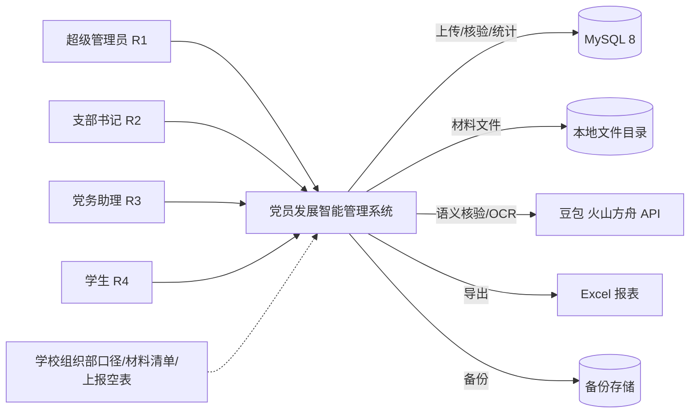

### 2.3 外部接口

| 外部系统/服务 | 交互内容 | 协议 | 失败处理 |
| --- | --- | --- | --- |
| 豆包（火山方舟） | 语义核验、视觉 OCR | HTTPS / JSON | 超时重试、转人工、告警 |
| 浏览器 | 页面与接口 | HTTPS | 友好错误页 |
| 文件系统 | 材料文件读写 | 本地 IO | 校验、告警、备份 |
| 备份存储 | 数据库与文件备份 | 文件复制 | 失败告警、重试 |

---

## 3. 总体架构

### 3.1 逻辑架构

系统采用轻量四层架构：展示层、接入层、应用层、数据层，外部服务通过应用层适配器接入。

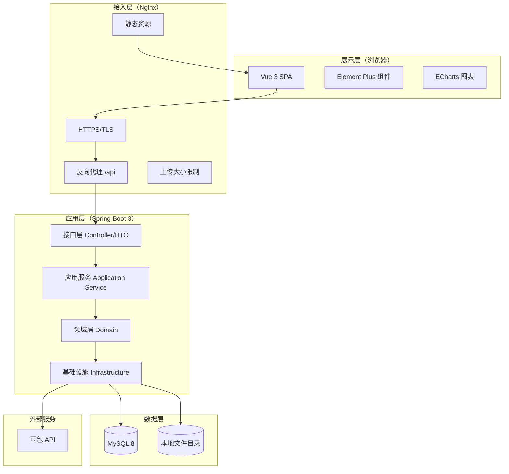

### 3.2 分层职责

| 层 | 职责 | 不允许做的事 |
| --- | --- | --- |
| 展示层 | 页面渲染、表单校验、交互反馈、图表 | 不直接拼 SQL、不信任前端权限 |
| 接入层 | TLS、静态资源、反向代理、限流、上传大小 | 不承载业务逻辑 |
| 接口层 | 参数校验、认证解析、DTO 转换、统一响应 | 不写复杂业务、不直接操作 Mapper |
| 应用服务 | 用例编排、事务边界、权限与数据范围、事件发布 | 不写 SQL、不依赖具体 HTTP |
| 领域层 | 状态机、规则、计算、领域校验 | 不依赖 Spring MVC、不依赖外部 SDK |
| 基础设施 | MyBatis、文件、模型客户端、OCR、导出、审计 | 不写业务判断 |

### 3.3 技术架构

| 层次 | 技术 | 作用 |
| --- | --- | --- |
| 前端 | Vue 3 + Vite + Pinia + Vue Router + Element Plus + ECharts + Axios | SPA、路由、状态、组件、图表、请求 |
| 接入 | Nginx | TLS、静态资源、反向代理、上传限制 |
| 后端 | Java 17 + Spring Boot 3 + Spring Security 6 + Validation | 应用框架、认证授权、参数校验 |
| 持久 | MyBatis-Plus + Flyway + MySQL 8 | ORM、迁移、存储 |
| 文件 | PDFBox + Apache POI + EasyExcel | PDF/DOCX 文本、Excel 导入导出 |
| 模型 | 豆包 API（OpenAI 兼容） | 语义核验、视觉 OCR |
| 调度 | Spring Scheduling + 数据库任务表 | 核验任务、每日预警计算 |
| 日志 | SLF4J + Logback + traceId | 运行日志与追踪 |
| 部署 | Docker Compose + Nginx + MySQL | 单机一键部署 |

### 3.4 部署架构

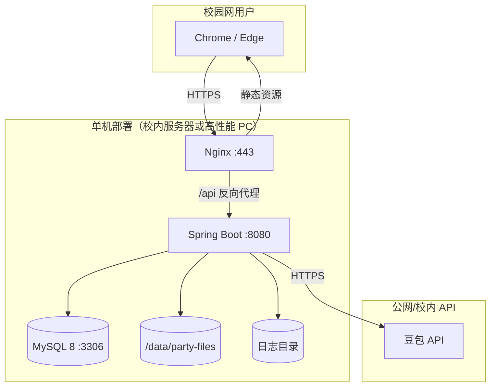

部署说明：

- Nginx 终止 TLS，静态资源由 Nginx 直出，API 反向代理到应用；
- MySQL 仅监听内网/本机，不暴露公网；
- 文件目录不在 Web 根目录，禁止 Nginx 直接访问；
- 应用与 MySQL 用 Docker Compose 编排，文件目录挂载宿主机卷；
- 备份任务由宿主机 cron 执行，备份数据库与文件目录。

### 3.5 依赖规则

```text
controller → application → domain
                  ↓
             infrastructure
```

- controller 只能依赖 application；
- application 可依赖 domain 与 infrastructure 接口；
- domain 不依赖 Spring Web、不依赖具体数据库；
- infrastructure 实现 domain/application 定义的端口（如 `LlmClient`、`FileStorage`）；
- 跨模块调用走 application 服务，不直接访问对方 Mapper。

---

## 4. 模块划分

### 4.1 模块清单

| 模块 | 代码包 | 职责 | 优先级 |
| --- | --- | --- | --- |
| M1 账号权限 | `auth`、`system` | 登录、JWT、角色、支部数据范围、账号维护 | P0 |
| M2 人员台账 | `person` | 建档、导入、检索、时间线、家庭成员 | P0 |
| M3 清单配置 | `checklist` | 材料类型、模板、核验要点、版本 | P0 |
| M4 AI 核验 | `verify` | 上传、OCR、规则、模型、报告、降级 | P0 |
| M5 审核整改 | `review` | 待办、复核、退回、重传、版本 | P0 |
| M6 流程看板 | `process` | 看板、锁定、推进、回退、阶段分布 | P0 |
| M7 时限预警 | `warning` | 时限规则、到期计算、预警、排期 | P0 |
| M8 统计报表 | `report` | 统计、合规指数、导出 | P0 |
| M9 档案归档 | `archive` | 目录、归档、检索、水印 | P1 |
| M10 审计安全 | `audit` | 操作日志、查看留痕、脱敏、备份 | P1 |
| 公共 | `common`、`config` | 统一响应、异常、枚举、工具、配置 | — |

### 4.2 模块依赖

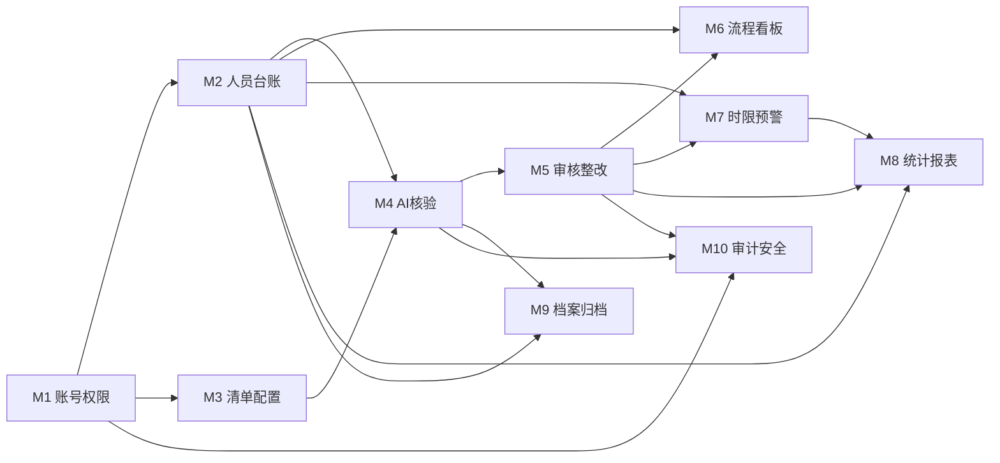

### 4.3 模块与需求映射

| 模块 | 功能需求 | 总体设计章节 | 详细设计章节 |
| --- | --- | --- | --- |
| M1 | FR-01-01—06 | 3、8、9 | 4、5、6 |
| M2 | FR-02-01—06 | 3、7 | 4、5、6 |
| M3 | FR-03-01—04 | 6、10 | 4、5、7 |
| M4 | FR-04-01—10 | 6.4、10 | 4、8 |
| M5 | FR-05-01—07 | 6.5 | 4、9 |
| M6 | FR-06-01—06 | 6.3 | 4、10 |
| M7 | FR-07-01—06 | 6.6 | 4、8.5 |
| M8 | FR-08-01—05 | 6.7、8 | 4、8.4 |
| M9 | FR-09-01—04 | 6.8 | 4、11 |
| M10 | FR-10-01—04 | 9 | 4、12 |

---

## 5. 核心流程设计

### 5.1 党员发展主流程

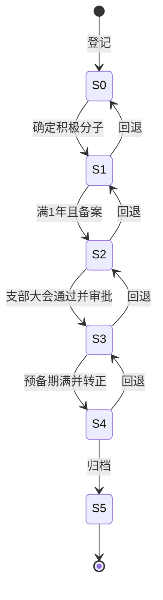

阶段推进不是简单的状态更新，而是“六规则校验 + 二次确认 + 事务提交 + 审计”的组合用例。

### 5.2 材料状态机

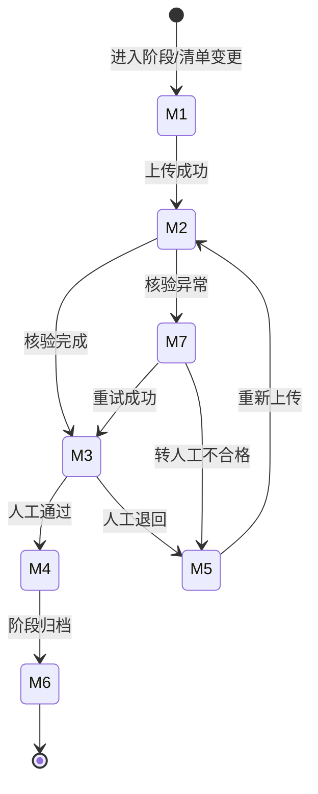

设计补充：

- `verify_task` 独立表达“排队/执行/成功/失败/超时”，材料主状态保持 M2；
- 同一材料同时只允许一个有效核验任务，重复发起返回已有任务；
- 复核通过/退回必须基于某个版本与某份报告，不能脱离证据。

### 5.3 阶段推进时序

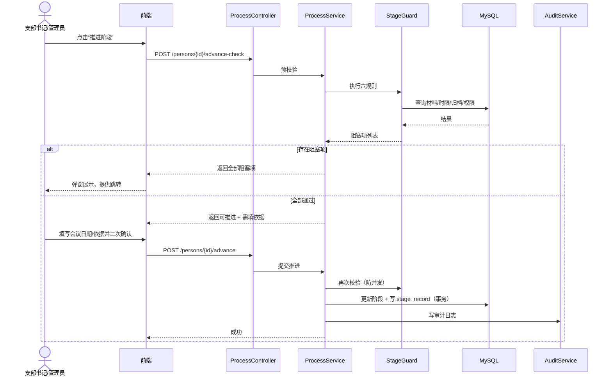

**关键设计**：

- `advance-check` 与 `advance` 两次校验，防止预校验后材料被改动；
- 推进事务内对 `person.version` 做乐观锁；
- 失败返回全部阻塞项，不逐条试错；
- 推进依据写入 `stage_record.evidence`。

### 5.4 材料核验时序

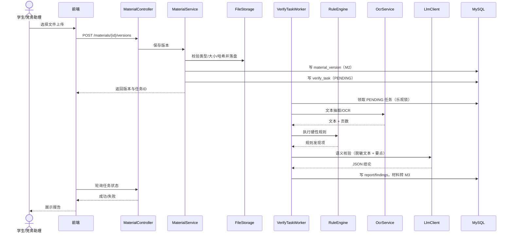

**关键设计**：

- 上传与核验解耦，避免 HTTP 超时；
- OCR/规则/模型任一步失败都记录 `verify_task.error_code`，材料可重试或转人工；
- 模型调用前脱敏，报告中保留原文片段用于回链；
- 核验结果不直接改变材料为 M4，必须人工复核。

### 5.5 复核整改时序

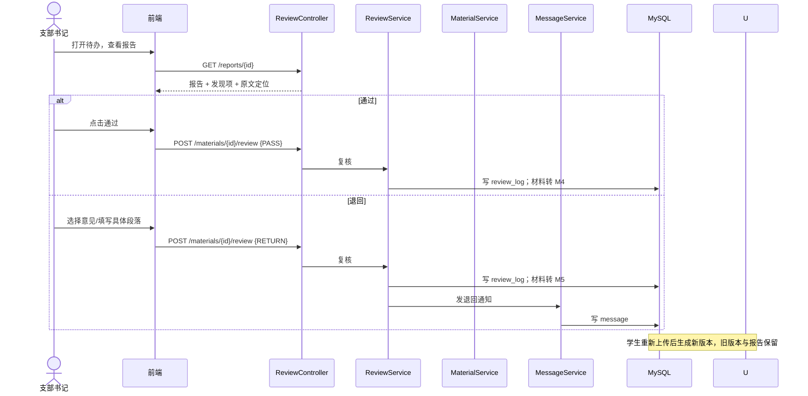

### 5.6 时限预警流程

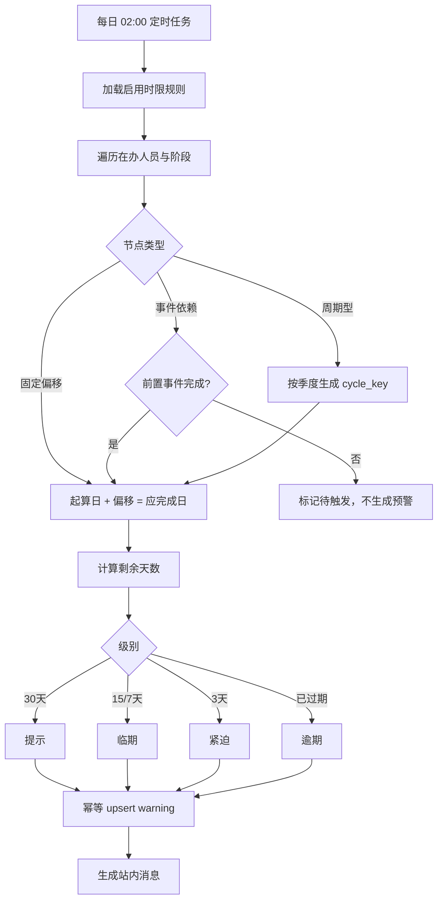

### 5.7 统计与导出流程

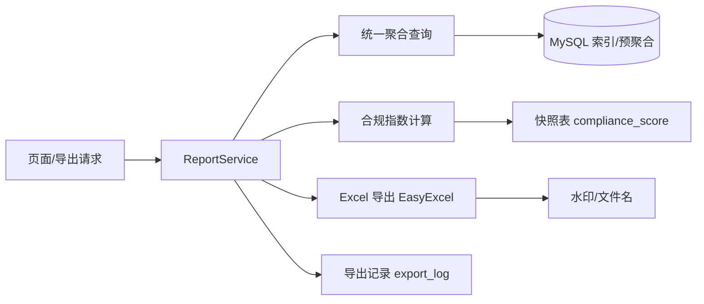

**关键设计**：页面与导出共用同一个 `ReportService` 聚合方法，避免“页面一个数、导出一个数”。

---

## 6. 数据架构

### 6.1 数据分域

| 数据域 | 主要表 | 责任模块 |
| --- | --- | --- |
| 身份权限域 | `sys_user`、`sys_branch`、`sys_config` | M1 |
| 人员档案域 | `person`、`family_member`、`stage_record`、`academic_year` | M2 |
| 清单配置域 | `material_type`、`checklist_template`、`checklist_item` | M3 |
| 材料核验域 | `material`、`material_version`、`verify_task`、`verify_report`、`verify_finding`、`review_log`、`verify_rule`、`prompt_template` | M4/M5 |
| 流程时限域 | `time_rule`、`warning`、`archive_record` | M6/M7/M9 |
| 统计审计域 | `compliance_score`、`message`、`audit_log`、`export_log`、`import_batch`、`import_error` | M2/M8/M10 |

### 6.2 概念模型

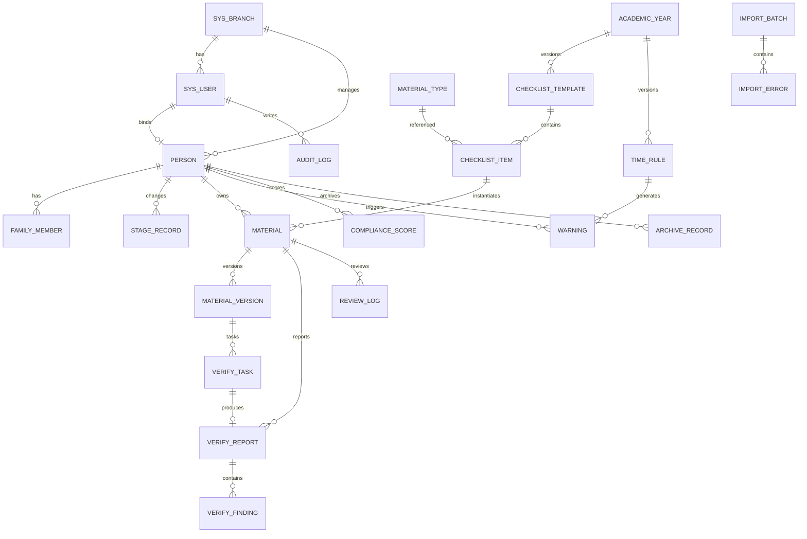

### 6.3 数据流

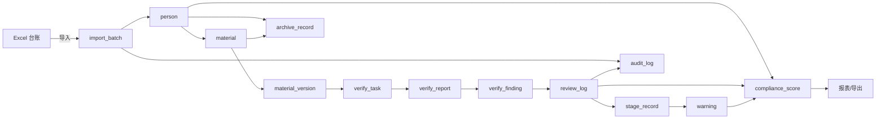

### 6.4 数据策略

| 策略 | 设计 |
| --- | --- |
| 主键 | `BIGINT` 自增，命名 `表缩写_id`（如 `person_id`） |
| 业务唯一键 | 学号全局唯一；材料按“人 + 阶段 + 材料类型”唯一；预警按“人 + 节点 + 周期”唯一 |
| 时间 | 统一 `DATETIME(3)`，时区 `Asia/Shanghai`；纯日期用 `DATE` |
| 枚举 | 存英文代码（S0/S1、M1—M7、R1—R4），界面显示中文 |
| 逻辑删除 | `deleted TINYINT`；材料、日志不物理删除；学号删除后不复用 |
| 乐观锁 | 人员、材料加 `version` 字段 |
| 文件 | 数据库存相对路径 + SHA-256；文件按 `person/{personId}/material/{materialId}/v{version}/` 存放 |
| 全文检索 | `material_version.text_content` 建 MySQL FULLTEXT（ngram） |
| 审计 | 只增不改不删；按月归档 |
| 备份 | 数据库 dump + 文件目录，保留 4 周 |

---

## 7. 接口总体设计

### 7.1 风格

- RESTful，统一前缀 `/api/v1`；
- JSON 请求/响应，文件上传用 `multipart/form-data`；
- 认证：`Authorization: Bearer <JWT>`；
- 时间格式：`yyyy-MM-dd` / `yyyy-MM-dd HH:mm:ss`；
- 分页：`page`（从 1 开始）、`size`（默认 20，最大 100）；
- 排序：`sort=field,asc|desc`，仅允许白名单字段；
- 所有写操作返回业务结果与 `traceId`。

### 7.2 统一响应

```json
{
  "code": 0,
  "message": "ok",
  "data": {},
  "traceId": "a1b2c3d4"
}
```

| 字段 | 说明 |
| --- | --- |
| `code` | 0 成功；非 0 为业务错误码 |
| `message` | 可直接展示的中文提示 |
| `data` | 业务数据，错误时为 null 或错误详情 |
| `traceId` | 链路追踪 ID，便于查日志 |

### 7.3 错误码规范

| 区间 | 含义 | 示例 |
| --- | --- | --- |
| 0 | 成功 | 0 |
| 10000—19999 | 认证/授权 | 10001 未登录；10003 无权限；10005 账号锁定 |
| 20000—29999 | 参数/校验 | 20001 参数错误；20002 文件类型不支持；20003 文件过大 |
| 30000—39999 | 业务规则 | 30001 材料未齐；30002 阶段锁定；30003 已存在；30004 状态不允许 |
| 40000—49999 | 外部服务 | 40001 模型超时；40002 OCR 失败；40003 模型返回无法解析 |
| 50000—59999 | 系统 | 50001 数据库错误；50002 文件存储错误；50003 未知错误 |

### 7.4 接口分组

| 分组 | 前缀 | 主要接口 | 权限 |
| --- | --- | --- | --- |
| 认证 | `/auth` | 登录、登出、当前用户、改密 | 公开/登录 |
| 用户与支部 | `/users`、`/branches` | 增删改查、停用、重置密码 | R1 |
| 人员 | `/persons` | 建档、检索、详情、时间线、家庭成员 | R1—R3 |
| 导入 | `/persons/import` | 模板下载、上传、批次、错误行 | R1—R3 |
| 清单配置 | `/checklists`、`/material-types` | 模板、条目、发布、克隆 | R1 |
| 规则配置 | `/verify-rules`、`/prompt-templates` | 规则/提示词 CRUD、版本 | R1 |
| 材料 | `/materials` | 上传、详情、版本、删除重传 | R1—R4（数据范围） |
| 核验 | `/verify-tasks`、`/reports` | 发起、状态、报告、发现项 | 登录 + 数据范围 |
| 复核 | `/reviews` | 待办、通过、退回、意见模板 | R1/R2（R3 初审） |
| 流程 | `/process` | 看板、预校验、推进、回退、阶段分布 | R1/R2；R3 只读 |
| 时限 | `/time-rules`、`/warnings`、`/schedule` | 规则、预警、处置、倒推 | R1 配置；R2/R3 处置 |
| 报表 | `/reports` | 统计、合规指数、导出 | R1/R2/R3（范围） |
| 归档 | `/archives` | 目录、归档、检索、下载 | R1/R2/R3 |
| 消息 | `/messages` | 列表、已读 | 登录 |
| 审计 | `/audit-logs`、`/export-logs` | 查询 | R1 |
| 系统 | `/configs`、`/health` | 参数、健康检查 | R1/公开 |

### 7.5 幂等与并发

| 场景 | 策略 |
| --- | --- |
| 批量导入 | 学号 upsert；同一批次重复提交返回已有批次 |
| 材料上传 | 客户端传 `sha256`，服务端校验；同材料同版本号唯一 |
| 发起核验 | 同一材料已有 PENDING/RUNNING 任务时返回该任务 |
| 复核 | `review_log` 以材料版本 + 复核人 + 时间唯一；材料状态机校验 |
| 阶段推进 | `person.version` 乐观锁；重复提交返回“状态已变化” |
| 预警生成 | 唯一键 upsert，级别变化更新 |
| 导出 | 每次生成新文件，记录 `export_log` |

### 7.6 文件上传

| 项 | 规则 |
| --- | --- |
| 允许类型 | PDF、JPG、PNG、DOCX |
| 单份大小 | ≤20 MB |
| 校验 | 扩展名 + MIME + 文件头魔数 |
| 文件名 | 服务端重命名为 UUID，原文件名存元数据 |
| 存储 | 非公开目录，按人员/材料/版本分目录 |
| 下载 | 鉴权接口流式返回，记录查看审计 |
| 病毒 | 一期不做杀毒，限制类型 + 非执行目录；二期可接 ClamAV |

---

## 8. 安全总体设计

### 8.1 认证

- 账号：学号/工号 + 密码；
- 密码：BCrypt（cost 10），不存明文；
- 登录失败：连续 5 次锁定 10 分钟；
- 令牌：JWT，有效期 8 小时；`token_version` 支持登出/停用即时失效；
- 首次登录/重置密码后强制改密；
- 登录日志：成功/失败均记录 IP、UA、时间。

### 8.2 授权

| 层 | 机制 |
| --- | --- |
| 页面 | 路由守卫 + 按钮权限指令，隐藏无权入口 |
| 接口 | `@PreAuthorize` 角色校验 |
| 数据 | 服务层数据范围：R1 全院；R2/R3 本支部；R4 本人 |
| 字段 | 序列化脱敏 + 单独完整值接口 |
| 文件 | 下载前校验材料所属人/支部与角色 |

### 8.3 敏感数据

| 数据 | 存储 | 展示 | 完整值 |
| --- | --- | --- | --- |
| 手机号 | AES-GCM 密文 + 掩码列 | 掩码 | R2 及以上，填理由 |
| 身份证号 | AES-GCM 密文 + 掩码列 | 掩码 | R2 及以上，填理由并留痕 |
| 家庭成员 | 明文（访问受控） | 按角色掩码 | R2 及以上 |
| 政审结论 | 文件/文本 | 摘要 | 授权查看 |
| 密码 | BCrypt | 不展示 | 不可逆 |

### 8.4 审计

| 事件 | 记录内容 |
| --- | --- |
| 登录/登出 | 账号、IP、UA、结果 |
| 查看材料 | 谁、何时、看谁的哪份、是否完整值、理由 |
| 上传/复核/推进/回退 | 对象、前后状态、理由、结果 |
| 配置变更 | 配置项、旧值、新值、操作人 |
| 导出 | 类型、筛选条件、行数、水印、文件 |
| 越权 | 请求路径、目标对象、结果 |

审计日志只增不改不删；应用不提供删除接口；数据库账号不授予 `DELETE`。

### 8.5 传输与存储

- 全站 HTTPS；
- 文件目录权限 `750`，应用账号可读写，Nginx 不可直接读；
- MySQL 仅内网/本机；
- 备份文件加密或存放在受控目录；
- 生产环境禁止开启 Swagger/调试端点。

### 8.6 大模型数据安全

1. 发送前剥离身份证号、手机号、住址、姓名，使用占位符；
2. 只发送核验必需的材料文本与要点，不发送整份政审表；
3. 不把模型响应原文写入普通日志；
4. 与供应商确认“不用于训练、不留存”；
5. 演示环境只使用虚构数据。

---

## 9. 配置设计

### 9.1 配置分类

| 配置 | 存储 | 版本化 | 热更新 |
| --- | --- | --- | --- |
| 材料类型 | `material_type` | 否 | 是 |
| 清单模板 | `checklist_template` / `checklist_item` | 是（学年版） | 发布后生效 |
| 核验规则 | `verify_rule` | 是（版本号） | 是 |
| 提示词 | `prompt_template` | 是（版本号） | 是 |
| 时限规则 | `time_rule` | 是（学年版） | 是 |
| 合规指数权重 | `sys_config` | 否 | 是 |
| 系统参数 | `sys_config` | 否 | 是 |

### 9.2 配置生命周期

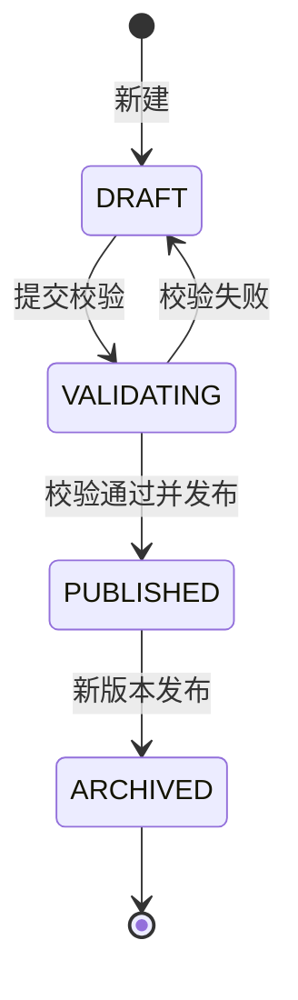

- 配置修改先存草稿，校验通过后发布；
- 发布后清理缓存，下一次请求生效；
- 历史人员绑定原模板，不因新版本改变判定；
- 配置变更写审计日志。

### 9.3 规则配置模型

| 字段 | 说明 |
| --- | --- |
| `rule_code` | 唯一编号，如 `R-S1-001` |
| `stage` | 适用阶段 |
| `material_type_id` | 适用材料类型 |
| `rule_type` | FILE_PRESENT / FILE_FORMAT / FIELD_PRESENT / DATE_ORDER / COUNT_LIMIT |
| `params` | JSON 参数，如 `{"field":"signature","pattern":"..."} ` |
| `severity` | HARD / SOFT |
| `enabled` | 是否启用 |
| `version_no` | 版本号 |

### 9.4 提示词配置

- 按“材料类型 + 核验目标”维护；
- 模板变量：`{{material_text}}`、`{{check_points}}`、`{{output_schema}}`；
- 输出强制 JSON；
- 发布前用样例集试跑；
- 报告保存 `prompt_version`，保证可复现。

---

## 10. 非功能设计

### 10.1 性能

| 指标 | 目标 | 设计手段 |
| --- | --- | --- |
| 核验 P90 | ≤30s | 异步任务、分段文本、并发 2—4、超时 30s |
| 看板首屏 | ≤3s | 聚合接口、索引、配置缓存 |
| 台账检索 | ≤2s | 联合索引、分页、避免前置通配 |
| 导入 100 行 | ≤1min | 批量插入、分段事务、错误行单独记录 |
| 并发 | ≥20 | 连接池 20—30、Tomcat 线程 100、上传限流 |

### 10.2 容量

| 项 | 基线 |
| --- | --- |
| 人员 | 5,000 |
| 材料版本 | 200,000 |
| 文件 | 300 GB |
| 审计日志 | 100 万条/年 |
| 核验任务 | 500/天峰值 |

### 10.3 可用性与恢复

| 项 | 目标 |
| --- | --- |
| 可用性 | 校内工作时间可用；单机，允许计划内停机 |
| RPO | ≤1 天（数据库每日 dump） |
| RTO | ≤4 小时（恢复数据库 + 文件目录） |
| 备份 | 数据库每日、文件每周、重要节点前手动 |
| 恢复演练 | 每月一次 |

### 10.4 可观测性

- 统一 `traceId`，响应头返回；
- 应用日志按天滚动，保留 30 天；
- 审计日志单独存储；
- Actuator 健康检查 `/actuator/health`；
- 关键指标：核验成功率、平均耗时、模型失败率、预警生成数、登录失败数；
- 告警：模型连续失败、磁盘使用率 >80%、备份失败。

### 10.5 兼容性

- Chrome / Edge 最近两个大版本；
- 最小分辨率 1366×768；
- 不依赖 IE；
- 导出 Excel 兼容 Office 2016+ / WPS。

---

## 11. 技术选型与理由

| 领域 | 选型 | 理由 | 替代方案 |
| --- | --- | --- | --- |
| 前端框架 | Vue 3 | 学习曲线低、生态成熟 | React |
| UI | Element Plus | 表格/表单/上传齐全 | Ant Design Vue |
| 图表 | ECharts | 漏斗、热力、甘特 | Chart.js |
| 后端 | Spring Boot 3 | 生态、权限、事务、调度 | FastAPI |
| ORM | MyBatis-Plus | SQL 可控、逻辑删除/分页 | JPA |
| 安全 | Spring Security + JWT | 标准、可扩展 | Sa-Token |
| 数据库 | MySQL 8 | 事务、全文检索、备份 | SQLite |
| 迁移 | Flyway | 版本化、可交接 | Liquibase |
| 文件 | PDFBox + POI | 开源、稳定 | Aspose（收费） |
| Excel | EasyExcel | 流式、低内存 | POI |
| 模型 | 豆包 API | 国内访问、JSON/视觉 | 通义/智谱 |
| 部署 | Docker Compose | 单机、环境一致 | 裸机脚本 |

---

## 12. 关键设计决策（ADR）

| 编号 | 决策 | 选项 | 结论 | 理由 | 影响 |
| --- | --- | --- | --- | --- | --- |
| ADR-01 | 后端技术栈 | Spring Boot / FastAPI / Node | Spring Boot | 权限、事务、文件、调度成熟；队员 B 主攻 Java | 学习成本中等 |
| ADR-02 | 数据库 | MySQL / SQLite | MySQL 8 | 并发、全文检索、备份 | 需部署运维 |
| ADR-03 | 规则引擎 | 自研轻量 / Drools / 纯模型 | 自研轻量 | 规则类型有限，避免过度设计 | 需定义 Schema |
| ADR-04 | 异步任务 | DB 任务表 / MQ | DB 任务表 | 单机、量小、可追溯 | 吞吐有限 |
| ADR-05 | 角色模型 | 单角色 / 多角色 | 一期单角色 | 匹配需求，降低复杂度 | 书记兼助理需两个账号 |
| ADR-06 | 文件存储 | 本地 / OSS / BLOB | 本地 | 成本、合规、简单 | 需自行备份 |
| ADR-07 | 认证 | JWT / Session | JWT | 前后端分离、无状态 | 需 token_version 撤销 |
| ADR-08 | 核验方式 | 异步 / 同步 | 异步 | 30s 超时、体验 | 前端需轮询 |
| ADR-09 | 删除策略 | 逻辑删除 / 物理删除 | 逻辑删除 | 档案可追溯 | 唯一键需设计 |
| ADR-10 | 时限节点 | 固定偏移 / 事件依赖 | 两者都支持 | T-06/T-09 需要 | 计算稍复杂 |
| ADR-11 | 缓存 | Caffeine / Redis / 无 | Caffeine | 单机、配置量小 | 多实例需改造 |
| ADR-12 | 前端渲染 | SPA / SSR | SPA | 交互多、部署简单 | 首屏略慢 |

---

## 13. 需求追踪

| 需求 | 设计章节 | 交付物 |
| --- | --- | --- |
| FR-01 账号权限 | 3、8、9 | 认证授权、用户管理、审计 |
| FR-02 人员台账 | 5、6、7 | 人员表、导入、时间线 |
| FR-03 清单配置 | 6、9 | 模板、材料类型、规则 |
| FR-04 AI 核验 | 5.4、6、9 | 任务、报告、发现项、降级 |
| FR-05 审核整改 | 5.5 | 复核、退回、版本、消息 |
| FR-06 流程看板 | 5.1—5.3 | 看板、六规则、回退 |
| FR-07 时限预警 | 5.6 | 规则、预警、排期 |
| FR-08 统计报表 | 5.7 | 聚合、指数、导出 |
| FR-09 档案归档 | 6 | 归档记录、检索、水印 |
| FR-10 审计安全 | 8 | 日志、留痕、备份 |
| NFR 性能 | 10.1 | 异步、索引、缓存 |
| NFR 安全 | 8 | 认证、授权、脱敏、审计 |
| NFR 部署 | 3.4 | Docker Compose |

---

## 14. 风险与待确认设计项

| 编号 | 事项 | 影响 | 处理 |
| --- | --- | --- | --- |
| D-01 | 模型 JSON 输出稳定性 | 核验失败率 | POC-1 验证；重试 + 降级 |
| D-02 | OCR 中文扫描件质量 | 语义核验准确率 | POC-2；清晰度要求；人工补录 |
| D-03 | 跨支部授权 | 权限模型 | 一期不做；R1 临时授权 |
| D-04 | 多角色 | 账号模型 | 一期单角色；二期扩展 |
| D-05 | 导出模板样张 | 报表验收 | 通用模板先行；第 8 周前拿到样张 |
| D-06 | 合规指数公式确认 | 指数可信度 | 业务方确认权重与扣分 |
| D-07 | 全量文件备份 | 数据恢复 | 数据库 + 文件目录一起备份 |
| D-08 | 真实材料合规 | 项目能否上线 | 只用虚构数据；真实材料审批+脱敏 |

---

## 附录 A 部署清单

| 组件 | 版本 | 端口 | 数据卷 |
| --- | --- | --- | --- |
| Nginx | 1.24+ | 443/80 | 静态资源、证书 |
| 应用 | JDK 17 | 8080（内网） | 日志、临时文件 |
| MySQL | 8.0 | 3306（内网） | 数据目录 |
| 文件 | 宿主机 | — | `/data/party-files` |
| 备份 | 宿主机 cron | — | `/data/backup` |

## 附录 B 变更记录

| 版本 | 日期 | 变更人 | 说明 |
| --- | --- | --- | --- |
| V1.0 | 2026-11-11 | 项目组 | 首次编写，完成总体架构、模块、流程、数据、接口、安全、部署设计 |