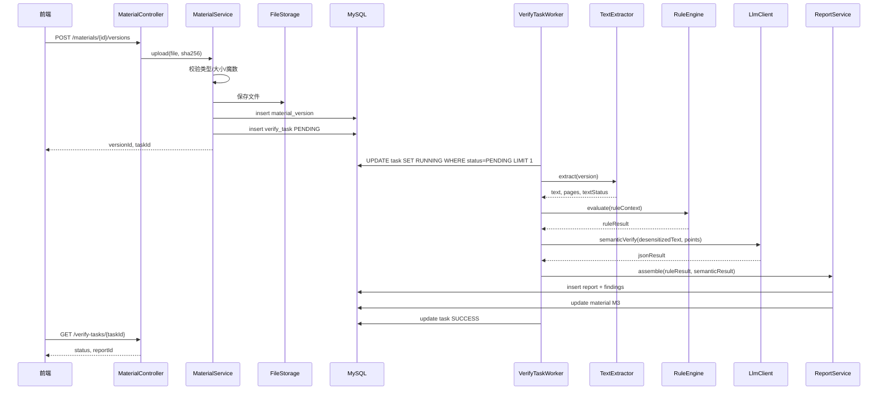
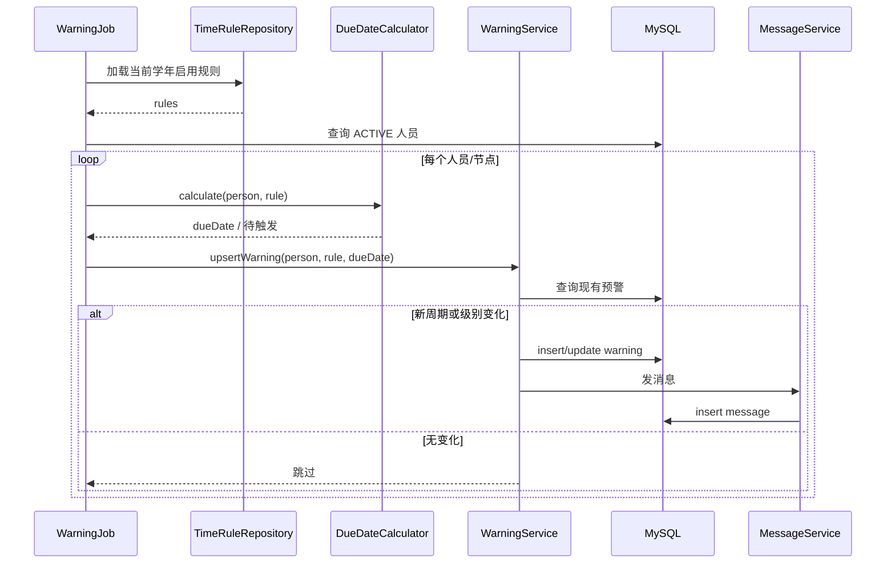

# 党员发展智能管理系统 · 详细设计说明书

| 项目 | 内容 |
| --- | --- |
| 文档编号 | PBS-DLD-001 |
| 版本 | V1.0 |
| 编制日期 | 2026-11-11 |
| 设计依据 | 《需求规格说明书 V2.0》《需求分析报告 V1.0》《可行性研究报告 V1.0》《总体设计说明书 V1.0》 |
| 设计范围 | 数据库、领域组件、接口、前端页面、算法、异常、安全、部署与测试设计 |
| 开发基线 | Java 17 + Spring Boot 3 + MyBatis-Plus + MySQL 8；Vue 3 + Vite + Element Plus + ECharts |
| 说明 | 本文只做设计，不包含可运行代码；表结构、接口路径、配置样例均为开发契约 |

---

## 1. 引言

### 1.1 目的

把总体设计转化为可直接拆分开发任务、可直接评审、可直接测试的详细契约，回答：

- 数据库有哪些表、字段、索引、约束；
- 每个核心组件如何分工、如何交互；
- 每个接口的路径、权限、入参、出参、错误；
- 每个页面如何组织、如何做权限与交互；
- 关键算法如何计算、异常如何降级；
- 如何部署、备份、测试、验收。

### 1.2 设计约定

| 项 | 约定 |
| --- | --- |
| 命名 | 类名 PascalCase；方法/变量 camelCase；数据库表/字段 snake_case |
| 包名 | `com.party.build` |
| 主键 | `BIGINT` 自增，字段名 `表缩写_id` |
| 时间 | `DATETIME(3)`，时区 `Asia/Shanghai`；纯日期 `DATE` |
| 金额/分数 | `DECIMAL`，禁止浮点 |
| 枚举 | 数据库存英文代码，Java 用 enum，前端用字典 |
| 布尔 | `TINYINT(1)`，0/1 |
| 字符集 | `utf8mb4` / `utf8mb4_0900_ai_ci` |
| 逻辑删除 | `deleted TINYINT NOT NULL DEFAULT 0` |
| 审计字段 | 业务表含 `created_at`、`updated_at`；需要时含 `created_by`、`updated_by` |
| 接口 | `/api/v1`，统一响应包裹 |
| 文档 | 图用 Mermaid；表结构以本文为准 |

---

## 2. 系统结构

### 2.1 后端包结构

```text
com.party.build
├── PartyBuildApplication.java
├── common
│   ├── api          # Result、PageResult、ErrorCode
│   ├── exception    # BizException、GlobalExceptionHandler
│   ├── enums        # Stage、MaterialStatus、Role、WarningLevel...
│   ├── util         # DateUtils、HashUtils、MaskUtils
│   └── validation   # 自定义校验注解
├── config
│   ├── SecurityConfig
│   ├── MybatisConfig
│   ├── AsyncConfig
│   ├── CacheConfig
│   ├── WebConfig
│   └── OpenApiConfig
├── auth
│   ├── controller   # AuthController、UserController
│   ├── service      # AuthService、UserService、DataScopeService
│   ├── domain       # User、Branch
│   ├── mapper
│   └── dto
├── person
│   ├── controller   # PersonController、ImportController
│   ├── service      # PersonService、ImportService、FamilyService
│   ├── domain       # Person、FamilyMember、StageRecord
│   ├── mapper
│   └── dto
├── checklist
│   ├── controller   # ChecklistController、MaterialTypeController
│   ├── service      # ChecklistService、TemplatePublishService
│   ├── domain       # ChecklistTemplate、ChecklistItem、MaterialType
│   ├── mapper
│   └── dto
├── verify
│   ├── controller   # MaterialController、VerifyController、ReportController
│   ├── service      # MaterialService、VerifyOrchestrator、ReportService
│   ├── rule         # RuleEngine、RuleEvaluator、RuleContext、Finding
│   ├── ai           # LlmClient、DoubaoClient、PromptBuilder、ResponseParser
│   ├── ocr          # TextExtractor、PdfExtractor、DocxExtractor、VisionOcr
│   ├── domain       # Material、MaterialVersion、VerifyTask、VerifyReport...
│   ├── mapper
│   └── dto
├── review
│   ├── controller   # ReviewController
│   ├── service      # ReviewService、ReviewTemplateService
│   ├── domain       # ReviewLog
│   ├── mapper
│   └── dto
├── process
│   ├── controller   # ProcessController
│   ├── service      # ProcessService、StageGuard、BoardService
│   ├── guard        # MaterialGuard、TimeGuard、ProcessGuard、FilingGuard...
│   ├── domain       # StageRecord
│   ├── mapper
│   └── dto
├── warning
│   ├── controller   # WarningController、ScheduleController、TimeRuleController
│   ├── service      # WarningService、DueDateCalculator、ScheduleService
│   ├── job          # WarningJob
│   ├── domain       # Warning、TimeRule
│   ├── mapper
│   └── dto
├── report
│   ├── controller   # ReportController、ExportController
│   ├── service      # ReportService、ComplianceService、ExportService
│   ├── domain       # ComplianceScore、ExportLog
│   ├── mapper
│   └── dto
├── archive
│   ├── controller   # ArchiveController、SearchController
│   ├── service      # ArchiveService、SearchService、WatermarkService
│   ├── domain       # ArchiveRecord
│   ├── mapper
│   └── dto
├── audit
│   ├── controller   # AuditController、MessageController
│   ├── service      # AuditService、MessageService、MaskService
│   ├── aspect       # AuditAspect
│   ├── domain       # AuditLog、Message
│   ├── mapper
│   └── dto
└── system
    ├── controller   # ConfigController、HealthController
    ├── service      # ConfigService、DictService
    └── domain       # SysConfig、AcademicYear
```

### 2.2 前端目录结构

```text
frontend/
├── src/
│   ├── api/            # 按模块封装 Axios 请求
│   ├── assets/
│   ├── components/     # 公共组件
│   ├── layouts/        # 主布局、空白布局
│   ├── router/         # 路由与守卫
│   ├── stores/         # Pinia：auth、dict、message、config
│   ├── styles/
│   ├── utils/          # request、permission、format、download
│   ├── views/          # 页面
│   └── main.js
├── public/
├── vite.config.js
└── package.json
```

### 2.3 分层调用规则

| 调用方 | 允许调用 | 禁止 |
| --- | --- | --- |
| Controller | Application Service、DTO | Mapper、外部 SDK |
| Application Service | Domain Service、Mapper 接口、Infrastructure 端口 | Controller、HttpServletRequest |
| Domain | 纯 Java、领域对象 | Spring Web、MyBatis、外部 SDK |
| Infrastructure | Mapper、文件、HTTP 客户端 | 业务判断 |
| Frontend View | API、Store、组件 | 直接拼 SQL、硬编码权限 |

---

## 3. 数据库详细设计

### 3.1 通用约定

- 引擎：InnoDB；字符集：`utf8mb4`；排序规则：`utf8mb4_0900_ai_ci`。
- 所有业务表默认含：

| 字段 | 类型 | 说明 |
| --- | --- | --- |
| `created_at` | `DATETIME(3) NOT NULL DEFAULT CURRENT_TIMESTAMP(3)` | 创建时间 |
| `updated_at` | `DATETIME(3) NOT NULL DEFAULT CURRENT_TIMESTAMP(3) ON UPDATE CURRENT_TIMESTAMP(3)` | 更新时间 |
| `deleted` | `TINYINT NOT NULL DEFAULT 0` | 逻辑删除：0 正常，1 删除 |

- 需要并发控制的表增加 `version INT NOT NULL DEFAULT 0`。
- 所有外键在应用层校验，不建数据库外键（便于迁移与逻辑删除）。
- 索引命名：`uk_` 唯一索引，`idx_` 普通索引，`ft_` 全文索引。
- 大文本用 `LONGTEXT`；结构化结果用 `JSON`；文件不进数据库。

### 3.2 表清单

| 序号 | 表名 | 中文名 | 所属模块 |
| ---: | --- | --- | --- |
| 1 | `sys_branch` | 支部 | M1 |
| 2 | `sys_user` | 系统账号 | M1 |
| 3 | `sys_config` | 系统参数 | M1 |
| 4 | `academic_year` | 学年版 | M3/M7 |
| 5 | `person` | 人员档案 | M2 |
| 6 | `family_member` | 家庭成员 | M2 |
| 7 | `stage_record` | 阶段变更记录 | M2/M6 |
| 8 | `material_type` | 材料类型 | M3 |
| 9 | `checklist_template` | 清单模板 | M3 |
| 10 | `checklist_item` | 清单条目 | M3 |
| 11 | `material` | 材料主记录 | M4 |
| 12 | `material_version` | 材料版本 | M4 |
| 13 | `verify_task` | 核验任务 | M4 |
| 14 | `verify_report` | 核验报告 | M4 |
| 15 | `verify_finding` | 核验发现项 | M4 |
| 16 | `review_log` | 复核记录 | M5 |
| 17 | `verify_rule` | 核验规则 | M3/M4 |
| 18 | `prompt_template` | 提示词模板 | M4 |
| 19 | `time_rule` | 时限规则 | M7 |
| 20 | `warning` | 预警 | M7 |
| 21 | `message` | 站内消息 | M5/M7 |
| 22 | `audit_log` | 审计日志 | M10 |
| 23 | `export_log` | 导出记录 | M8/M9 |
| 24 | `import_batch` | 导入批次 | M2 |
| 25 | `import_error` | 导入错误行 | M2 |
| 26 | `compliance_score` | 合规指数快照 | M8 |
| 27 | `archive_record` | 归档记录 | M9 |

### 3.3 表结构

#### 3.3.1 sys_branch 支部

| 字段 | 类型 | 空 | 键/默认 | 说明 |
| --- | --- | --- | --- | --- |
| `branch_id` | BIGINT | 否 | PK, AI | 支部 ID |
| `branch_code` | VARCHAR(32) | 否 | UK | 支部编码，如 `RJXY-01` |
| `branch_name` | VARCHAR(100) | 否 |  | 支部名称 |
| `college_name` | VARCHAR(100) | 否 |  | 所属学院 |
| `status` | TINYINT | 否 | 1 | 1 启用，0 停用 |
| `sort_no` | INT | 否 | 0 | 排序 |

索引：`uk_branch_code(branch_code)`、`idx_college(college_name)`。

#### 3.3.2 sys_user 系统账号

| 字段 | 类型 | 空 | 键/默认 | 说明 |
| --- | --- | --- | --- | --- |
| `user_id` | BIGINT | 否 | PK, AI | 账号 ID |
| `username` | VARCHAR(64) | 否 | UK | 学号/工号，不复用 |
| `password_hash` | VARCHAR(100) | 否 |  | BCrypt 哈希 |
| `real_name` | VARCHAR(50) | 否 |  | 姓名 |
| `person_id` | BIGINT | 是 |  | R4 绑定的人员 ID；R1—R3 可空 |
| `branch_id` | BIGINT | 否 |  | 主支部 |
| `role_code` | VARCHAR(8) | 否 |  | R1/R2/R3/R4 |
| `status` | TINYINT | 否 | 1 | 1 正常，0 停用 |
| `failed_count` | INT | 否 | 0 | 连续登录失败次数 |
| `lock_until` | DATETIME(3) | 是 |  | 锁定截止时间 |
| `token_version` | INT | 否 | 0 | 令牌版本，登出/停用 +1 |
| `must_change_password` | TINYINT | 否 | 0 | 首次登录/重置后强制改密 |
| `last_login_at` | DATETIME(3) | 是 |  | 最后登录时间 |

索引：`uk_username(username)`、`idx_branch(branch_id)`、`idx_person(person_id)`、`idx_role(role_code)`。

#### 3.3.3 sys_config 系统参数

| 字段 | 类型 | 空 | 键/默认 | 说明 |
| --- | --- | --- | --- | --- |
| `config_id` | BIGINT | 否 | PK, AI | 参数 ID |
| `config_key` | VARCHAR(100) | 否 | UK | 参数键，如 `compliance.weight.material` |
| `config_value` | TEXT | 否 |  | 参数值 |
| `value_type` | VARCHAR(20) | 否 | STRING | STRING/INT/DECIMAL/BOOLEAN/JSON |
| `description` | VARCHAR(255) | 是 |  | 说明 |
| `updated_by` | BIGINT | 是 |  | 修改人 |

索引：`uk_config_key(config_key)`。

#### 3.3.4 academic_year 学年版

| 字段 | 类型 | 空 | 键/默认 | 说明 |
| --- | --- | --- | --- | --- |
| `year_id` | BIGINT | 否 | PK, AI | 学年版 ID |
| `year_code` | VARCHAR(20) | 否 | UK | 如 `2026-2027` |
| `start_date` | DATE | 否 |  | 开始日期 |
| `end_date` | DATE | 否 |  | 结束日期 |
| `status` | TINYINT | 否 | 0 | 0 未启用，1 当前，2 已归档 |

索引：`uk_year_code(year_code)`、`idx_status(status)`。

#### 3.3.5 person 人员档案

| 字段 | 类型 | 空 | 键/默认 | 说明 |
| --- | --- | --- | --- | --- |
| `person_id` | BIGINT | 否 | PK, AI | 人员 ID |
| `student_no` | VARCHAR(32) | 否 | UK | 学号，全局唯一 |
| `name` | VARCHAR(50) | 否 |  | 姓名 |
| `gender` | CHAR(1) | 是 |  | M/F |
| `college` | VARCHAR(100) | 是 |  | 学院 |
| `major` | VARCHAR(100) | 是 |  | 专业 |
| `class_name` | VARCHAR(100) | 是 |  | 班级 |
| `branch_id` | BIGINT | 否 |  | 所属支部 |
| `phone_cipher` | VARBINARY(256) | 是 |  | 手机号 AES-GCM 密文 |
| `phone_mask` | VARCHAR(20) | 是 |  | 手机号掩码，如 `138****1234` |
| `application_date` | DATE | 否 |  | 递交申请书日期 |
| `current_stage` | VARCHAR(4) | 否 | S0 | S0—S5 |
| `stage_start_date` | DATE | 否 |  | 当前阶段起始日 |
| `template_id` | BIGINT | 否 |  | 绑定清单模板版本 |
| `status` | VARCHAR(16) | 否 | ACTIVE | ACTIVE/ARCHIVED |
| `source_batch_id` | BIGINT | 是 |  | 导入批次 |
| `remark` | VARCHAR(200) | 是 |  | 备注 |
| `version` | INT | 否 | 0 | 乐观锁 |

索引：`uk_student_no(student_no)`、`idx_branch_stage(branch_id, current_stage)`、`idx_name(name)`、`idx_application(application_date)`、`idx_stage_start(stage_start_date)`。

> 设计说明：学号逻辑删除后不复用；如确需重建，走恢复流程。手机号密文与掩码同时存，查询/展示不需要解密。

#### 3.3.6 family_member 家庭成员

| 字段 | 类型 | 空 | 键/默认 | 说明 |
| --- | --- | --- | --- | --- |
| `member_id` | BIGINT | 否 | PK, AI | 成员 ID |
| `person_id` | BIGINT | 否 |  | 人员 ID |
| `name` | VARCHAR(50) | 否 |  | 姓名 |
| `relation` | VARCHAR(20) | 否 |  | 关系 |
| `work_unit` | VARCHAR(200) | 是 |  | 工作单位 |
| `political_status` | VARCHAR(30) | 是 |  | 政治面貌 |

索引：`idx_person(person_id)`。

> 不存身份证号、住址、电话；如政审材料中包含，只存在于文件内，按文件权限控制。

#### 3.3.7 stage_record 阶段变更记录

| 字段 | 类型 | 空 | 键/默认 | 说明 |
| --- | --- | --- | --- | --- |
| `record_id` | BIGINT | 否 | PK, AI | 记录 ID |
| `person_id` | BIGINT | 否 |  | 人员 ID |
| `from_stage` | VARCHAR(4) | 是 |  | 原阶段，首条为空 |
| `to_stage` | VARCHAR(4) | 否 |  | 新阶段 |
| `change_type` | VARCHAR(16) | 否 |  | INIT/ADVANCE/ROLLBACK/IMPORT |
| `change_date` | DATETIME(3) | 否 |  | 变更时间 |
| `operator_id` | BIGINT | 是 |  | 操作人；导入可为空 |
| `reason` | VARCHAR(500) | 是 |  | 理由 |
| `evidence` | JSON | 是 |  | 依据：会议日期、材料 ID、备案日期等 |
| `template_id` | BIGINT | 是 |  | 变更时模板版本 |

索引：`idx_person_date(person_id, change_date)`、`idx_to_stage(to_stage)`。

#### 3.3.8 material_type 材料类型

| 字段 | 类型 | 空 | 键/默认 | 说明 |
| --- | --- | --- | --- | --- |
| `type_id` | BIGINT | 否 | PK, AI | 类型 ID |
| `type_code` | VARCHAR(64) | 否 | UK | 唯一编码，如 `APPLICATION` |
| `type_name` | VARCHAR(100) | 否 |  | 材料名称 |
| `stage_scope` | VARCHAR(32) | 否 |  | 适用阶段，如 `S0`/`S1,S2,S3` |
| `file_formats` | VARCHAR(100) | 否 | `pdf,jpg,png,docx` | 允许格式 |
| `default_required` | TINYINT | 否 | 1 | 默认必填 |
| `sort_no` | INT | 否 | 0 | 排序 |
| `status` | TINYINT | 否 | 1 | 1 启用 |

索引：`uk_type_code(type_code)`、`idx_stage(stage_scope)`。

#### 3.3.9 checklist_template 清单模板

| 字段 | 类型 | 空 | 键/默认 | 说明 |
| --- | --- | --- | --- | --- |
| `template_id` | BIGINT | 否 | PK, AI | 模板 ID |
| `template_code` | VARCHAR(64) | 否 |  | 模板编码 |
| `template_name` | VARCHAR(100) | 否 |  | 名称 |
| `academic_year_id` | BIGINT | 否 |  | 学年版 |
| `version_no` | INT | 否 | 1 | 版本号 |
| `status` | VARCHAR(16) | 否 | DRAFT | DRAFT/PUBLISHED/ARCHIVED |
| `effective_from` | DATE | 是 |  | 生效开始 |
| `effective_to` | DATE | 是 |  | 生效结束 |
| `created_by` | BIGINT | 否 |  | 创建人 |

索引：`uk_template_version(template_code, version_no)`、`idx_year_status(academic_year_id, status)`。

#### 3.3.10 checklist_item 清单条目

| 字段 | 类型 | 空 | 键/默认 | 说明 |
| --- | --- | --- | --- | --- |
| `item_id` | BIGINT | 否 | PK, AI | 条目 ID |
| `template_id` | BIGINT | 否 |  | 模板 ID |
| `stage` | VARCHAR(4) | 否 |  | S0—S4 |
| `material_type_id` | BIGINT | 否 |  | 材料类型 |
| `required` | TINYINT | 否 | 1 | 是否必填 |
| `min_count` | INT | 否 | 1 | 最少份数 |
| `max_count` | INT | 是 |  | 最多份数 |
| `min_pages` | INT | 是 |  | 最少页数 |
| `verify_points` | JSON | 是 |  | 核验要点引用 |
| `sort_no` | INT | 否 | 0 | 排序 |

索引：`uk_template_stage_type(template_id, stage, material_type_id)`、`idx_template(template_id)`。

#### 3.3.11 material 材料主记录

| 字段 | 类型 | 空 | 键/默认 | 说明 |
| --- | --- | --- | --- | --- |
| `material_id` | BIGINT | 否 | PK, AI | 材料 ID |
| `person_id` | BIGINT | 否 |  | 人员 ID |
| `stage` | VARCHAR(4) | 否 |  | 所属阶段 |
| `material_type_id` | BIGINT | 否 |  | 材料类型 |
| `checklist_item_id` | BIGINT | 否 |  | 清单条目 |
| `required` | TINYINT | 否 | 1 | 是否必填 |
| `status` | VARCHAR(4) | 否 | M1 | M1—M7 |
| `current_version_id` | BIGINT | 是 |  | 当前版本 |
| `due_date` | DATE | 是 |  | 应完成日 |
| `reviewer_id` | BIGINT | 是 |  | 最后复核人 |
| `last_review_at` | DATETIME(3) | 是 |  | 最后复核时间 |
| `archived` | TINYINT | 否 | 0 | 是否已归档 |
| `version` | INT | 否 | 0 | 乐观锁 |

索引：`uk_person_stage_type(person_id, stage, material_type_id)`、`idx_status(status)`、`idx_due(due_date)`、`idx_person(person_id)`。

#### 3.3.12 material_version 材料版本

| 字段 | 类型 | 空 | 键/默认 | 说明 |
| --- | --- | --- | --- | --- |
| `version_id` | BIGINT | 否 | PK, AI | 版本 ID |
| `material_id` | BIGINT | 否 |  | 材料 ID |
| `version_no` | INT | 否 | 1 | 版本号，从 1 递增 |
| `file_name` | VARCHAR(255) | 否 |  | 原始文件名 |
| `file_path` | VARCHAR(500) | 否 |  | 相对路径 |
| `file_size` | BIGINT | 否 |  | 字节 |
| `mime_type` | VARCHAR(100) | 否 |  | MIME |
| `sha256` | CHAR(64) | 否 |  | 文件哈希 |
| `page_count` | INT | 是 |  | 页数 |
| `text_content` | LONGTEXT | 是 |  | 抽取/OCR 文本 |
| `text_status` | VARCHAR(16) | 否 | PENDING | PENDING/OK/FAILED |
| `ocr_used` | TINYINT | 否 | 0 | 是否使用 OCR |
| `uploaded_by` | BIGINT | 否 |  | 上传人 |
| `uploaded_at` | DATETIME(3) | 否 |  | 上传时间 |

索引：`uk_material_version(material_id, version_no)`、`idx_sha256(sha256)`、`ft_text(text_content)` WITH PARSER ngram。

> 全文索引需 MySQL 配置 `ngram_token_size=2`；若环境不支持，检索降级为 `LIKE`。

#### 3.3.13 verify_task 核验任务

| 字段 | 类型 | 空 | 键/默认 | 说明 |
| --- | --- | --- | --- | --- |
| `task_id` | BIGINT | 否 | PK, AI | 任务 ID |
| `material_id` | BIGINT | 否 |  | 材料 ID |
| `version_id` | BIGINT | 否 |  | 版本 ID |
| `status` | VARCHAR(16) | 否 | PENDING | PENDING/RUNNING/SUCCESS/FAILED/TIMEOUT |
| `attempt_no` | INT | 否 | 1 | 尝试次数 |
| `model_provider` | VARCHAR(32) | 是 |  | `doubao` |
| `model_name` | VARCHAR(64) | 是 |  | 模型名 |
| `prompt_version` | VARCHAR(32) | 是 |  | 提示词版本 |
| `error_code` | VARCHAR(64) | 是 |  | 错误码 |
| `error_msg` | VARCHAR(500) | 是 |  | 错误信息 |
| `queued_at` | DATETIME(3) | 否 |  | 入队时间 |
| `started_at` | DATETIME(3) | 是 |  | 开始时间 |
| `finished_at` | DATETIME(3) | 是 |  | 结束时间 |
| `duration_ms` | INT | 是 |  | 耗时 |

索引：`idx_status_queue(status, queued_at)`、`idx_version(version_id)`、`idx_material(material_id)`。

#### 3.3.14 verify_report 核验报告

| 字段 | 类型 | 空 | 键/默认 | 说明 |
| --- | --- | --- | --- | --- |
| `report_id` | BIGINT | 否 | PK, AI | 报告 ID |
| `material_id` | BIGINT | 否 |  | 材料 ID |
| `version_id` | BIGINT | 否 |  | 版本 ID |
| `task_id` | BIGINT | 否 |  | 任务 ID |
| `rule_conclusion` | VARCHAR(16) | 是 |  | PASS/MISSING/ERROR |
| `semantic_conclusion` | VARCHAR(16) | 是 |  | PASS/DOUBT/CONFLICT/UNKNOWN |
| `overall_conclusion` | VARCHAR(16) | 否 |  | PASS/NEED_FIX/DOUBT/ERROR |
| `confidence` | DECIMAL(5,4) | 是 |  | 0—1 |
| `rule_version` | VARCHAR(32) | 是 |  | 规则版本 |
| `model_name` | VARCHAR(64) | 是 |  | 模型名 |
| `prompt_version` | VARCHAR(32) | 是 |  | 提示词版本 |
| `evidence` | JSON | 是 |  | 汇总证据 |
| `duration_ms` | INT | 是 |  | 耗时 |

索引：`idx_material(material_id)`、`idx_version(version_id)`、`idx_task(task_id)`。

#### 3.3.15 verify_finding 核验发现项

| 字段 | 类型 | 空 | 键/默认 | 说明 |
| --- | --- | --- | --- | --- |
| `finding_id` | BIGINT | 否 | PK, AI | 发现项 ID |
| `report_id` | BIGINT | 否 |  | 报告 ID |
| `layer` | VARCHAR(16) | 否 |  | RULE/SEMANTIC |
| `rule_code` | VARCHAR(64) | 是 |  | 规则编号 |
| `point_name` | VARCHAR(200) | 是 |  | 要点名称 |
| `conclusion` | VARCHAR(16) | 否 |  | PASS/MISSING/DOUBT/CONFLICT/INFO |
| `severity` | VARCHAR(16) | 否 | SOFT | HARD/SOFT |
| `evidence_text` | VARCHAR(2000) | 是 |  | 原文片段 |
| `page_no` | INT | 是 |  | 页码 |
| `char_start` | INT | 是 |  | 起始字符 |
| `char_end` | INT | 是 |  | 结束字符 |
| `suggestion` | VARCHAR(1000) | 是 |  | 修改建议 |
| `confidence` | DECIMAL(5,4) | 是 |  | 置信度 |

索引：`idx_report(report_id)`、`idx_layer_conclusion(layer, conclusion)`、`idx_rule(rule_code)`。

#### 3.3.16 review_log 复核记录

| 字段 | 类型 | 空 | 键/默认 | 说明 |
| --- | --- | --- | --- | --- |
| `review_id` | BIGINT | 否 | PK, AI | 记录 ID |
| `material_id` | BIGINT | 否 |  | 材料 ID |
| `version_id` | BIGINT | 否 |  | 版本 ID |
| `report_id` | BIGINT | 是 |  | 报告 ID |
| `reviewer_id` | BIGINT | 否 |  | 复核人 |
| `conclusion` | VARCHAR(16) | 否 |  | PASS/RETURN |
| `reason_code` | VARCHAR(32) | 是 |  | MISJUDGE/STANDARD_DIFF/MATERIAL_ISSUE/OTHER |
| `opinion` | VARCHAR(1000) | 是 |  | 意见，退回必填 |

索引：`idx_material(material_id)`、`idx_reviewer(reviewer_id)`、`idx_time(created_at)`。

#### 3.3.17 verify_rule 核验规则

| 字段 | 类型 | 空 | 键/默认 | 说明 |
| --- | --- | --- | --- | --- |
| `rule_id` | BIGINT | 否 | PK, AI | 规则 ID |
| `rule_code` | VARCHAR(64) | 否 | UK | 规则编号，如 `R-S1-001` |
| `rule_name` | VARCHAR(200) | 否 |  | 名称 |
| `stage` | VARCHAR(4) | 否 |  | 适用阶段 |
| `material_type_id` | BIGINT | 是 |  | 适用材料 |
| `rule_type` | VARCHAR(32) | 否 |  | 规则类型 |
| `params` | JSON | 是 |  | 参数 |
| `severity` | VARCHAR(16) | 否 | HARD | HARD/SOFT |
| `enabled` | TINYINT | 否 | 1 | 是否启用 |
| `version_no` | INT | 否 | 1 | 版本号 |
| `created_by` | BIGINT | 是 |  | 创建人 |

索引：`uk_rule_code(rule_code)`、`idx_stage_type(stage, material_type_id)`。

#### 3.3.18 prompt_template 提示词模板

| 字段 | 类型 | 空 | 键/默认 | 说明 |
| --- | --- | --- | --- | --- |
| `prompt_id` | BIGINT | 否 | PK, AI | 模板 ID |
| `prompt_code` | VARCHAR(64) | 否 |  | 编码，如 `SEMANTIC_S1` |
| `version_no` | INT | 否 | 1 | 版本号 |
| `content` | TEXT | 否 |  | 提示词正文 |
| `variables` | JSON | 是 |  | 变量声明 |
| `status` | VARCHAR(16) | 否 | DRAFT | DRAFT/PUBLISHED/ARCHIVED |
| `created_by` | BIGINT | 是 |  | 创建人 |

索引：`uk_prompt_version(prompt_code, version_no)`、`idx_status(status)`。

#### 3.3.19 time_rule 时限规则

| 字段 | 类型 | 空 | 键/默认 | 说明 |
| --- | --- | --- | --- | --- |
| `rule_id` | BIGINT | 否 | PK, AI | 规则 ID |
| `rule_code` | VARCHAR(32) | 否 |  | T-01—T-11 |
| `academic_year_id` | BIGINT | 否 |  | 学年版 |
| `node_code` | VARCHAR(32) | 否 |  | 节点编码 |
| `node_name` | VARCHAR(100) | 否 |  | 节点名称 |
| `start_event` | VARCHAR(64) | 否 |  | 起算事件 |
| `depends_on_node` | VARCHAR(64) | 是 |  | 前置节点，逗号分隔 |
| `offset_value` | INT | 否 |  | 偏移量 |
| `offset_unit` | VARCHAR(16) | 否 | DAY | DAY/MONTH |
| `warn_offsets` | JSON | 是 |  | 四级提前量配置 |
| `responsible_role` | VARCHAR(8) | 否 |  | R1—R4 |
| `enabled` | TINYINT | 否 | 1 | 是否启用 |

索引：`uk_year_node(academic_year_id, node_code)`、`idx_enabled(enabled)`。

#### 3.3.20 warning 预警

| 字段 | 类型 | 空 | 键/默认 | 说明 |
| --- | --- | --- | --- | --- |
| `warning_id` | BIGINT | 否 | PK, AI | 预警 ID |
| `person_id` | BIGINT | 否 |  | 人员 ID |
| `stage` | VARCHAR(4) | 否 |  | 阶段 |
| `time_rule_id` | BIGINT | 否 |  | 时限规则 |
| `node_code` | VARCHAR(32) | 否 |  | 节点编码 |
| `cycle_key` | VARCHAR(32) | 否 |  | 周期键，如 `2026Q1`、`S1-2026-03-01` |
| `due_date` | DATE | 否 |  | 应完成日 |
| `level` | VARCHAR(16) | 否 | INFO | INFO/NEAR/URGENT/OVERDUE/CLOSED |
| `status` | VARCHAR(16) | 否 | OPEN | OPEN/HANDLED/IGNORED |
| `handled_by` | BIGINT | 是 |  | 处置人 |
| `handled_at` | DATETIME(3) | 是 |  | 处置时间 |
| `handle_note` | VARCHAR(500) | 是 |  | 处置说明 |
| `last_notified_level` | VARCHAR(16) | 是 |  | 上次通知级别 |
| `message_sent` | TINYINT | 否 | 0 | 是否已发消息 |

索引：`uk_person_node_cycle(person_id, node_code, cycle_key)`、`idx_level_status(level, status)`、`idx_due(due_date)`。

#### 3.3.21 message 站内消息

| 字段 | 类型 | 空 | 键/默认 | 说明 |
| --- | --- | --- | --- | --- |
| `message_id` | BIGINT | 否 | PK, AI | 消息 ID |
| `receiver_id` | BIGINT | 否 |  | 接收账号 |
| `type` | VARCHAR(32) | 否 |  | RETURN/WARNING/SYSTEM |
| `title` | VARCHAR(200) | 否 |  | 标题 |
| `content` | VARCHAR(1000) | 否 |  | 内容 |
| `biz_type` | VARCHAR(32) | 是 |  | 业务类型 |
| `biz_id` | BIGINT | 是 |  | 业务 ID |
| `read_at` | DATETIME(3) | 是 |  | 已读时间 |

索引：`idx_receiver_read(receiver_id, read_at)`、`idx_biz(biz_type, biz_id)`。

#### 3.3.22 audit_log 审计日志

| 字段 | 类型 | 空 | 键/默认 | 说明 |
| --- | --- | --- | --- | --- |
| `log_id` | BIGINT | 否 | PK, AI | 日志 ID |
| `user_id` | BIGINT | 是 |  | 操作人 |
| `username` | VARCHAR(64) | 是 |  | 操作人账号快照 |
| `action` | VARCHAR(64) | 否 |  | LOGIN/VIEW/UPLOAD/REVIEW/ADVANCE/ROLLBACK/CONFIG/EXPORT... |
| `object_type` | VARCHAR(32) | 是 |  | 对象类型 |
| `object_id` | BIGINT | 是 |  | 对象 ID |
| `result` | VARCHAR(16) | 否 | SUCCESS | SUCCESS/DENIED/FAIL |
| `reason` | VARCHAR(500) | 是 |  | 理由/失败原因 |
| `detail` | JSON | 是 |  | 变更前后、筛选条件等 |
| `ip` | VARCHAR(45) | 是 |  | IPv4/IPv6 |
| `user_agent` | VARCHAR(255) | 是 |  | UA |

索引：`idx_user_time(user_id, created_at)`、`idx_action_time(action, created_at)`、`idx_object(object_type, object_id)`。

#### 3.3.23 export_log 导出记录

| 字段 | 类型 | 空 | 键/默认 | 说明 |
| --- | --- | --- | --- | --- |
| `export_id` | BIGINT | 否 | PK, AI | 记录 ID |
| `user_id` | BIGINT | 否 |  | 导出人 |
| `export_type` | VARCHAR(32) | 否 |  | PERSON/REPORT/ARCHIVE |
| `filter_json` | JSON | 是 |  | 筛选条件 |
| `file_name` | VARCHAR(255) | 否 |  | 文件名 |
| `file_path` | VARCHAR(500) | 否 |  | 临时文件路径 |
| `watermark_text` | VARCHAR(200) | 是 |  | 水印内容 |
| `row_count` | INT | 是 |  | 行数 |

索引：`idx_user_time(user_id, created_at)`。

#### 3.3.24 import_batch 导入批次

| 字段 | 类型 | 空 | 键/默认 | 说明 |
| --- | --- | --- | --- | --- |
| `batch_id` | BIGINT | 否 | PK, AI | 批次 ID |
| `file_name` | VARCHAR(255) | 否 |  | 文件名 |
| `file_sha256` | CHAR(64) | 否 |  | 文件哈希，幂等 |
| `template_version` | VARCHAR(32) | 是 |  | 模板版本 |
| `total_rows` | INT | 否 | 0 | 总行数 |
| `success_rows` | INT | 否 | 0 | 成功行数 |
| `failed_rows` | INT | 否 | 0 | 失败行数 |
| `status` | VARCHAR(16) | 否 | PROCESSING | PROCESSING/SUCCESS/PARTIAL/FAILED |
| `created_by` | BIGINT | 否 |  | 操作人 |
| `finished_at` | DATETIME(3) | 是 |  | 完成时间 |

索引：`idx_creator_time(created_by, created_at)`、`idx_sha256(file_sha256)`。

#### 3.3.25 import_error 导入错误行

| 字段 | 类型 | 空 | 键/默认 | 说明 |
| --- | --- | --- | --- | --- |
| `error_id` | BIGINT | 否 | PK, AI | 错误 ID |
| `batch_id` | BIGINT | 否 |  | 批次 ID |
| `row_no` | INT | 否 |  | Excel 行号 |
| `column_name` | VARCHAR(64) | 是 |  | 列名 |
| `error_msg` | VARCHAR(500) | 否 |  | 错误说明 |
| `raw_data` | JSON | 是 |  | 原始行数据 |

索引：`idx_batch(batch_id)`。

#### 3.3.26 compliance_score 合规指数快照

| 字段 | 类型 | 空 | 键/默认 | 说明 |
| --- | --- | --- | --- | --- |
| `score_id` | BIGINT | 否 | PK, AI | 快照 ID |
| `person_id` | BIGINT | 否 |  | 人员 ID |
| `academic_year_id` | BIGINT | 否 |  | 学年版 |
| `period_type` | VARCHAR(16) | 否 |  | DAY/WEEK/MONTH |
| `period_key` | VARCHAR(20) | 否 |  | 如 `2026-W45` |
| `material_score` | DECIMAL(5,2) | 否 |  | 0—100 |
| `time_score` | DECIMAL(5,2) | 否 |  | 0—100 |
| `content_score` | DECIMAL(5,2) | 否 |  | 0—100 |
| `total_score` | DECIMAL(5,2) | 否 |  | 0—100 |
| `risk_level` | VARCHAR(8) | 否 |  | RED/YELLOW/GREEN |
| `detail` | JSON | 是 |  | 分项明细 |
| `calculated_at` | DATETIME(3) | 否 |  | 计算时间 |

索引：`uk_person_period(person_id, period_type, period_key)`、`idx_total(total_score)`、`idx_risk(risk_level)`。

#### 3.3.27 archive_record 归档记录

| 字段 | 类型 | 空 | 键/默认 | 说明 |
| --- | --- | --- | --- | --- |
| `archive_id` | BIGINT | 否 | PK, AI | 归档 ID |
| `person_id` | BIGINT | 否 |  | 人员 ID |
| `stage` | VARCHAR(4) | 否 |  | 阶段 |
| `archive_no` | VARCHAR(64) | 否 | UK | 归档编号 |
| `manifest` | JSON | 是 |  | 材料清单与哈希 |
| `file_path` | VARCHAR(500) | 是 |  | 归档包路径 |
| `status` | VARCHAR(16) | 否 | BUILDING | BUILDING/READY/FAILED |
| `archived_by` | BIGINT | 是 |  | 归档人 |
| `archived_at` | DATETIME(3) | 是 |  | 归档时间 |

索引：`uk_archive_no(archive_no)`、`uk_person_stage(person_id, stage)`（同一人同一阶段只归档一次）。

### 3.4 关键约束与索引说明

| 约束/索引 | 目的 |
| --- | --- |
| `uk_student_no` | 防止重复建档；导入幂等键 |
| `uk_person_stage_type` | 一人一阶段一材料只有一条主记录 |
| `uk_material_version` | 版本号唯一 |
| `uk_person_node_cycle` | 预警幂等 |
| `uk_person_period` | 合规指数快照幂等 |
| `idx_branch_stage` | 台账按支部/阶段筛选 |
| `idx_status_queue` | 核验任务领取 |
| `idx_due` | 预警扫描 |
| `ft_text` | 全文检索 |
| `idx_audit_user_time` | 审计查询 |

### 3.5 初始化数据

| 数据 | 内容 |
| --- | --- |
| 支部 | 至少 1 个演示支部 |
| 账号 | R1、R2、R3、R4 各 1 个演示账号 |
| 学年版 | `2026-2027` |
| 材料类型 | 按需求表 11 + 附录 A 初始化 |
| 清单模板 | S0—S4，发布 1 个版本 |
| 时限规则 | T-01—T-11 默认值 |
| 核验规则 | 每类材料 3—8 条硬性规则 |
| 提示词 | 每种材料 1 个版本 |
| 系统参数 | 权重、超时、文件大小、预警级别 |
| 演示数据 | 30 人、60 份材料，全部虚构 |

---

## 4. 领域组件详细设计

### 4.1 材料状态机

**组件**：`MaterialStateMachine`

**允许迁移**：

| 当前 | 事件 | 目标 | 前置条件 |
| --- | --- | --- | --- |
| M1 | UPLOAD | M2 | 文件校验通过 |
| M2 | VERIFY_SUCCESS | M3 | 报告生成成功 |
| M2 | VERIFY_FAIL | M7 | 超时/解析失败 |
| M3 | REVIEW_PASS | M4 | 复核人有权，报告存在 |
| M3 | REVIEW_RETURN | M5 | 退回意见非空 |
| M5 | UPLOAD | M2 | 新版本上传成功 |
| M4 | ARCHIVE | M6 | 阶段归档完成 |
| M7 | RETRY_SUCCESS | M3 | 重试成功 |
| M7 | MANUAL_REJECT | M5 | 人工判定不合格 |

**规则**：

1. 任何不在表中的迁移返回 `30004 状态不允许`；
2. M4/M6 不允许直接重新上传，必须先由 R2 回退或发起新阶段；
3. 每次迁移写 `audit_log`，材料状态变化不单独建表，但报告/复核记录保留证据；
4. 同一材料并发操作使用 `version` 乐观锁。

### 4.2 阶段推进 Guard

**组件**：`StageGuard` + 六个 `Guard` 实现

| Guard | 校验 | 返回 |
| --- | --- | --- |
| `MaterialGuard` | 本阶段清单必填材料均 M4；份数/页数达标 | 缺失/未通过材料列表 |
| `TimeGuard` | 关键节点未逾期；逾期须有支部书记说明 | 逾期节点、天数 |
| `ProcessGuard` | 无未处理退回；上一阶段已归档 | 退回项、未归档阶段 |
| `FilingGuard` | 备案/批复日期已登记 | 缺失节点 |
| `PermissionGuard` | 角色 + 支部/本人范围 | 403 |
| `ConfirmGuard` | 二次确认 + 推进依据 | 缺少依据 |

**执行顺序**：Permission → Material → Time → Process → Filing → Confirm。

**聚合规则**：

- 前五个 Guard 全部执行，收集所有失败项，一次性返回；
- `ConfirmGuard` 只在 `advance-check` 通过后、`advance` 提交时校验；
- 返回结构：

| 字段 | 说明 |
| --- | --- |
| `passed` | 是否全部通过 |
| `blockers` | 阻塞项数组：`code`、`message`、`action`、`detail` |
| `warnings` | 非阻塞提示 |

**并发**：`advance` 事务内重新执行前五个 Guard，并用 `person.version` 乐观锁；失败返回 `30005 状态已变化`。

### 4.3 规则引擎

**组件**：`RuleEngine`、`RuleEvaluator`、`RuleContext`、`Finding`

**规则类型与参数**：

| 类型 | 参数示例 | 判定 |
| --- | --- | --- |
| `FILE_PRESENT` | `{}` | 是否存在版本 |
| `FILE_FORMAT` | `{"formats":["pdf","jpg"],"maxSizeMb":20}` | 扩展名/MIME/大小 |
| `FIELD_PRESENT` | `{"field":"signature","patterns":["本人签名","签字"]}` | 文本是否包含 |
| `DATE_ORDER` | `{"earlier":"report_date","later":"stage_start_date"}` | 日期先后 |
| `COUNT_LIMIT` | `{"min":1,"max":4}` | 份数/次数 |
| `PAGE_LIMIT` | `{"min":3}` | 页数 |
| `SEMANTIC_POINT` | `{"point":"入党动机具体"}` | 交给模型，不由规则引擎判定 |

**执行步骤**：

1. 根据材料类型/阶段加载启用的规则，按 `sort_no` 排序；
2. 构建上下文：人员、材料、版本、文本、页数、日期字段；
3. 逐条评估，捕获异常并记为 `ERROR`，不中断其他规则；
4. 硬性规则失败 → `HARD`；软性规则失败 → `SOFT`；
5. 汇总为 `RuleResult`：`conclusion`、`findings`、`hitCount`；
6. 只有 `HARD` 影响材料核验结论，`SOFT` 作为建议。

**文本抽取与定位**：

- PDF 按页抽取，保留页码；
- DOCX 按段落抽取，记录段落序号；
- OCR 结果按页返回；
- 关键词定位：在规范化文本中查找，记录字符区间；找不到时 `char_start/end` 为空，前端只显示页码。

**规则配置校验**：

- `rule_type` 必须在枚举内；
- `params` 必须符合该类型的 JSON Schema；
- 规则编号唯一；
- 引用不存在的材料类型/阶段拒绝发布。

### 4.4 大模型语义核验

**组件**：`LlmClient`（端口）、`DoubaoClient`（适配器）、`PromptBuilder`、`ResponseParser`、`DesensitizeService`

**调用契约**：

| 项 | 设计 |
| --- | --- |
| 协议 | HTTPS，OpenAI 兼容 Chat Completions |
| 模型 | 配置项 `llm.model`，不写死 |
| 输入 | 材料文本（截断/分段）+ 核验要点 + 输出 Schema |
| 输出 | JSON 数组，每项含 `point_code`、`conclusion`、`evidence`、`suggestion`、`confidence` |
| 超时 | 连接 5s，读取 30s |
| 重试 | 解析失败重试 1 次；网络错误重试 1 次 |
| 限流 | 全局并发 2—4，按用户 5 次/分钟 |
| 降级 | 超时/失败 → `verify_task.TIMEOUT/FAILED`，材料 M7/保持 M2，人工处理 |
| 版本 | 保存 `model_name`、`prompt_version`、`rule_version` |

**提示词结构**：

1. 角色：党务材料核验助手；
2. 任务：逐条判断核验要点；
3. 输入：材料文本、要点列表；
4. 规则：只依据原文，不臆测；证据必须摘录原文；无法判断输出 `UNKNOWN`；
5. 输出：严格 JSON，不要 Markdown；
6. 安全：不输出身份证号、电话、住址。

**脱敏**：

- 发送前替换：身份证号 → `[ID]`，手机号 → `[PHONE]`，住址 → `[ADDR]`，姓名 → `[NAME]`；
- 保留关系与结论，保留核验所需上下文；
- 映射表只存内存，不落库；
- 日志只记录脱敏后文本摘要。

**分段策略**：

- 文本 ≤ 12,000 字：一次调用；
- 12,000—30,000 字：按段落/页切分，每段独立核验，汇总去重；
- >30,000 字：只核验关键段落（开头、结尾、每个要点附近），报告中标注“部分核验”。

### 4.5 OCR 与文本抽取

**组件**：`TextExtractor` 策略接口

| 实现 | 适用 | 说明 |
| --- | --- | --- |
| `PdfTextExtractor` | 文本型 PDF | PDFBox 抽取，保留页号 |
| `PdfVisionExtractor` | 扫描型 PDF | 转图片后调视觉模型 |
| `ImageVisionExtractor` | JPG/PNG | 视觉模型 OCR |
| `DocxTextExtractor` | DOCX | POI 抽取段落与表格 |

**判断逻辑**：

1. PDF 先用 PDFBox 抽取；文本长度/页数低于阈值（如 <50 字/页）判定为扫描件；
2. 扫描件转 200—300 DPI 图片，逐页 OCR；
3. OCR 失败记录 `text_status=FAILED`，任务转人工；
4. DOCX 直接抽取；页数不可靠时不作为硬性规则；
5. 所有文本写入 `material_version.text_content`，供检索与核验。

**限制**：一期不做表格结构还原、手写体高精度、印章识别；这些作为语义/人工确认。

### 4.6 复核与整改

**组件**：`ReviewService`

**通过**：

1. 校验材料状态 M3、报告存在、复核人有权限；
2. 写 `review_log`（PASS）；
3. 材料转 M4，更新 `current_version_id`、`reviewer_id`、`last_review_at`；
4. 写审计。

**退回**：

1. 校验 `opinion` 非空且 ≥10 字；
2. 写 `review_log`（RETURN，`reason_code`）；
3. 材料转 M5；
4. 给上传人发 `message`（退回原因、整改期限）；
5. 写审计。

**重新上传**：

1. 新版本号 = 当前最大 +1；
2. 材料转 M2，清空当前报告关联（历史报告保留）；
3. 自动发起核验任务。

**意见模板**：

- 预置 ≥10 条，按材料类型分类；
- 模板内容可修改后提交；
- 模板管理仅 R1/R2。

### 4.7 时限与预警

**组件**：`DueDateCalculator`、`WarningService`、`WarningJob`

**节点类型**：

| 类型 | `start_event` | 计算 |
| --- | --- | --- |
| 固定偏移 | `APPLICATION_DATE`、`STAGE_START`、`APPROVAL_DATE` | 起算日 + 偏移 |
| 事件依赖 | `PREV_NODE` | 前置节点完成日 + 偏移 |
| 周期型 | `QUARTER_START` | 每季度首日 + 偏移，生成多个周期 |

**预警生成步骤**：

1. 每日 02:00 触发；
2. 加载当前学年版启用的 `time_rule`；
3. 遍历 `status=ACTIVE` 的人员；
4. 对每个适用节点计算 `due_date`；
5. 计算剩余天数，映射级别；
6. 以 `(person_id, node_code, cycle_key)` upsert；
7. 级别变化或首次生成时发消息；
8. 已处理/已忽略的预警不重复生成，除非进入新周期。

**级别映射**（默认）：

| 剩余天数 | 级别 |
| --- | --- |
| >30 | 不生成 |
| 16—30 | INFO |
| 4—15 | NEAR |
| 1—3 | URGENT |
| ≤0 | OVERDUE |

**周期键**：

- 阶段节点：`S{stage}-{stage_start_date}`；
- 季度节点：`YYYYQn`；
- 年度节点：`YYYY`；
- 一次性节点：`ONCE`。

### 4.8 合规指数

**组件**：`ComplianceService`

**公式**：

```text
C = 0.40 × M + 0.35 × T + 0.25 × Q
```

| 分项 | 定义 | 计算 |
| --- | --- | --- |
| M 材料完整度 | 截至当前阶段，必填材料通过率 | `M = 100 × passed_required / total_required`；无必填材料记 100 |
| T 时效健康度 | 时限节点健康程度 | `T = 100 × (1 - Σw / N)`；N 为已触发节点数；w：逾期 1.0、紧迫 0.6、临期 0.3、提示 0.1、正常 0；结果截断 0—100 |
| Q 内容质量 | 语义核验质量 | `Q = 100 × (1 - (1.0×conflict + 0.7×doubt + 0.5×missing + 0.3×lowConfidence) / max(1, semanticTotal))`；截断 0—100 |

**分档**：

| 分数 | 风险 | 颜色 |
| --- | --- | --- |
| <60 | 高风险 | 红 |
| 60—79.99 | 中风险 | 黄 |
| ≥80 | 低风险 | 绿 |

**快照**：

- 默认每周五 23:00 计算一次；
- 支持按需重算；
- 保存分项与明细，便于解释；
- 支部指数 = 在办人员 C 的算术平均；热力图按“支部 × 阶段”聚合。

**可配置项**：三项权重、分档阈值、扣分权重、周期。所有参数存 `sys_config`，修改后下一周期生效。

### 4.9 倒推排期

**组件**：`ScheduleService`

**输入**：人员、目标日期（拟转正日期）、当前阶段、模板时限规则。

**输出**：节点、最晚完成日、是否可行、关键路径、风险提示。

**算法步骤**：

1. 构建节点依赖图：`depends_on_node` 指向前置节点；
2. 以目标节点（默认 T-11 转正审批）为终点，`latest_due(target) = targetDate`；
3. 逆拓扑遍历：`latest_due(pre) = min(latest_due(successor) - duration(successor))`；
4. 对每个节点计算 `latest_start = latest_due - duration`；
5. 与当前日期/实际起始日比较：
   - `latest_start < 今天` → 不可行，标红；
   - 距今天 ≤7 天 → 紧迫；
   - 其他 → 正常；
6. 输出日历与关键路径；
7. 对周期型节点（思想汇报）按季度展开。

**边界**：

- 月偏移按自然月，遇月末取当月最后一天；
- 一期按自然日计算，不扣节假日；
- 事件依赖节点未触发时显示“待触发”，不参与逆推；
- 结果只作规划建议，不改变实际阶段。

### 4.10 批量导入

**组件**：`ImportService`

**步骤**：

1. 校验文件类型/大小/表头；
2. 计算 `sha256`，若同哈希批次已成功，直接返回该批次（幂等）；
3. 逐行解析，校验必填、日期、枚举、支部、学号格式；
4. 文件内学号重复 → 标记错误行；
5. 以学号 upsert：
   - 不存在：插入 `person`，写 `stage_record`（INIT）；
   - 存在：更新非空字段；若阶段变化，写 `stage_record`（IMPORT）；
6. 正确行入库，错误行写 `import_error`；
7. 更新批次统计与状态（SUCCESS/PARTIAL/FAILED）；
8. 事务策略：每 100 行一个事务；单行失败不影响其他行；
9. 写审计。

**字段校验**：

| 字段 | 规则 |
| --- | --- |
| 姓名 | 2—4 个汉字，不含空格 |
| 学号 | 唯一，字母数字 |
| 性别 | 男/女 |
| 支部 | 必须存在于 `sys_branch` |
| 申请书日期 | `yyyy-MM-dd`，不晚于今天 |
| 当前阶段 | S0—S4 |
| 阶段起始日 | 不早于申请书日期 |

### 4.11 归档与检索

**归档**：

1. 校验该人该阶段全部必填材料 M4；
2. 生成 `archive_no`；
3. 写 `archive_record`（BUILDING）；
4. 汇总材料版本文件，生成 manifest（材料 ID、版本、SHA-256）；
5. 打包 ZIP 到 `/data/party-files/archive/{personId}/{stage}.zip`；
6. 成功 → READY，材料转 M6；失败 → FAILED，保留错误信息；
7. 写审计。

**检索**：

- 关键词检索 `material_version.text_content`；
- 优先 `MATCH ... AGAINST`，失败降级 `LIKE`；
- 返回材料、人员、阶段、命中片段；
- 受数据范围限制。

### 4.12 审计、脱敏与水印

**审计**：

- `@Audit` 注解 + AOP；
- 安全关键操作同步写（登录、查看敏感、导出、推进/回退）；
- 普通操作异步写，队列满时降级同步；
- 日志只增不改不删；数据库账号无 DELETE 权限。

**脱敏**：

| 类型 | 规则 |
| --- | --- |
| 手机号 | 前 3 后 4，中间 `****` |
| 姓名 | 保留姓，名用 `*` |
| 身份证号 | 前 6 后 4，中间 `********` |
| 工作单位 | R3 显示“某单位”，R2 显示全称 |
| 政审结论 | 摘要显示，原文需权限 |

**水印**：

- PDF：PDFBox 逐页叠加“姓名 + 用途 + 时间”，透明度 0.15；
- Excel：页眉/页脚 + 单元格批注；
- 图片：生成水印副本，不修改原件；
- 水印文本写入 `export_log`。

---

## 5. 接口详细设计

### 5.1 认证与用户

| 方法 | 路径 | 权限 | 说明 |
| --- | --- | --- | --- |
| POST | `/api/v1/auth/login` | 公开 | 登录，返回 JWT |
| POST | `/api/v1/auth/logout` | 登录 | 登出，`token_version+1` |
| GET | `/api/v1/auth/me` | 登录 | 当前用户、角色、支部 |
| PUT | `/api/v1/auth/password` | 登录 | 修改密码 |
| GET | `/api/v1/users` | R1 | 账号列表 |
| POST | `/api/v1/users` | R1 | 新增账号 |
| PUT | `/api/v1/users/{id}` | R1 | 修改账号 |
| PUT | `/api/v1/users/{id}/status` | R1 | 启用/停用 |
| PUT | `/api/v1/users/{id}/reset-password` | R1 | 重置密码 |
| GET | `/api/v1/branches` | 登录 | 支部列表 |
| POST | `/api/v1/branches` | R1 | 新增支部 |
| PUT | `/api/v1/branches/{id}` | R1 | 修改支部 |

**登录请求**：`username`、`password`。

**登录响应**：`token`、`expiresIn`、`user{userId, realName, roleCode, branchId, personId, mustChangePassword}`。

**认证规则**：

- 连续 5 次失败锁定 10 分钟；
- 锁定期内返回 `10005`；
- 停用账号返回 `10004`；
- 首次登录/重置后 `mustChangePassword=true`，除改密接口外拒绝业务请求。

### 5.2 人员与导入

| 方法 | 路径 | 权限 | 说明 |
| --- | --- | --- | --- |
| GET | `/api/v1/persons` | R1/R2/R3 | 分页检索：支部、阶段、姓名、学号、日期区间 |
| POST | `/api/v1/persons` | R1/R2/R3 | 建档 |
| GET | `/api/v1/persons/{id}` | 数据范围 | 详情 |
| PUT | `/api/v1/persons/{id}` | R1/R2/R3 | 修改 |
| DELETE | `/api/v1/persons/{id}` | R1 | 逻辑删除 |
| GET | `/api/v1/persons/{id}/timeline` | 数据范围 | 阶段时间线 |
| GET | `/api/v1/persons/{id}/family-members` | 数据范围 | 家庭成员 |
| POST | `/api/v1/persons/{id}/family-members` | R1/R2/R3 | 新增成员 |
| PUT | `/api/v1/family-members/{id}` | R1/R2/R3 | 修改成员 |
| DELETE | `/api/v1/family-members/{id}` | R1/R2/R3 | 删除成员 |
| GET | `/api/v1/persons/import/template` | R1/R2/R3 | 下载导入模板 |
| POST | `/api/v1/persons/import` | R1/R2/R3 | 上传 Excel（multipart） |
| GET | `/api/v1/persons/import/batches` | R1/R2/R3 | 批次列表 |
| GET | `/api/v1/persons/import/batches/{id}` | R1/R2/R3 | 批次详情 |
| GET | `/api/v1/persons/import/batches/{id}/errors` | R1/R2/R3 | 错误行 |
| GET | `/api/v1/persons/export` | R1/R2/R3 | 导出台账 |

**检索参数**：`branchId`、`stage`、`keyword`、`stageStartFrom`、`stageStartTo`、`page`、`size`。

**数据范围**：R2/R3 强制 `branch_id=当前用户支部`；R1 可指定支部；R4 不可访问。

### 5.3 清单与规则配置

| 方法 | 路径 | 权限 | 说明 |
| --- | --- | --- | --- |
| GET | `/api/v1/material-types` | 登录 | 材料类型列表 |
| POST | `/api/v1/material-types` | R1 | 新增 |
| PUT | `/api/v1/material-types/{id}` | R1 | 修改 |
| GET | `/api/v1/checklists/templates` | R1/R2 | 模板列表 |
| POST | `/api/v1/checklists/templates` | R1 | 新建草稿 |
| GET | `/api/v1/checklists/templates/{id}` | R1/R2 | 模板详情 |
| PUT | `/api/v1/checklists/templates/{id}` | R1 | 修改草稿 |
| POST | `/api/v1/checklists/templates/{id}/clone` | R1 | 克隆新版本 |
| POST | `/api/v1/checklists/templates/{id}/validate` | R1 | 校验 |
| POST | `/api/v1/checklists/templates/{id}/publish` | R1 | 发布 |
| GET | `/api/v1/checklists/templates/{id}/items` | R1/R2 | 条目列表 |
| POST | `/api/v1/checklists/templates/{id}/items` | R1 | 新增条目 |
| PUT | `/api/v1/checklists/items/{itemId}` | R1 | 修改条目 |
| DELETE | `/api/v1/checklists/items/{itemId}` | R1 | 删除条目 |
| GET | `/api/v1/verify-rules` | R1 | 规则列表 |
| POST | `/api/v1/verify-rules` | R1 | 新增 |
| PUT | `/api/v1/verify-rules/{id}` | R1 | 修改 |
| GET | `/api/v1/prompt-templates` | R1 | 提示词列表 |
| POST | `/api/v1/prompt-templates` | R1 | 新增 |
| PUT | `/api/v1/prompt-templates/{id}` | R1 | 修改 |
| GET | `/api/v1/time-rules` | R1 | 时限规则 |
| PUT | `/api/v1/time-rules/{id}` | R1 | 修改 |
| GET | `/api/v1/configs` | R1 | 系统参数 |
| PUT | `/api/v1/configs` | R1 | 批量修改 |

**发布校验**：

- 模板至少包含 S0—S4 的必要条目；
- 每条材料类型存在；
- 核验要点引用有效；
- 时限规则无环依赖。

### 5.4 材料与核验

| 方法 | 路径 | 权限 | 说明 |
| --- | --- | --- | --- |
| GET | `/api/v1/persons/{personId}/materials` | 数据范围 | 人员材料清单 |
| POST | `/api/v1/materials/{id}/versions` | R4 本人；R1—R3 在数据范围内代传并留痕 | 上传新版本（multipart + sha256） |
| GET | `/api/v1/materials/{id}` | 数据范围 | 材料详情 |
| GET | `/api/v1/materials/{id}/versions` | 数据范围 | 版本列表 |
| GET | `/api/v1/materials/{id}/versions/{vid}/download` | 数据范围 | 鉴权下载 |
| DELETE | `/api/v1/materials/{id}/versions/{vid}` | R1/R2 | 逻辑删除版本（M1/M2/M5） |
| POST | `/api/v1/materials/{id}/verify` | 数据范围 | 发起核验 |
| GET | `/api/v1/verify-tasks/{taskId}` | 数据范围 | 任务状态 |
| GET | `/api/v1/materials/{id}/reports` | 数据范围 | 报告列表 |
| GET | `/api/v1/reports/{reportId}` | 数据范围 | 报告详情 + 发现项 |

**上传参数**：`file`、`sha256`（可选，服务端计算）、`remark`。

**上传校验**：

- 类型：PDF/JPG/PNG/DOCX；
- 大小 ≤20 MB；
- 文件头魔数；
- 文件名安全化；
- 同材料同哈希已存在 → 返回 `30003`，不重复存。

**核验响应**：`taskId`、`status`、`materialStatus`。

### 5.5 复核

| 方法 | 路径 | 权限 | 说明 |
| --- | --- | --- | --- |
| GET | `/api/v1/reviews/pending` | R1/R2/R3 | 待办列表，按紧急度排序 |
| GET | `/api/v1/reviews/templates` | R1/R2 | 意见模板 |
| POST | `/api/v1/materials/{id}/review` | R1/R2（R3 初审） | 通过/退回 |
| GET | `/api/v1/materials/{id}/reviews` | 数据范围 | 审核流水 |

**复核请求**：`conclusion`（PASS/RETURN）、`reasonCode`、`opinion`、`versionId`、`reportId`。

**校验**：

- `versionId` 必须是当前版本；
- `reportId` 必须属于该版本；
- 退回意见 ≥10 字；
- 材料状态必须 M3；
- 乐观锁冲突返回 `30005`。

### 5.6 流程

| 方法 | 路径 | 权限 | 说明 |
| --- | --- | --- | --- |
| GET | `/api/v1/process/board` | R1/R2/R3 | 人员进度看板 |
| GET | `/api/v1/process/persons/{id}/advance-check` | R1/R2 | 推进预校验 |
| POST | `/api/v1/process/persons/{id}/advance` | R1/R2 | 推进阶段 |
| POST | `/api/v1/process/persons/{id}/rollback` | R1/R2 | 回退阶段 |
| GET | `/api/v1/process/stage-distribution` | R1/R2/R3 | 阶段分布 |

**推进请求**：`targetStage`、`meetingDate`、`reason`、`confirm=true`。

**推进响应**：`success`、`newStage`、`warnings`。

**回退请求**：`targetStage`（仅上一阶段）、`reason`（≥10 字）、`confirm=true`。

### 5.7 预警与排期

| 方法 | 路径 | 权限 | 说明 |
| --- | --- | --- | --- |
| GET | `/api/v1/warnings` | R1/R2/R3 | 预警清单，按级别/支部/状态筛选 |
| PUT | `/api/v1/warnings/{id}/handle` | R1/R2/R3 | 标记已处理/忽略，填说明 |
| GET | `/api/v1/warnings/summary` | R1/R2/R3 | 按支部/级别统计 |
| GET | `/api/v1/schedule/calendar` | R1/R2/R3 | 年度发展日历 |
| POST | `/api/v1/schedule/reverse` | R1/R2 | 倒推排期 |
| POST | `/api/v1/schedule/simulate` | R1/R2 | 影响模拟（P2，二期） |

**倒推请求**：`personId`、`targetDate`、`targetNode`（默认 T-11）。

**倒推响应**：`feasible`、`nodes[{nodeCode,nodeName,latestDate,status}]`、`criticalPath`。

### 5.8 报表与导出

| 方法 | 路径 | 权限 | 说明 |
| --- | --- | --- | --- |
| GET | `/api/v1/reports/stage-count` | R1/R2/R3 | 阶段人数 |
| GET | `/api/v1/reports/completion` | R1/R2/R3 | 完成率/逾期 |
| GET | `/api/v1/reports/compliance` | R1/R2/R3 | 合规指数列表 |
| GET | `/api/v1/reports/compliance/heatmap` | R1/R2/R3 | 支部热力图 |
| POST | `/api/v1/reports/export` | R1/R2/R3 | 导出 Excel |
| GET | `/api/v1/exports/{id}/download` | 导出人/R1 | 下载导出文件 |

**导出口径**：页面与导出共用 `ReportService`；导出上限 10,000 行，超过提示缩小范围。

### 5.9 归档与检索

| 方法 | 路径 | 权限 | 说明 |
| --- | --- | --- | --- |
| GET | `/api/v1/persons/{id}/archive/tree` | 数据范围 | 档案目录树 |
| POST | `/api/v1/persons/{id}/archive` | R1/R2 | 归档 |
| GET | `/api/v1/archives/{id}` | 数据范围 | 归档详情 |
| GET | `/api/v1/archives/{id}/download` | 数据范围 | 下载归档包（水印） |
| GET | `/api/v1/materials/search` | 数据范围 | 全文检索 |

### 5.10 消息、审计、系统

| 方法 | 路径 | 权限 | 说明 |
| --- | --- | --- | --- |
| GET | `/api/v1/messages` | 登录 | 我的消息 |
| PUT | `/api/v1/messages/{id}/read` | 登录 | 标记已读 |
| PUT | `/api/v1/messages/read-all` | 登录 | 全部已读 |
| GET | `/api/v1/audit-logs` | R1 | 审计查询 |
| GET | `/api/v1/export-logs` | R1 | 导出记录 |
| GET | `/api/v1/configs/public` | 公开 | 前端所需字典/开关 |
| GET | `/api/v1/health` | 公开 | 健康检查 |

### 5.11 错误码

| 错误码 | 含义 | HTTP |
| --- | --- | --- |
| 0 | 成功 | 200 |
| 10001 | 未登录/令牌无效 | 401 |
| 10003 | 无权限 | 403 |
| 10004 | 账号停用 | 403 |
| 10005 | 账号锁定 | 423 |
| 10006 | 密码错误 | 401 |
| 20001 | 参数错误 | 400 |
| 20002 | 文件类型不支持 | 400 |
| 20003 | 文件过大 | 413 |
| 30001 | 材料未齐 | 422 |
| 30002 | 阶段锁定 | 422 |
| 30003 | 已存在 | 409 |
| 30004 | 状态不允许 | 409 |
| 30005 | 状态已变化，请刷新 | 409 |
| 40001 | 模型超时 | 504 |
| 40002 | OCR 失败 | 502 |
| 40003 | 模型返回无法解析 | 502 |
| 50001 | 数据库错误 | 500 |
| 50002 | 文件存储错误 | 500 |
| 50003 | 未知错误 | 500 |

---

## 6. 前端详细设计

### 6.1 路由

| 路径 | 页面 | 角色 | 说明 |
| --- | --- | --- | --- |
| `/login` | 登录 | 公开 | 学号/工号 + 密码 |
| `/dashboard` | 工作台 | 登录 | 待办、预警、我的材料 |
| `/persons` | 人员台账 | R1/R2/R3 | 列表、筛选、导出 |
| `/persons/import` | 批量导入 | R1/R2/R3 | 上传、预览、错误行 |
| `/persons/:id` | 人员详情 | 数据范围 | 基本信息/材料/时间线/家庭/合规 |
| `/config/checklists` | 清单模板 | R1 | 模板列表 |
| `/config/checklists/:id` | 模板编辑 | R1 | 条目、核验要点 |
| `/config/rules` | 核验规则 | R1 | 规则列表/编辑 |
| `/config/prompts` | 提示词 | R1 | 版本管理 |
| `/config/time-rules` | 时限规则 | R1 | 参数维护 |
| `/config/dicts` | 字典/支部 | R1 | 基础数据 |
| `/materials/:id` | 材料详情 | 数据范围 | 上传/版本/报告 |
| `/reviews` | 复核工作台 | R1/R2/R3 | 待办、报告、通过/退回 |
| `/board` | 流程看板 | R1/R2/R3 | 人员卡片、锁定、阶段分布 |
| `/warnings` | 预警清单 | R1/R2/R3 | 分级、处置 |
| `/schedule` | 发展日历 | R1/R2/R3 | 倒推排期、日历 |
| `/reports` | 统计报表 | R1/R2/R3 | 图表、合规指数、导出 |
| `/archives/:personId` | 电子档案 | 数据范围 | 目录树、检索、下载 |
| `/search` | 全文检索 | 数据范围 | 关键词、命中片段 |
| `/messages` | 消息中心 | 登录 | 列表、已读 |
| `/audit` | 审计日志 | R1 | 查询 |
| `/system/users` | 账号管理 | R1 | 增删改、重置 |
| `/system/branches` | 支部管理 | R1 | 维护 |
| `/system/settings` | 系统参数 | R1 | 权重、超时、开关 |
| `/403`、`/404` | 异常页 | 公开 | 友好提示 |

### 6.2 页面设计要点

| 页面 | 核心交互 | 关键组件 |
| --- | --- | --- |
| 工作台 | 待办卡片、预警红点、快捷入口 | `TodoCard`、`WarningBadge`、`QuickEntry` |
| 人员台账 | 组合筛选、分页、批量选择、导出 | `PersonTable`、`StageTag`、`FilterBar` |
| 导入 | 下载模板、拖拽上传、预览、错误行、确认导入 | `ImportWizard`、`ErrorTable` |
| 人员详情 | 时间线、材料卡片、合规仪表 | `StageTimeline`、`MaterialCard`、`ComplianceGauge` |
| 清单编辑 | 阶段树、材料条目、规则要点、发布 | `ChecklistEditor`、`RulePointEditor` |
| 材料详情 | 上传、版本列表、报告、回链 | `FileUploader`、`VersionList`、`VerifyReport` |
| 复核 | 待办列表、报告对照、意见模板、通过/退回 | `ReviewWorkbench`、`FindingList`、`ReviewDialog` |
| 看板 | 人员卡片、锁定标识、阶段漏斗 | `PersonBoard`、`LockBadge`、`FunnelChart` |
| 预警 | 分级列表、处置、跳转 | `WarningList`、`HandleDialog` |
| 日历 | 月/季度视图、节点、风险色 | `ScheduleCalendar` |
| 报表 | 统计卡、趋势、热力图、导出 | `StatCard`、`Heatmap`、`ExportButton` |
| 档案 | 目录树、文件、检索 | `ArchiveTree`、`SearchBox` |

### 6.3 权限与状态

- 路由守卫读取 `meta.roles`，无权限跳 `/403`；
- 按钮级用 `v-permission` 指令；
- 登录态存 Pinia + `sessionStorage`，刷新恢复；
- 请求拦截器统一加 `Authorization`，401 跳登录，403 提示；
- 字典/配置缓存，避免重复请求；
- 所有列表页支持空状态、加载态、错误重试。

### 6.4 交互规范

- 核心任务 ≤3 次点击：工作台直达待办/上传/推进；
- 拦截必须说明原因并给出下一步：`blockers` 渲染为可点击列表；
- 危险操作二次确认：推进、回退、删除、导出敏感数据；
- 表单即时校验，错误定位到字段；
- 长任务显示进度/轮询，不阻塞页面；
- 术语中文，不显示技术词。

---

## 7. 关键时序

### 7.1 核验任务详细时序



### 7.2 预警生成详细时序



---

## 8. 算法详细设计

### 8.1 硬性规则评估

**输入**：`RuleContext`（人员、材料、版本、文本、页数、日期字段、清单条目）。

**步骤**：

1. 校验规则是否启用、是否适用当前阶段/材料；
2. 按 `rule_type` 路由到评估器；
3. 评估器返回 `Finding`（`conclusion`、`evidence`、`confidence`）；
4. 异常捕获 → `ERROR`，记录 `error_msg`；
5. 汇总：任一 `HARD` 且 `MISSING` → 规则结论 `MISSING`；有 `ERROR` → `ERROR`；否则 `PASS`。

**确定性保证**：

- 规则只依赖已抽取文本/元数据，不调用模型；
- 日期解析失败 → `ERROR`，不静默通过；
- 文本编码/空白规范化后再匹配；
- 每条规则有单元测试样例。

### 8.2 语义结论合成

**输入**：规则结论、语义 findings。

**规则**：

1. 硬性 `MISSING` → 总体 `NEED_FIX`；
2. 软性 `CONFLICT` → `NEED_FIX`；
3. 软性 `DOUBT` 且置信度 ≥0.7 → `DOUBT`；
4. 语义 `UNKNOWN` → `DOUBT`，标注“需人工”；
5. 全部通过 → `PASS`；
6. 任何解析/OCR 失败 → `ERROR`。

### 8.3 合规指数计算

按 4.8 节公式；计算步骤：

1. 读取人员模板与当前阶段；
2. 统计必填材料总数与 M4/M6 数；
3. 统计已触发时限节点与级别；
4. 统计语义发现项；
5. 计算 M/T/Q；
6. 加权求和，截断 0—100，保留 2 位；
7. 分档，写快照；
8. 结果缓存 10 分钟。

**解释性**：`detail` 保存 `required`、`passed`、`overdue`、`urgent`、`near`、`conflict`、`doubt` 等计数，前端可展开。

### 8.4 倒推排期

按 4.9 节；补充：

- 依赖图检测环，有环拒绝计算；
- 目标日期早于今天 → 直接判不可行；
- 节点最晚完成日早于人员实际起始日 → 标红“时间不足”；
- 关键路径 = 从目标节点回溯，选择最晚完成日最早的依赖链；
- 输出按时间升序。

### 8.5 文本规范化与相似度（P2 预留）

一期不实现雷同检测，但保留文本与接口：

1. 去除空白、标点、模板句；
2. 分句/分段；
3. SimHash 64 位粗筛（汉明距离 ≤3）；
4. 向量余弦精排（可用模型 embedding 或 TF-IDF）；
5. 相似度 ≥0.85 且非引用规范表述 → 疑似雷同；
6. 模型判定“引用”还是“实质抄袭”；
7. 输出相似度矩阵与疑似对。

---

## 9. 异常与降级

| 场景 | 检测 | 处理 | 用户提示 |
| --- | --- | --- | --- |
| 模型超时 | 30s | 任务 TIMEOUT，材料保持 M2/M7 | “核验超时，可重试或转人工” |
| 模型返回非 JSON | 解析失败 | 重试 1 次；仍失败 M7 | “核验异常，已转人工” |
| OCR 失败 | 文本状态 FAILED | 任务 FAILED，人工补录 | “无法识别，请上传清晰文件或人工处理” |
| 文件过大 | >20MB | 拒绝上传 | “单份不超过 20MB” |
| 文件类型不支持 | 扩展名/MIME/魔数 | 拒绝 | “仅支持 PDF/JPG/PNG/DOCX” |
| 重复上传 | SHA-256 相同 | 返回已有版本 | “该文件已上传” |
| 并发复核 | 乐观锁冲突 | 409 | “材料状态已变化，请刷新” |
| 阶段并发推进 | 乐观锁冲突 | 409 | “人员状态已变化，请刷新” |
| 导入部分失败 | 行级校验 | 正确行入库，错误行返回 | “成功 X 行，失败 Y 行，查看详情” |
| 数据库不可用 | 连接异常 | 50001，告警 | “系统繁忙，请稍后重试” |
| 磁盘满 | 写入失败 | 50002，停止上传，告警 | “存储空间不足，请联系管理员” |
| 令牌过期 | 401 | 跳登录，保留回跳地址 | “登录已过期” |
| 越权 | 403 | 拒绝并审计 | “无权限访问” |
| 导出过大 | >10,000 行 | 拒绝并提示缩小范围 | “数据过多，请缩小筛选范围” |
| 备份失败 | cron 返回非 0 | 告警 | 管理员处理 |

**降级原则**：

1. 外部服务失败不阻断主流程；
2. 核验失败可人工处理；
3. 统计失败可重试，不影响业务数据；
4. 任何降级都记录原因与操作人。

---

## 10. 性能与容量设计

### 10.1 查询优化

| 场景 | 索引/策略 |
| --- | --- |
| 人员列表 | `idx_branch_stage` + 条件拼接；关键词用姓名/学号前缀 |
| 材料列表 | `idx_person` + 阶段 |
| 待办 | `idx_status` + 支部 |
| 预警 | `idx_level_status` + `idx_due` |
| 审计 | `idx_user_time`、`idx_action_time` |
| 检索 | `ft_text`；无结果再 `LIKE` |
| 看板 | 聚合 SQL + 10 分钟缓存 |

### 10.2 写入优化

- 批量导入每 100 行一个事务；
- 核验报告/发现项批量插入；
- 审计异步写，队列容量 10,000；
- 文件流式上传，不一次性读入内存；
- 导出流式写，避免 OOM。

### 10.3 缓存

| 缓存 | 内容 | 失效 |
| --- | --- | --- |
| Caffeine | 字典、材料类型、清单模板、系统参数 | 配置发布/修改时清除 |
| 本地 | 合规指数 | 10 分钟 |
| 前端 | 字典/用户信息 | 登录/刷新 |

一期不引入 Redis；多实例部署时再改造。

### 10.4 容量与扩展

| 指标 | 一期 | 扩展方式 |
| --- | --- | --- |
| 人员 | 5,000 | 分页/索引 |
| 材料版本 | 200,000 | 文件分目录、冷热分离 |
| 文件 | 300 GB | 挂载扩容/对象存储 |
| 并发 | 20 | 连接池/多实例 |
| 核验任务 | 500/天 | 增加 worker |

---

## 11. 安全详细设计

### 11.1 认证

- JWT Claims：`sub`（userId）、`role`、`branchId`、`personId`、`ver`（tokenVersion）、`exp`；
- 签名：HS256，密钥 256 位，环境变量注入；
- 有效期 8 小时；
- 登出/停用/改密 → `token_version+1`，旧令牌立即失效；
- 不在 JWT 中放姓名、手机号等敏感信息。

### 11.2 密码

- BCrypt cost 10；
- 最小 8 位，含字母与数字；
- 不允许与账号相同；
- 重置密码生成随机 12 位，首次登录强制修改；
- 不记录明文密码。

### 11.3 权限

| 层 | 实现 |
| --- | --- |
| 路由 | `meta.roles` + 守卫 |
| 按钮 | `v-permission` |
| 接口 | `@PreAuthorize("hasRole('R1')")` |
| 数据 | `DataScopeService` 注入 `branch_id`/`person_id` 条件 |
| 文件 | 下载前校验材料所属人/支部 |
| 导出 | 校验范围，记录 `export_log` |

**越权测试矩阵**：

| 场景 | 期望 |
| --- | --- |
| R4 访问他人档案 | 403 + 审计 |
| R3 访问其他支部人员 | 403/空结果 + 审计 |
| R3 推进阶段 | 403 |
| R4 查看政审原文 | 403 |
| 未登录访问 API | 401 |
| 伪造 JWT | 401 |
| 停用账号旧令牌 | 401 |

### 11.4 脱敏

- `@Sensitive` 注解 + Jackson 序列化；
- 导出、日志、消息同样脱敏；
- 完整值接口单独鉴权，理由 ≥5 字，写审计；
- 前端不缓存完整值。

### 11.5 文件安全

- 非公开目录，权限 750；
- 文件名 UUID，禁用路径分隔符；
- 扩展名 + MIME + 魔数三重校验；
- 禁止 SVG/HTML/JS/EXE；
- 下载走鉴权接口，`Content-Disposition: attachment`；
- 防目录遍历：路径规范化后必须位于根目录内；
- 一期不杀毒，二期可接 ClamAV。

### 11.6 审计与备份

- 审计只增不改不删；DB 账号无 DELETE；
- 关键操作同步写，普通操作异步；
- 数据库每日 dump，文件每周全量，保留 4 周；
- 备份文件放受控目录，必要时加密；
- 每季度恢复演练一次（学生项目可每月）。

### 11.7 大模型合规

- 发送前脱敏；
- 只发核验必需文本；
- 供应商不训练/不留存；
- 不在日志中记录完整敏感文本；
- 演示只用虚构数据；
- 真实材料使用需指导教师书面同意。

---

## 12. 部署与运维

### 12.1 Docker Compose 服务

| 服务 | 镜像 | 端口 | 卷 |
| --- | --- | --- | --- |
| `mysql` | mysql:8.0 | 3306（内网） | `mysql-data` |
| `app` | eclipse-temurin:17-jre | 8080（内网） | `party-files`、`logs` |
| `nginx` | nginx:1.24 | 80/443 | `nginx-conf`、`cert`、`dist` |

### 12.2 环境变量

| 变量 | 说明 |
| --- | --- |
| `DB_URL`、`DB_USER`、`DB_PASSWORD` | 数据库连接 |
| `JWT_SECRET` | 令牌密钥，≥32 字节 |
| `LLM_ENDPOINT`、`LLM_API_KEY`、`LLM_MODEL` | 模型服务 |
| `FILE_ROOT` | 文件根目录 |
| `UPLOAD_MAX_MB` | 上传上限，默认 20 |
| `TZ` | `Asia/Shanghai` |

### 12.3 启动顺序

1. MySQL 健康检查通过；
2. Flyway 执行迁移；
3. 应用启动，检查文件目录可写；
4. Nginx 启动，健康检查 `/api/v1/health`；
5. 初始化管理员账号（首次部署脚本）。

### 12.4 备份与恢复

**备份**：

- 每日 02:30：`mysqldump` + gzip；
- 每周日 03:00：文件目录 `tar`；
- 备份保留 4 周；
- 记录备份日志，失败告警。

**恢复**：

1. 停止应用；
2. 恢复数据库 dump；
3. 解压文件目录到 `FILE_ROOT`；
4. 校验 SHA-256/文件数；
5. 启动应用，抽查材料下载与报告。

### 12.5 日志

- 应用日志：`logs/app.log`，按天滚动，保留 30 天；
- 审计日志：数据库表，保留 ≥6 个月；
- Nginx 日志：访问/错误，保留 30 天；
- 日志中不记录密码、令牌、完整敏感文本。

---

## 13. 测试设计要点

### 13.1 测试层次

| 层次 | 范围 | 工具/方式 |
| --- | --- | --- |
| 单元测试 | 规则、状态机、合规指数、排期、脱敏 | JUnit 5 + Mockito |
| 集成测试 | 接口 + MySQL + 文件 | Spring Boot Test + Testcontainers（可选） |
| 端到端 | 8 步演示脚本 | 手工 + Playwright（可选） |
| 性能 | 导入、检索、核验、看板 | JMeter / k6 |
| 安全 | 越权、上传、注入、XSS | 手工 + OWASP ZAP（可选） |
| 验收 | 标注样例集 | 人工比对 |

### 13.2 必测用例

| 编号 | 用例 | 期望 |
| --- | --- | --- |
| T-01 | 缺材料推进 | 拒绝，列出缺项，阶段不变 |
| T-02 | 超时限推进 | 要求支部书记说明 |
| T-03 | 越阶段推进 | 拒绝 |
| T-04 | 学生对他人档案 | 403 + 审计 |
| T-05 | 模型超时 | 任务 TIMEOUT，材料不丢，可重试 |
| T-06 | 模型返回非 JSON | 重试 1 次，失败转人工 |
| T-07 | 重复上传同文件 | 返回已有版本，不重复存 |
| T-08 | 并发复核 | 一方成功，一方 409 |
| T-09 | 导入 100 行 5 错 | 定位行/列，正确行入库，重导不重复 |
| T-10 | 退回意见为空 | 拒绝 |
| T-11 | 敏感字段掩码 | R3 只见掩码 |
| T-12 | 导出水印 | 文件含姓名/用途/时间 |
| T-13 | 预警幂等 | 同日重复跑不重复插入 |
| T-14 | 倒推有环 | 拒绝并提示 |
| T-15 | 合规指数边界 | 0/60/80/100 分档正确 |
| T-16 | 全文检索 | 关键词可定位材料 |
| T-17 | 备份恢复 | 数据与文件一致 |
| T-18 | 权限停用 | 旧令牌立即失效 |

### 13.3 标注样例集

- 规模：30—50 份；
- 覆盖：缺项、日期矛盾、家庭成员不一致、空泛套话、疑似雷同、扫描件模糊；
- 标注：每份标注应命中规则/要点；
- 用途：提示词调优、回归、验收；
- 管理：放 `docs/test/samples/`，全部虚构。

---

## 14. 需求追踪矩阵

| 需求 | 表 | 接口 | 页面 | 测试 |
| --- | --- | --- | --- | --- |
| FR-01-01 登录 | `sys_user` | `/auth/login` | `/login` | T-18 |
| FR-01-02 角色支部 | `sys_user`、`sys_branch` | `/users` | `/system/users` | 权限矩阵 |
| FR-01-03 双重校验 | — | 全部 | 路由/按钮 | T-04 |
| FR-01-04 账号维护 | `sys_user` | `/users` | `/system/users` | 账号 CRUD |
| FR-01-05 字段分级 | `sys_config` | `/configs` | `/system/settings` | T-11 |
| FR-01-06 批量开通 | `sys_user`、`person` | `/persons/import` | `/persons/import` | 导入 |
| FR-02-01 建档 | `person` | `/persons` | `/persons` | CRUD |
| FR-02-02 导入 | `import_batch`、`import_error` | `/persons/import` | `/persons/import` | T-09 |
| FR-02-03 检索 | `person` | `/persons` | `/persons` | 查询 |
| FR-02-04 时间线 | `stage_record` | `/persons/{id}/timeline` | `/persons/:id` | 时间线 |
| FR-02-05 家庭 | `family_member` | `/family-members` | `/persons/:id` | CRUD |
| FR-02-06 导出 | `export_log` | `/persons/export` | `/persons` | 导出 |
| FR-03-01 阶段材料 | `checklist_item` | `/checklists` | `/config/checklists` | 配置 |
| FR-03-02 核验要点 | `verify_rule` | `/verify-rules` | `/config/rules` | 配置 |
| FR-03-03 版本 | `checklist_template` | `/checklists/templates` | `/config/checklists` | 版本切换 |
| FR-03-04 预览 | — | `/checklists/{id}/validate` | `/config/checklists/:id` | 试跑 |
| FR-04-01 上传 | `material_version` | `/materials/{id}/versions` | `/materials/:id` | 上传 |
| FR-04-02 硬性 | `verify_finding` | `/reports/{id}` | `/materials/:id` | T-01 |
| FR-04-03 语义 | `verify_finding` | `/reports/{id}` | `/materials/:id` | 样例集 |
| FR-04-04 报告 | `verify_report` | `/reports/{id}` | `/reviews` | 报告 |
| FR-04-05 复核 | `review_log` | `/materials/{id}/review` | `/reviews` | T-08 |
| FR-04-06 兜底 | `verify_task` | `/verify-tasks/{id}` | `/materials/:id` | T-05/T-06 |
| FR-04-07 一致性 | `verify_finding` | `/reports/{id}` | `/reviews` | 二期 |
| FR-04-08 外置 | `verify_rule`、`prompt_template` | `/verify-rules` | `/config/rules` | 配置 |
| FR-04-09 雷同 | 预留 | — | — | 三期 |
| FR-04-10 样例集 | — | — | — | 样例集 |
| FR-05-01 待办 | `material` | `/reviews/pending` | `/reviews` | 列表 |
| FR-05-02 结论 | `review_log` | `/materials/{id}/review` | `/reviews` | T-10 |
| FR-05-03 模板 | `sys_config` | `/reviews/templates` | `/reviews` | 模板 |
| FR-05-04 通知 | `message` | `/messages` | `/messages` | 通知 |
| FR-05-05 版本 | `material_version` | `/materials/{id}/versions` | `/materials/:id` | 版本 |
| FR-05-06 对比 | 预留 | — | — | 二期 |
| FR-05-07 流水 | `review_log` | `/materials/{id}/reviews` | `/materials/:id` | 流水 |
| FR-06-01 看板 | `material` | `/process/board` | `/board` | 看板 |
| FR-06-02 锁定 | — | `/process/board` | `/board` | 锁定 |
| FR-06-03 校验 | `stage_record` | `/process/.../advance` | `/board` | T-01/T-02 |
| FR-06-04 分布 | `person` | `/process/stage-distribution` | `/board` | 图表 |
| FR-06-05 回退 | `stage_record` | `/process/.../rollback` | `/board` | 回退 |
| FR-06-06 批量 | — | — | — | 二期 |
| FR-07-01 规则 | `time_rule` | `/time-rules` | `/config/time-rules` | 配置 |
| FR-07-02 到期 | `warning` | `/warnings` | `/warnings` | 计算 |
| FR-07-03 清单 | `warning` | `/warnings` | `/warnings` | 处置 |
| FR-07-04 提醒 | `message` | `/messages` | `/messages` | 通知 |
| FR-07-05 倒推 | `time_rule` | `/schedule/reverse` | `/schedule` | 排期 |
| FR-07-06 模拟 | — | `/schedule/simulate` | `/schedule` | 二期 |
| FR-08-01 人数 | `person` | `/reports/stage-count` | `/reports` | 统计 |
| FR-08-02 完成率 | `material`、`warning` | `/reports/completion` | `/reports` | 统计 |
| FR-08-03 导出 | `export_log` | `/reports/export` | `/reports` | 导出 |
| FR-08-04 指数 | `compliance_score` | `/reports/compliance` | `/reports` | T-15 |
| FR-08-05 摘要 | — | — | — | 三期 |
| FR-09-01 目录 | `archive_record` | `/persons/{id}/archive/tree` | `/archives/:id` | 目录 |
| FR-09-02 完整性 | `archive_record` | `/persons/{id}/archive` | `/archives/:id` | 归档 |
| FR-09-03 检索 | `material_version` | `/materials/search` | `/search` | T-16 |
| FR-09-04 水印 | `export_log` | `/archives/{id}/download` | `/archives/:id` | T-12 |
| FR-10-01 日志 | `audit_log` | `/audit-logs` | `/audit` | 审计 |
| FR-10-02 留痕 | `audit_log` | 查看接口 | `/materials/:id` | 留痕 |
| FR-10-03 备份 | — | — | — | T-17 |
| FR-10-04 查询 | `audit_log` | `/audit-logs` | `/audit` | 查询 |

---

## 15. 待确认问题

| 编号 | 问题 | 当前设计假设 | 影响 |
| --- | --- | --- | --- |
| Q-21 | M9 是否一期 | 二期 | 范围 |
| Q-22 | 预警级别 | 四级 30/15/7/3 | 预警 |
| Q-23 | 身份证号 | 不入库 | 数据模型 |
| Q-24 | DOCX | 允许，文本类 | 上传 |
| Q-25 | 三防定义 | 防漏项/防造假/防泄密 | 申报 |
| Q-26 | 模块数 | 10 个 | 文档 |
| Q-27 | 合规指数公式 | 本文 4.8 节 | 指数 |
| Q-28 | 事件型时限 | 前置事件后计算 | 排期 |
| Q-29 | 多角色 | 一期单角色 | 权限 |
| Q-30 | 备份范围 | 数据库 + 文件 | 运维 |
| Q-31 | 模型合规 | 脱敏 + 不训练/不留存 | 合规 |
| Q-32 | 材料字典 | 表 11 为主 + 附录 A 要点 | 初始化 |
| Q-33 | 真实数据 | 仅虚构演示 | 合规 |
| Q-34 | 学号复用 | 不复用 | 数据 |
| Q-35 | 合规指数一期 | 建议做 | 排期 |
| D-01 | 模型供应商 | 豆包，可替换 | 接口 |
| D-02 | 导出样张 | 通用模板先行 | 报表 |
| D-03 | OCR 方案 | PDFBox + 视觉模型 | 核验 |
| D-04 | 多附件 | 一份材料一版本，多页文件 | 上传 |
| D-05 | 归档包格式 | ZIP + manifest | 归档 |

---

## 附录 A 枚举字典

| 枚举 | 值 | 中文 |
| --- | --- | --- |
| 阶段 | S0/S1/S2/S3/S4/S5 | 申请人/积极分子/发展对象/预备党员/正式党员/已归档 |
| 材料状态 | M1—M7 | 待上传/待核验/待人工复核/已通过/已退回/已归档/核验异常 |
| 角色 | R1/R2/R3/R4 | 超级管理员/支部书记/党务助理/学生 |
| 核验层 | RULE/SEMANTIC | 规则层/语义层 |
| 规则结论 | PASS/MISSING/ERROR | 通过/缺项/异常 |
| 语义结论 | PASS/DOUBT/CONFLICT/UNKNOWN | 通过/存疑/冲突/无法识别 |
| 总体结论 | PASS/NEED_FIX/DOUBT/ERROR | 通过/需整改/存疑/异常 |
| 复核结论 | PASS/RETURN | 通过/退回 |
| 复核原因 | MISJUDGE/STANDARD_DIFF/MATERIAL_ISSUE/OTHER | 误判/标准理解不同/材料确有问题/其他 |
| 预警级别 | INFO/NEAR/URGENT/OVERDUE/CLOSED | 提示/临期/紧迫/逾期/已关闭 |
| 预警状态 | OPEN/HANDLED/IGNORED | 待处理/已处理/已忽略 |
| 风险 | RED/YELLOW/GREEN | 高/中/低 |
| 导入状态 | PROCESSING/SUCCESS/PARTIAL/FAILED | 处理中/成功/部分成功/失败 |
| 任务状态 | PENDING/RUNNING/SUCCESS/FAILED/TIMEOUT | 排队/执行/成功/失败/超时 |
| 变更类型 | INIT/ADVANCE/ROLLBACK/IMPORT | 初始化/推进/回退/导入 |

## 附录 B 系统参数清单

| 键 | 默认值 | 说明 |
| --- | --- | --- |
| `upload.max.size.mb` | 20 | 单份材料上限 |
| `upload.allowed.formats` | `pdf,jpg,jpeg,png,docx` | 允许格式 |
| `verify.timeout.seconds` | 30 | 核验超时 |
| `verify.max.retry` | 1 | 解析失败重试次数 |
| `verify.worker.count` | 2 | 核验线程数 |
| `llm.model` | 待配置 | 模型名 |
| `llm.max.text.length` | 12000 | 单次文本长度 |
| `compliance.weight.material` | 0.40 | 材料权重 |
| `compliance.weight.time` | 0.35 | 时限权重 |
| `compliance.weight.content` | 0.25 | 内容权重 |
| `compliance.risk.red` | 60 | 红色阈值 |
| `compliance.risk.green` | 80 | 绿色阈值 |
| `warning.offsets` | `30,15,7,3` | 默认提前量 |
| `export.max.rows` | 10000 | 单次导出行数 |
| `login.max.fail` | 5 | 登录失败次数 |
| `login.lock.minutes` | 10 | 锁定时长 |
| `token.expire.hours` | 8 | 令牌有效期 |

## 附录 C 变更记录

| 版本 | 日期 | 变更人 | 说明 |
| --- | --- | --- | --- |
| V1.0 | 2026-11-11 | 项目组 | 首次编写，完成数据库、组件、接口、前端、算法、安全、部署与测试设计 |