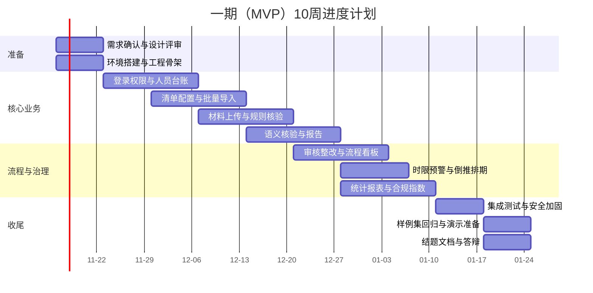

# 党员发展智能管理系统 · 可行性研究报告

| 项目 | 内容 |
| --- | --- |
| 文档编号 | PBS-FS-001 |
| 版本 | V1.0 |
| 编制日期 | 2026-11-11 |
| 项目名称 | 党员发展智能管理系统 |
| 项目类型 | 大学生创新创业训练计划项目（一期 MVP） |
| 报告目的 | 在编码前判断项目在技术、经济、操作、合规、进度五个维度是否可行，并给出立项条件与风险对策 |
| 结论 | **有条件可行（Go）**，条件见第 10 章 |

---

## 1. 摘要

### 1.1 项目概况

本项目面向高校基层党务助理与支部书记，建设一个轻量化网页系统，把党员发展从“靠人记、靠人催、靠人看”的台账式管理，转变为“流程可锁、材料可核、时限可算、风险可见”的闭环管理。系统以“规则引擎 + 大模型”双引擎材料核验为核心，辅以流程看板、时限预警、合规指数、统计导出与审计留痕。

一期目标：3 名学生在一个学期（约 10 周）内，跑通“导入—上传—核验—复核—推进—预警—导出”完整闭环，形成可现场演示、可结题验收、可延续为毕业设计的成果。

### 1.2 可行性结论

| 维度 | 结论 | 关键依据 |
| --- | --- | --- |
| 技术 | 可行 | 技术栈成熟；核心难点（模型 JSON 输出、OCR、异步核验）均有成熟方案，需 2—3 周 POC 验证 |
| 经济 | 可行 | 现金投入约 1,000—2,000 元/年；主要成本是学生工时，无重大采购 |
| 操作 | 可行 | 业务流程与现有党务工作一致；界面中文、任务导向；培训成本低 |
| 合规 | 有条件可行 | 必须使用虚构数据演示；真实材料需审批、脱敏、限制外发；不得整段送第三方模型 |
| 进度 | 有条件可行 | 31 条 P0 + 5 条高价值 P1，10 周可完成；需冻结范围、预留 15% 缓冲、第 4 周 POC 过关 |

### 1.3 主要风险

按“概率 × 影响”排序，前五位是：

1. 真实政审材料违规使用（合规风险，后果最重）；
2. 语义核验准确率不达 80%（核心创新点受质疑）；
3. 三人时间投入不足（进度风险）；
4. 大模型接口不稳定/限流/网络不通（演示风险）；
5. 现有台账字段与导入模板不一致（替代不了 Excel）。

对应措施见第 8 章。

---

## 2. 研究依据与项目边界

### 2.1 依据

- 《党员发展智能管理系统需求规格说明书 V2.0》；
- 《党员发展智能管理系统需求分析报告 V1.0》；
- 本项目负责人作为学院党建助理的实际经办经验；
- 河池学院展示案例提供的业务框架；
- 学校党委组织部现行党员发展材料与时限口径（待逐项核定）；
- 《中华人民共和国个人信息保护法》《中华人民共和国数据安全法》《中华人民共和国网络安全法》及学校数据管理规定。

### 2.2 一期边界

**做**：

- 网页端（Chrome / Edge），单机部署；
- 账号、角色、支部数据范围；
- 人员台账、Excel 批量导入；
- 材料清单模板配置；
- PDF/JPG/PNG/DOCX 上传、OCR/文本抽取；
- 规则层硬性要素校验 + 模型层语义核验；
- 人工复核、退回、重传、版本留痕；
- 流程看板、六规则推进校验；
- 时限预警、倒推排期；
- 统计报表、合规指数、Excel 导出；
- 审计日志、基础脱敏、查看留痕。

**不做**：

- 独立 APP、小程序；
- 短信、微信、企业微信推送；
- 大模型微调、本地部署；
- 高并发集群、多租户；
- 线上党课、答题、论坛；
- 电子签章、可信时间戳；
- 与学工/教务系统对接；
- 雷同检测、版本对比、影响模拟（二期/三期）。

### 2.3 关键假设

| 编号 | 假设 | 不成立时的后果 |
| --- | --- | --- |
| A-01 | 学校允许在院内服务器/个人电脑部署，且可申请 HTTPS 证书或使用自签 | 需改用公网云主机，成本与合规审查增加 |
| A-02 | 现有台账可导出为 Excel，字段基本齐全 | 需先做数据清洗，导入工期增加 3—5 人日 |
| A-03 | 豆包 API 在校园网可访问，账号可申请 | 需更换模型服务商或使用代理，POC 顺延 |
| A-04 | 组织部可提供材料清单、时限口径、上报空表 | 规则与报表只能按默认值做，验收口径不完整 |
| A-05 | 演示与测试可使用虚构数据 | 若必须用真实材料，合规风险显著上升，需额外审批与脱敏 |
| A-06 | 三名成员每周合计可投入 30—45 小时 | 进度按比例顺延，需削减 P1 |

---

## 3. 技术可行性

### 3.1 技术栈选择

| 层次 | 选型 | 版本基线 | 选择理由 |
| --- | --- | --- | --- |
| 前端 | Vue 3 + Vite | Vue 3.4+ / Vite 5+ | 学习曲线平缓，组件生态成熟，适合学生团队 |
| UI | Element Plus | 2.x | 表格、表单、弹窗、上传组件齐全，政务风格适配 |
| 图表 | ECharts | 5.x | 漏斗图、热力图、甘特图均支持 |
| 状态/路由 | Pinia + Vue Router | 2.x / 4.x | 官方推荐，结构清晰 |
| 后端 | Java 17 + Spring Boot 3 | 3.2+ | 生态成熟，权限/事务/调度/文件处理齐全 |
| ORM | MyBatis-Plus | 3.5+ | SQL 可控，分页与逻辑删除开箱即用 |
| 安全 | Spring Security 6 + JWT | 6.x | 认证授权标准方案，易做接口级控制 |
| 数据库 | MySQL 8.0 | 8.0+ | 事务、索引、全文检索（ngram）、备份成熟 |
| 迁移 | Flyway | 9.x+ | 数据库版本化，便于交接 |
| 文件处理 | PDFBox + Apache POI | 2.x / 5.x | PDF 文本、页数；DOCX 解析 |
| Excel | EasyExcel | 3.x | 流式读写，内存占用低 |
| 大模型 | 豆包（火山方舟）API | 按服务商 | 国内访问稳定，支持 JSON 输出与视觉理解 |
| 部署 | Docker Compose + Nginx | 24.x+ | 单机一键部署，环境一致 |

> 选型遵循“轻量、成熟、可交接”三原则：不引入微服务、不引入消息队列、不引入 Elasticsearch、不引入 Redis（一期），以降低三人大创项目的运维复杂度。

### 3.2 关键技术可行性

#### 3.2.1 规则引擎

**需求**：规则可配置、命中可解释、漏检为 0、改规则不改代码。

**方案**：不引入 Drools 等重型规则引擎，采用“规则类型枚举 + JSON 参数 + Java 评估器”的轻量方案。

| 规则类型 | 判定内容 | 确定性 |
| --- | --- | --- |
| FILE_PRESENT | 材料是否上传、版本是否存在 | 高 |
| FILE_FORMAT | 扩展名、MIME、大小、页数 | 高 |
| FIELD_PRESENT | 文本中是否出现姓名、日期、单位、结论语等 | 中高（依赖文本抽取） |
| DATE_ORDER | 日期先后、时间间隔、季度覆盖 | 高 |
| COUNT_LIMIT | 份数、次数、页数下限 | 高 |
| SEMANTIC_POINT | 内容是否切题、是否空泛 | 由模型判断，非规则 |

**可行性判断**：高。规则类型有限，JSON Schema 可校验，评估器可单元测试；不需要动态脚本，避免安全与维护问题。

**边界**：手写签名、盖章、照片、页数（DOCX）不宜作为硬性规则，否则无法保证 0 漏检；应转为语义/人工确认。

#### 3.2.2 大模型语义核验

**需求**：输出结构化结论、每条结论有依据、超时/解析失败可降级、准确率≥80%。

**方案**：

- 调用豆包 Chat Completions（JSON 模式），输入为“材料文本 + 核验要点 + 输出 Schema”；
- 输出固定 JSON：`{point_code, conclusion, evidence, suggestion, confidence}` 数组；
- 解析失败重试 1 次；仍失败转“核验异常”，人工处理；
- 单次超时 30 秒；失败不影响主流程；
- 提示词版本化，报告保存模型名/提示词版本；
- 发送前脱敏：去除身份证号、电话、住址、姓名，使用占位符。

**可行性判断**：中高。JSON 输出与超时控制是成熟工程实践；准确率取决于提示词与样例集，需 POC 验证。

**风险**：模型幻觉、长文本截断、中文扫描件 OCR 错误、接口限流。对策见第 8 章。

#### 3.2.3 OCR 与文本抽取

**需求**：PDF/JPG/PNG/DOCX，扫描件可检索、可核验，单份≤20MB。

**方案**：

| 输入 | 处理 |
| --- | --- |
| 文本型 PDF | PDFBox 直接抽取文本与页数 |
| 扫描型 PDF / JPG / PNG | 豆包视觉模型 OCR；失败转人工 |
| DOCX | Apache POI 抽取段落与表格文本 |

**可行性判断**：中高。文本型 PDF/DOCX 稳定；扫描件中文 OCR 受清晰度影响，需在样例集上评估。

**边界**：一期不做版面还原、表格结构还原、手写体高精度识别；核验以文本要点为主，不承诺逐字准确。

#### 3.2.4 异步核验与降级

**需求**：单份≤30 秒（P90），并发≥20，超时不阻断主流程。

**方案**：

- 上传成功后写入 `verify_task`（PENDING），接口立即返回；
- 应用内调度线程（2—4 个 worker）领取任务，调用规则引擎与模型；
- 前端每 2 秒轮询任务状态，或刷新材料详情；
- 超时/失败写 `FAILED/TIMEOUT`，材料保持 M2，提示“转人工/重试”；
- 不引入 RabbitMQ/Kafka，降低部署复杂度。

**可行性判断**：高。单机 20 并发、每天几百份材料，数据库任务表足够；需处理任务重复领取（`UPDATE ... WHERE status='PENDING'` 乐观锁）。

#### 3.2.5 权限与数据范围

**需求**：四类角色、支部隔离、字段脱敏、越权留痕。

**方案**：

- Spring Security + JWT；
- 接口级 `@PreAuthorize` 控制角色；
- 服务层 `DataScope` 拦截器按 `branch_id` 拼接条件；
- R4 强制 `person_id = 当前用户绑定人员`；
- 字段脱敏用 Jackson 序列化器 + 角色策略；
- 查看敏感字段完整值走单独接口，填理由并写审计。

**可行性判断**：高。均为成熟模式，工作量约 5—7 人日。

#### 3.2.6 合规指数与倒推排期

**需求**：可计算、可排序、可解释；按拟转正日期反推节点。

**方案**：

- 合规指数：材料完整度、时效健康度、内容质量分三项加权，权重配置化；
- 倒推排期：按节点依赖关系逆序计算，处理“日/月”偏移与事件依赖节点；
- 均为确定性计算，不调用模型。

**可行性判断**：高。工作量约 5—7 人日，演示价值高。

### 3.3 技术验证（POC）计划

| 编号 | 验证项 | 通过标准 | 时限 | 责任 |
| --- | --- | --- | --- | --- |
| POC-1 | 豆包 JSON 输出 | 20 次调用中 ≥18 次可直接解析；失败可重试 | 第 3 周 | 队员 B |
| POC-2 | 扫描件 OCR | 20 份样例中 ≥16 份关键字段可抽取 | 第 3 周 | 队员 B |
| POC-3 | 核验时延 | 单份 P90≤30 秒（含 OCR） | 第 4 周 | 队员 B |
| POC-4 | 降级 | 断网/超时/解析失败时材料不丢、状态可恢复 | 第 4 周 | 队员 B |
| POC-5 | 权限隔离 | 学生/跨支部越权均被拒绝并留痕 | 第 2 周 | 队员 B |
| POC-6 | 导入 100 行 | 5 处错误准确定位，正确行入库，重导不重复 | 第 3 周 | 队员 B |

**POC 不通过的处理**：

- POC-1 失败：改用“模型输出自由文本 + 本地 JSON 修复/正则抽取”，仍失败则语义核验降级为人工；
- POC-2 失败：限制扫描件必须清晰，或改用本地 PaddleOCR 作为备选；
- POC-3 失败：缩小单次文本长度、分段核验、提高并发；
- POC-5 失败：暂停业务开发，先修权限，不允许带病上线。

### 3.4 团队能力可行性

| 角色 | 现有能力假设 | 需补能力 | 学习成本 |
| --- | --- | --- | --- |
| 负责人 | 业务熟悉、文档与测试能力强 | 原型工具、验收方法 | 低 |
| 队员 A（前端） | Vue 基础、HTML/CSS/JS | Element Plus、ECharts、权限路由 | 中 |
| 队员 B（后端） | Java/Spring 基础 | Spring Security、文件处理、模型 API | 中高 |

**判断**：可行，但队员 B 是瓶颈。建议：

- 第 1 周完成 Spring Boot + MySQL + JWT 骨架，避免边学边搭；
- 复杂权限、异步任务由队员 B 主责，负责人协助测试；
- 前端先做静态原型，接口未就绪时用 Mock 数据；
- 关键模块写单元测试，减少联调返工。

### 3.5 技术可行性结论

**可行**。没有必须攻克的理论难题，核心是工程实现与数据质量。最大不确定性在语义核验准确率与 OCR 质量，必须在第 3—4 周用 POC 验证；若 POC 不通过，按降级方案调整，不影响主流程闭环。

---

## 4. 经济可行性

### 4.1 成本构成

| 类别 | 项目 | 说明 |
| --- | --- | --- |
| 一次性 | 开发设备 | 使用成员现有电脑，0 元 |
| 一次性 | 域名/证书 | 域名约 50—80 元/年；HTTPS 可用 Let's Encrypt，0 元 |
| 一次性 | 服务器 | 优先使用学校/学院服务器，0 元；若用云主机，2C4G 约 600—1,200 元/年 |
| 运行 | 大模型 API | 按 token 计费，估算见 4.2 |
| 运行 | OCR | 若用视觉模型，按图片计费；若用本地 OCR，0 元 |
| 运行 | 存储/备份 | 300 GB 本地磁盘或学校存储，0—500 元/年 |
| 运行 | 运维 | 学生 self-hosted，0 元 |
| 人力 | 开发工时 | 3 人 × 10 周 × 15 小时 ≈ 450 人时（机会成本，非现金） |

### 4.2 大模型与 OCR 费用估算

**假设**（需按服务商现行价复核）：

- 单份材料文本 3,000—8,000 字，按 1 字≈1 token 估算；
- 单次核验输入（材料 + 要点 + 提示词）约 5,000—10,000 token，输出约 1,000—2,000 token；
- 每年真实材料 20,000 份（1,000 人 × 20 类），开发调优 1,000 次；
- 输入单价按 0.0008 元/千 token、输出按 0.002 元/千 token 估算（仅为量级参考）。

| 场景 | token 量 | 估算费用 |
| --- | --- | --- |
| 开发调优（1,000 次） | 约 10M | 约 20—40 元 |
| 一年生产（20,000 份） | 约 160M | 约 200—400 元 |
| 重试/异常（+30%） | 约 50M | 约 60—120 元 |
| OCR（60,000 页，0.005 元/页） | — | 约 300 元 |
| **合计** | — | **约 600—900 元/年** |

**结论**：即使估算上浮 3 倍，年度 API 成本仍在 3,000 元以内，对大创项目可接受。建议设置月度配额与告警，防止调试期超支。

### 4.3 效益分析

| 效益 | 估算 | 说明 |
| --- | --- | --- |
| 材料核验时间 | 1,000 份/年 × 5 分钟 ≈ 83 小时/年 | 从 3—8 分钟/份降到 1 分钟内人工复核 |
| 台账汇总 | 12 次/年 × 3 小时 ≈ 36 小时/年 | 一键导出替代手工合并 |
| 逾期风险 | 难以量化 | 提前 30/15/7/3 天预警，减少考察超期、转正延期 |
| 档案检索 | 每次 10 分钟 → 10 秒 | 高频但低频次，长期收益 |
| 合规价值 | 难以量化 | 查看留痕、导出水印、权限隔离降低泄密风险 |

按 50 元/小时的机会成本折算，每年节省约 6,000—8,000 元；现金投入约 1,000—2,000 元/年，**现金回收期 < 1 年**。但学生项目的核心收益是能力训练、申报结题与毕业设计延续，不应只按金钱衡量。

### 4.4 敏感性分析

| 变量 | 变化 | 影响 |
| --- | --- | --- |
| API 单价 ×3 | 年费约 1,800—2,700 元 | 仍可接受；可减少非必要调用 |
| 材料量 ×2 | 年费约 1,200—1,800 元 | 可接受；需控制并发与配额 |
| 使用云服务器 | +600—1,200 元/年 | 仍可接受；优先申请学校资源 |
| 开发延期 2 周 | 人力机会成本 +20% | 通过削减 P1 控制 |

### 4.5 经济可行性结论

**可行**。项目无重大采购、无场地与人员工资支出，现金成本低；主要投入是学生工时。建议优先使用学校服务器与免费 HTTPS，API 设置预算上限。

---

## 5. 操作与社会可行性

### 5.1 用户接受度

| 用户 | 关注点 | 系统对策 |
| --- | --- | --- |
| 党务助理 | 不要增加录入负担 | Excel 批量导入、材料批量上传、常用意见模板 |
| 支部书记 | 审批责任清晰、不被 AI 误导 | AI 只给建议、人工终裁、结论回链 |
| 学生 | 知道交什么、何时交、为什么被退 | 本人待办、退回意见具体到段落、进度可视 |
| 管理员 | 规则可改、账号可控、数据可备份 | 配置化、批量开通、整库+文件备份 |

### 5.2 与现有流程的契合

- 阶段划分与学校现行党员发展流程一致；
- 材料名称沿用党务口径，不另造词；
- 时限、清单、模板均可配置，不把学校现行规定写死；
- 不改变审批责任，只把“查材料、记时间、做台账”自动化。

### 5.3 培训与推广

- 培训对象：1—3 名党务助理、若干支部书记；
- 培训时长：30—60 分钟；
- 培训材料：一页纸操作卡 + 8 分钟演示脚本 + 常见问题；
- 推广路径：先在 1 个支部试点 2 周，再扩展到学院；二期再考虑跨学院。

### 5.4 组织支持

项目需要学校/学院提供：

1. 现行材料清单、时限口径、上报空表；
2. 现有台账 Excel 样例（脱敏）；
3. 部署服务器或允许使用个人电脑演示；
4. 指导教师对合规边界的书面确认；
5. 试点支部与配合人员。

### 5.5 操作可行性结论

**可行**。系统不改变业务责任链，只减少重复劳动；但“上传材料”本身会增加学生动作，需通过批量上传、清晰待办、退回意见具体化来降低抵触。

---

## 6. 法律与合规可行性

### 6.1 适用法律与规范

| 法规/规范 | 关键要求 | 对本项目的影响 |
| --- | --- | --- |
| 《个人信息保护法》 | 最小必要、目的限定、告知同意、敏感个人信息单独保护 | 政审材料含家庭信息，属敏感个人信息，必须严格权限与最小化 |
| 《数据安全法》 | 数据分类分级、全流程安全、风险监测 | 材料分级、审计、备份 |
| 《网络安全法》 | 网络运行安全、个人信息保护 | HTTPS、访问控制、日志 |
| 学校数据管理规定 | 校内数据不出校、外部服务审批 | 大模型调用需审批/脱敏 |
| 大创项目管理规定 | 经费使用、结题材料 | 不影响技术方案 |

### 6.2 合规风险点

| 风险点 | 说明 | 措施 |
| --- | --- | --- |
| 真实材料上传公网 | 政审材料含家庭成员工作单位、社会关系 | 演示只用虚构数据；生产部署在校内；禁止公网演示真实材料 |
| 材料发送第三方模型 | 可能构成委托处理/数据出境 | 脱敏后发送；只发核验必需文本；与供应商确认不训练、不留存 |
| 字段级脱敏不彻底 | 页面隐藏但接口/导出/日志泄露 | 序列化、导出、日志三处统一策略 |
| 导出文件外泄 | 报表含敏感信息 | 水印、导出审批、导出记录 |
| 日志留存不足 | 无法追溯 | ≥6 个月，只增不删 |
| 学生信息过度收集 | 身份证号、住址等 | 不结构化存储；材料按需上传 |

### 6.3 合规可行性结论

**有条件可行**。只要坚持“虚构数据演示、真实数据校内、外发必脱敏、访问必留痕”四条底线，项目可以在合规框架内完成。若无法满足，建议降级为“纯虚构数据演示系统”，不接入真实业务。

---

## 7. 进度可行性

### 7.1 总体计划

一期按 10 周安排，第 1 周为需求确认与设计评审，第 2—9 周开发与联调，第 10 周验收与演示准备。

> 日期为建议排期，需按学校校历、考试周与寒假调整；如遇春节，整体前移或后移。

### 7.2 里程碑

| 里程碑 | 时间 | 交付物 | 通过标准 |
| --- | --- | --- | --- |
| MS1 设计基线 | 第 1 周末 | 需求分析、可行性、总体/详细设计 | 组内评审通过 |
| MS2 骨架可登录 | 第 2 周末 | 前后端骨架、数据库、登录、权限 | 四类角色可登录，越权被拒 |
| MS3 台账可导入 | 第 4 周末 | M2/M3 + 导入 | 100 行含 5 处错误可定位，重导不重复 |
| MS4 核验可演示 | 第 6 周末 | M4 + 报告 + 降级 | 20 份样例核验成功，超时可降级 |
| MS5 闭环可跑通 | 第 8 周末 | M5/M6/M7/M8 | 缺材料/越阶段/超时限均被拦截 |
| MS6 验收可答辩 | 第 10 周末 | 样例集、演示、文档 | 8 步演示脚本完整跑通 |

### 7.3 工作量分解

| 模块 | 人日（估） | 主责 | 说明 |
| --- | ---: | --- | --- |
| M1 账号权限 | 6 | 队员 B | 登录、JWT、角色、数据范围、审计 |
| M2 人员台账 | 8 | 队员 B + 负责人 | 建档、导入、检索、时间线 |
| M3 清单配置 | 5 | 负责人 + 队员 B | 模板、材料类型、核验要点 |
| M4 AI 核验 | 12 | 队员 B + 负责人 | 上传、OCR、规则、模型、报告、降级 |
| M5 审核整改 | 6 | 队员 B | 待办、复核、退回、版本 |
| M6 流程看板 | 6 | 队员 A | 看板、锁定、推进、分布 |
| M7 时限预警 | 5 | 队员 A + 队员 B | 规则、计算、预警、排期 |
| M8 统计报表 | 5 | 队员 A | 统计、导出、合规指数 |
| M10 审计安全 | 4 | 队员 B | 日志、留痕、脱敏 |
| 前端公共 | 8 | 队员 A | 布局、路由、权限、组件 |
| 联调测试 | 6 | 全组 | 接口联调、缺陷修复 |
| 文档与演示 | 5 | 负责人 | 测试用例、使用说明、PPT |
| **合计** | **76 人日** |  | 3 人 × 10 周 × 2.5 天/周 ≈ 75 人日 |

> 估算含 15% 缓冲。若按每周每人 2.5 个有效人日计算，10 周约 75 人日，与估算基本匹配；这意味着**不能随意加功能**。

### 7.4 进度风险与缓冲

| 风险 | 影响 | 对策 |
| --- | --- | --- |
| 队员 B 学习成本高 | M1/M4 延期 | 第 1 周集中培训；权限骨架先用成熟脚手架 |
| 模型/OCR 不稳定 | M4 延期 | 第 3—4 周 POC；准备降级方案 |
| 考试周/寒假 | 有效工时下降 | 提前识别，削减 P1 |
| 需求变更 | 返工 | 第 2 周后冻结范围，变更走书面确认 |
| 联调发现接口不一致 | 返工 | 第 2 周先定接口契约，前后端并行 |

### 7.5 进度可行性结论

**有条件可行**。10 周完成 31 条 P0 + 5 条高价值 P1 是紧平衡，必须：范围冻结、POC 前置、接口先行、每周演示、预留缓冲。若第 4 周 POC 未通过，应削减合规指数/倒推排期等 P1，保住“导入—上传—核验—复核—推进—预警—导出”主闭环。

---

## 8. 风险分析

### 8.1 风险矩阵

概率/影响按 1—5 打分，风险值 = 概率 × 影响。

| 编号 | 风险 | 概率 | 影响 | 风险值 | 等级 | 应对措施 | 责任 |
| --- | --- | ---: | ---: | ---: | --- | --- | --- |
| R-01 | 真实政审材料违规使用 | 3 | 5 | 15 | 高 | 只用虚构数据；真实材料审批+脱敏；校内部署 | 负责人 |
| R-02 | 语义核验准确率 <80% | 4 | 4 | 16 | 高 | 标注集调优；人工终裁；明确辅助定位 | 队员 B |
| R-03 | 三人时间投入不足 | 4 | 4 | 16 | 高 | P0 优先；每周检查；削减 P1 | 负责人 |
| R-04 | 模型接口不稳定/限流 | 3 | 4 | 12 | 高 | 超时重试；降级人工；备用服务商 | 队员 B |
| R-05 | 台账字段与模板不一致 | 4 | 3 | 12 | 高 | 开发前对齐模板；导入预览；错误行定位 | 负责人 |
| R-06 | 范围蔓延 | 4 | 3 | 12 | 高 | 范围冻结；变更书面确认 | 负责人 |
| R-07 | 导出模板无样张 | 4 | 3 | 12 | 高 | 通用模板先行；第 8 周前拿到样张 | 负责人 |
| R-08 | 校园网无法访问 API | 2 | 4 | 8 | 中 | 提前测试；代理/备用网络 | 队员 B |
| R-09 | OCR 质量差 | 3 | 3 | 9 | 中 | 样例评估；清晰度要求；人工补录 | 队员 B |
| R-10 | 权限漏洞 | 2 | 5 | 10 | 高 | 服务端双校验；越权测试；代码评审 | 队员 B |
| R-11 | 文件丢失/损坏 | 2 | 4 | 8 | 中 | 本地+备份；SHA-256 校验 | 队员 B |
| R-12 | 时限口径与组织部不符 | 3 | 3 | 9 | 中 | 参数可配；上线前逐项核定 | 负责人 |
| R-13 | 数据迁移失败 | 3 | 3 | 9 | 中 | 试导入；回滚方案；分批迁移 | 队员 B |
| R-14 | 演示现场网络故障 | 3 | 3 | 9 | 中 | 本地缓存演示数据；录屏备份 | 队员 A |
| R-15 | 团队协作冲突 | 2 | 3 | 6 | 中 | 分工明确；周会；Git 规范 | 负责人 |

### 8.2 重点风险对策

**R-01 合规**：

- 建立“演示数据白名单”，所有样例由脚本生成，姓名、学号、单位均为虚构；
- 系统首次登录弹出“禁止上传真实政审材料”提示；
- 真实材料仅在经审批的校内环境使用，且发送模型前脱敏；
- 指导教师书面确认合规边界。

**R-02 准确率**：

- 第 2—4 周建立 30—50 份标注样例集，覆盖缺项、冲突、空泛、雷同；
- 提示词迭代以样例集回归为准，不以“感觉”调优；
- 报告明确“AI 建议、人工终裁”，验收按 80% 准确率 + 人工补足；
- 语义核验失败可降级为人工，不阻断流程。

**R-03 进度**：

- 每周日晚组会，检查里程碑与燃尽；
- 第 4 周 POC 未过，立即削减 P1，保主闭环；
- 关键路径任务由队员 B 主责，其他人不等待。

**R-04 接口稳定**：

- 所有模型调用统一封装，超时、重试、熔断、降级；
- 保存原始响应摘要（脱敏）便于排查；
- 准备第二家兼容 OpenAI 协议的服务商作为备选。

---

## 9. 备选方案比较

### 9.1 技术栈

| 方案 | 优点 | 缺点 | 结论 |
| --- | --- | --- | --- |
| Spring Boot + Vue | 生态成熟、权限/文件/调度齐全、易交接 | 队员 B 学习成本中等 | **采用** |
| FastAPI + Vue | 开发快、AI 对接顺 | 权限/审计需自建，Java 生态弱 | 备选 |
| Node.js + Vue | 前后端统一 TS | 队员 B 不熟，事务/文件处理弱 | 不采用 |

### 9.2 数据库

| 方案 | 优点 | 缺点 | 结论 |
| --- | --- | --- | --- |
| MySQL 8 | 事务、索引、全文检索、备份成熟 | 需部署与运维 | **采用** |
| SQLite | 零运维、单文件 | 并发写弱、全文检索受限、推广难 | 不采用（仅可用于本地开发备选） |

### 9.3 核验方案

| 方案 | 优点 | 缺点 | 结论 |
| --- | --- | --- | --- |
| 规则 + 模型双引擎 | 准确、可解释、可降级 | 实现工作量中等 | **采用** |
| 纯大模型 | 开发快 | 幻觉、不可解释、硬性漏检 | 不采用 |
| 纯规则 | 确定、可解释 | 无法判断内容质量 | 不采用 |
| Drools 等重型规则引擎 | 功能强 | 学习/维护成本高，过度设计 | 不采用 |

### 9.4 异步任务

| 方案 | 优点 | 缺点 | 结论 |
| --- | --- | --- | --- |
| 数据库任务表 + 应用线程 | 轻量、可追溯、无需中间件 | 吞吐有限 | **采用** |
| RabbitMQ | 解耦、吞吐高 | 多一个中间件，运维复杂 | 不采用 |
| 同步调用 | 简单 | 易超时、体验差 | 不采用 |

### 9.5 文件存储

| 方案 | 优点 | 缺点 | 结论 |
| --- | --- | --- | --- |
| 本地非公开目录 | 简单、低成本、可控 | 扩展性差、需自行备份 | **采用** |
| 对象存储 OSS | 扩展、托管 | 成本、合规、网络依赖 | 二期考虑 |
| 数据库 BLOB | 事务一致 | 备份/性能差 | 不采用 |

---

## 10. 综合结论与立项条件

### 10.1 结论

本项目在**技术、经济、操作、合规、进度**五个维度均具备可行性，建议立项并按一期范围实施。项目没有理论性障碍，主要挑战是：

- 语义核验准确率与 OCR 质量；
- 三人时间与范围控制；
- 真实材料的合规边界；
- 学校现行口径的准确性。

### 10.2 立项条件

| 编号 | 条件 | 未满足的后果 | 责任 |
| --- | --- | --- | --- |
| C-01 | 第 11 章待确认事项（至少 Q-21—Q-27）完成确认 | 需求口径不定，返工 | 负责人 |
| C-02 | 演示与测试只用虚构数据；真实材料使用需书面审批 | 合规风险，可能叫停 | 负责人/指导教师 |
| C-03 | 第 4 周 POC-1—POC-4 通过 | 核验模块需降级或延期 | 队员 B |
| C-04 | 第 6 周前完成 30—50 份标注样例集 | 准确率无法验收 | 负责人 |
| C-05 | 第 8 周前拿到上报空表样张 | 导出模板无法 1:1 验收 | 负责人 |
| C-06 | 第 2 周后冻结一期范围 | 范围蔓延，进度失控 | 全组 |
| C-07 | 学校服务器/部署环境落实 | 影响演示与上线 | 负责人 |
| C-08 | 大模型服务合规条款确认（不训练、不留存） | 敏感数据外发风险 | 负责人 |

### 10.3 建议

1. **先做减法**：一期只保 31 条 P0 + 5 条高价值 P1，其余全部延后；
2. **POC 前置**：第 3—4 周验证模型 JSON、OCR、时延、降级，不通过就调整方案；
3. **数据先行**：第 1—2 周对齐台账字段、材料清单、时限口径、报表样张；
4. **演示数据先行**：第 2 周生成 30 人、60 份材料的虚构样例集，前后端都用它联调；
5. **合规写进流程**：登录提示、上传确认、脱敏、审计、导出水印，不要留到最后补。

---

## 附录 A 估算假设与数据来源

| 项目 | 假设 | 来源/说明 |
| --- | --- | --- |
| 学院规模 | 1,000 人/年，5 年 5,000 条 | 按单学院估算，需实际核对 |
| 材料数量 | 20—25 类/人 | 需求文档表 11 |
| 单份材料大小 | 1—2 MB | 扫描件偏大，文本件偏小 |
| 单份核验 token | 5,000—10,000 | 文本长度 + 提示词 + 输出 |
| API 单价 | 0.0008/0.002 元/千 token | 量级参考，需按服务商现价复核 |
| 学生工时 | 15 小时/周/人 | 10 周合计 450 小时 |
| 机会成本 | 50 元/小时 | 仅用于效益折算，非实际支出 |
| 汇率/税费 | 不涉及 | 国内服务 |

## 附录 B 参考文件

1. 《党员发展智能管理系统需求规格说明书 V2.0》
2. 《党员发展智能管理系统需求分析报告 V1.0》
3. 《GB/T 8567-2006 计算机软件文档编制规范》
4. 《GB/T 25000.51-2016 系统与软件质量要求和评价》
5. 《中华人民共和国个人信息保护法》
6. 《中华人民共和国数据安全法》
7. 《中华人民共和国网络安全法》

## 附录 C 变更记录

| 版本 | 日期 | 变更人 | 说明 |
| --- | --- | --- | --- |
| V1.0 | 2026-11-11 | 项目组 | 首次编写，完成五维可行性分析与立项条件 |