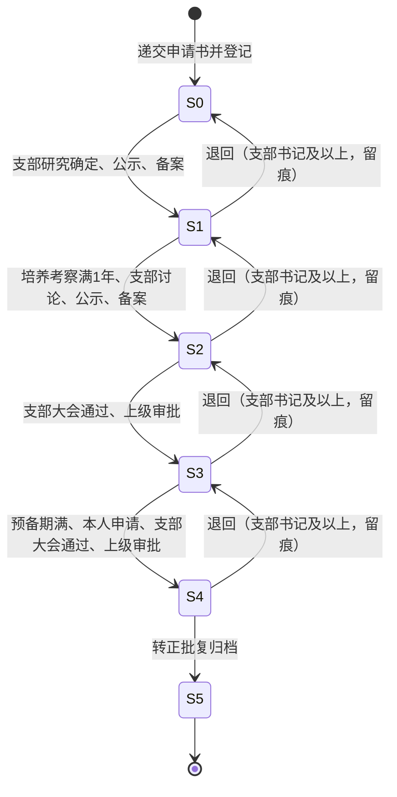
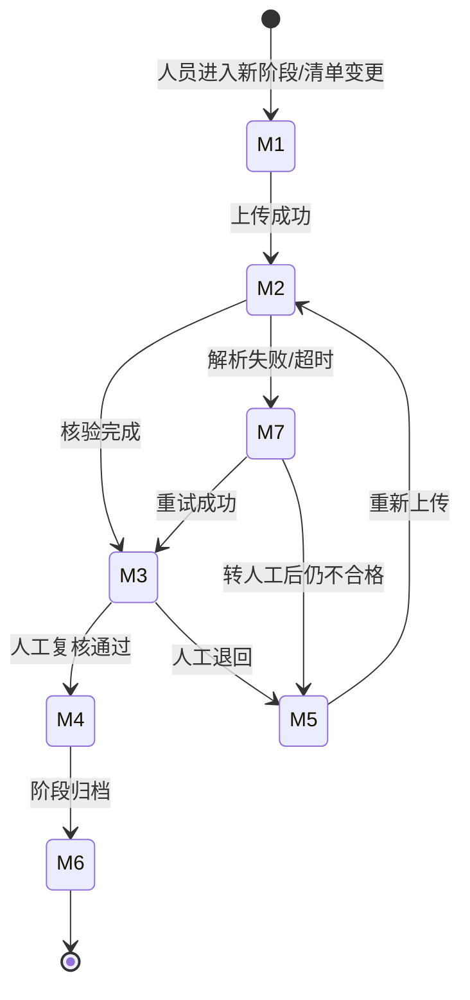
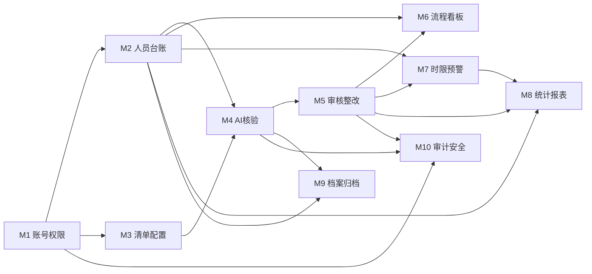
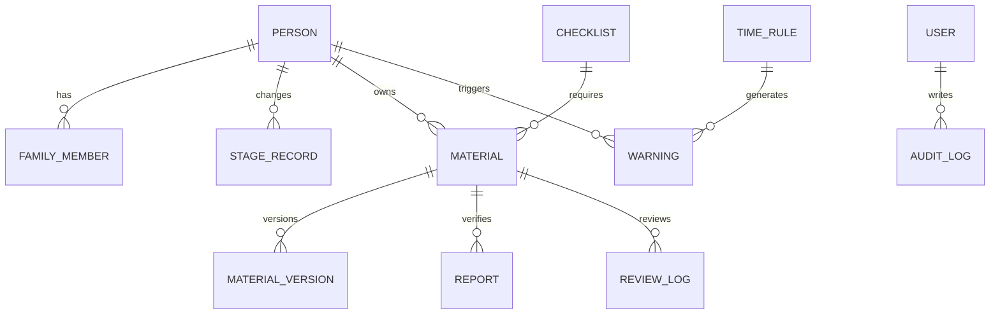

# 党员发展智能管理系统 · 需求分析报告

| 项目 | 内容 |
| --- | --- |
| 文档编号 | PBS-REQ-ANALYSIS-001 |
| 版本 | V1.0 |
| 编制日期 | 2026-11-11 |
| 分析对象 | 《党员发展智能管理系统需求规格说明书 V2.0》（2026-11-05） |
| 分析目的 | 核对需求完整性、一致性、可实现性与可验收性，形成后续可行性研究、总体设计与详细设计的统一输入 |
| 文档状态 | 设计基线（待项目组与指导教师确认第 11 章待确认事项） |

---

## 1. 分析范围与方法

### 1.1 分析范围

本报告只分析需求规格说明书所描述的一期（MVP）及已明确规划的二期、三期内容，不扩展到党课培训、知识答题、论坛、移动端等文档已声明“不做”的范围。

分析覆盖：

- 项目定位、建设目标与衡量指标；
- 五类创新点及其取舍；
- 四类角色与权限矩阵；
- 党员发展六阶段、材料七状态、阶段流转六规则、时限规则库；
- M1—M10 共 58 条功能需求；
- 12 类核心数据实体及数据字典；
- 性能、安全、易用、兼容、可维护等非功能需求；
- 一期范围、迭代计划、验收标准与风险。

### 1.2 分析方法

采用软件工程需求评审常用的五类检查：

| 方法 | 检查内容 | 本报告落点 |
| --- | --- | --- |
| 完整性检查 | 角色、流程、数据、异常、非功能是否闭合 | 第 4、5、7、8 章 |
| 一致性检查 | 同一概念在不同章节的编号、枚举、优先级是否一致 | 第 9 章 |
| 可实现性检查 | 需求能否在给定技术栈、周期、数据条件下实现 | 第 6 章、可行性报告 |
| 可验证性检查 | 每条需求是否有明确验收口径 | 第 10 章 |
| 追踪性检查 | 需求—模块—设计—测试是否可双向追踪 | 第 10 章、详细设计第 13 章 |

### 1.3 分析结论摘要

需求文档整体质量较高，业务链条完整、边界清楚、优先级明确，具备直接进入设计阶段的条件。主要问题不是“缺功能”，而是**若干跨章节口径未统一**和**支撑性实体缺失**，集中在以下五处：

1. “三防”只有名称没有定义；
2. 预警等级、提前量在四处分歧；
3. M9 模块优先级与其中两条 P0 功能、一期范围冲突；
4. 身份证号“掩码可见”与“不存身份证号”矛盾；
5. 数据实体缺少消息、学年版、文件版本、配置版本、支部字典等支撑表。

上述问题均已在第 9 章给出设计裁决或待确认建议，不阻塞总体设计，但**必须在编码前由业务方拍板**。

---

## 2. 项目定位与需求理解

### 2.1 一句话定位

系统不是党务信息发布平台，而是面向基层党务助理与支部书记的**党员发展流程智能副驾驶**：以人为单位、以材料为证据、以时间为刻度，把“靠人记、靠人催、靠人看”的台账式管理，转变为“流程可锁、材料可核、时限可算、风险可见”的闭环管理。

### 2.2 三层价值

| 层级 | 价值 | 对应设计 |
| --- | --- | --- |
| 操作层 | 少翻文件、少漏项、少催办 | 批量导入、材料核验、待办与预警 |
| 管理层 | 知道谁被卡住、哪个支部风险高 | 流程看板、合规指数、支部热力图 |
| 治理层 | 结论可解释、操作可追溯、敏感信息可控 | 双引擎证据链、审计日志、字段脱敏 |

### 2.3 与同类系统的差异

需求文档的差异化定位是成立的，但需要在设计中落到实处，否则容易退化为普通 OA：

| 差异点 | 设计必须体现的机制 | 若缺失的后果 |
| --- | --- | --- |
| 双引擎核验 | 规则结论与模型结论分列、各自可回链 | 变成“大模型一句话判断”，不可信 |
| 可解释 | 每条结论保存规则编号、原文片段、置信度 | 支部书记仍需重看，效率不提升 |
| 量化治理 | 合规指数公式、权重配置、风险分档 | 看板只有状态，没有优先级 |
| 事前排期 | 逆序推演节点最晚完成日 | 仍停留在到期提醒 |
| 安全可控 | 字段分级、查看留痕、导出水印 | 敏感材料不敢上线 |

### 2.4 建设目标的复核

需求文档给出的六个衡量指标中，五个可在系统中直接埋点测量，一个需要人工抽样：

| 指标 | 可测量性 | 建议测量点 |
| --- | --- | --- |
| 单份材料核验耗时 | 可自动测量 | 核验任务 `started_at` 到 `finished_at`，同时记录人工复核耗时 |
| 材料缺项漏检率 | 可用标注集测量 | 30—50 份标注样例回归 |
| 全院台账汇总耗时 | 可自动测量 | 导出任务开始到文件生成完成 |
| 节点逾期发现时点 | 可自动测量 | 预警生成时间与应完成日比对 |
| 档案检索耗时 | 可自动测量 | 检索接口 P95 响应时间 |
| 思想汇报雷同识别 | 二期能力 | 相似度矩阵与人工判定一致率 |

> 注意：需求文档中“现状值”均为【待测】，验收时应先完成一次基线测量，否则“提升”无法证明。建议在开发第一周由负责人用现有台账做一次 30 份材料计时。

---

## 3. 利益相关者与角色分析

### 3.1 利益相关者

| 利益相关者 | 关注点 | 对系统的影响 |
| --- | --- | --- |
| 项目负责人（党务助理） | 减少重复劳动、材料不遗漏、申报与结题有成果 | 主要操作用户与需求提出者 |
| 支部书记 | 审批责任、材料结论、风险处置 | 关键审批与回退操作者 |
| 学院党委 / 超级管理员 | 全院口径统一、账号与规则可控、数据安全 | 配置与审计责任主体 |
| 学生（各阶段人员） | 知道自己要交什么、何时交、被退回原因 | 材料上传者，系统体验直接影响推广 |
| 指导教师 | 范围可控、技术路线合理、合规风险低 | 范围与合规的守门人 |
| 学校组织部 | 上报口径、材料规范、时限要求 | 规则与报表的最终口径来源 |
| 大模型 / OCR 服务商 | 接口稳定性、数据合规 | 外部依赖与合规风险源 |

### 3.2 角色与权限复核

需求文档定义 R1 超级管理员、R2 支部书记、R3 党务助理、R4 发展对象（学生）四类角色，并把入党申请人、积极分子、发展对象、预备党员、正式党员统一归入 R4。这一划分合理，理由是：

- 五类人员在系统中的**操作能力相同**（上传本人材料、查看本人进度），差异只在“当前阶段需要交什么”；
- 用阶段而不是角色表达差异，避免角色爆炸；
- 正式党员不再产生新材料，但仍可查阅本人档案。

需要补充的设计点：

1. **账号与人员分离**：User 是登录账号，Person 是发展档案。R1—R3 可能没有 Person 记录，R4 必须有且只能绑定一个 Person。
2. **一人多角色**：现实中支部书记可能同时是党务助理。需求写“一个账号绑定一个主支部和一个角色”，一期建议单角色，多角色留二期；演示时用不同账号区分。
3. **跨支部查看**：R3“可申请跨支部查看”目前没有申请、审批、授权、到期回收的载体，一期建议不做，或退化为超级管理员临时授权。
4. **权限校验双门槛**：角色能做什么 + 对象是否属于本人/本支部。前者在接口层，后者在服务层数据范围拦截，二者都必须做。

### 3.3 权限矩阵的实现口径

| 操作 | 实现口径 | 备注 |
| --- | --- | --- |
| 查看全院台账 | `role=R1` | R1 不受支部限制 |
| 查看本支部台账 | `role in (R2,R3)` 且 `branch_id=当前用户支部` | 服务层强制拼接支部条件 |
| 查看本人档案 | `role=R4` 且 `person_id=当前用户绑定人员` | 不能只看 `person_id` 参数 |
| 新增/导入人员 | `role in (R1,R2,R3)` | R3 仅限本支部 |
| 推进阶段 | `role in (R1,R2)` | R3 只能提交建议，不能直接推进 |
| 复核材料 | `role in (R1,R2)`；R3 仅初审 | 初审与终审在数据上要区分 |
| 上传本人材料 | `role=R4` 且本人 | R1—R3 代传需单独授权，建议一期不做 |
| 配置清单/时限 | `role=R1` | 业务负责人使用 R1 账号 |
| 查看敏感字段 | 见第 4.3 节分级 | 完整值查看须填理由并留痕 |
| 导出 | R1 全院；R2 本支部；R3 需审批 | 一期 R3 导出建议仅限本支部且留痕 |

---

## 4. 业务流程分析

### 4.1 党员发展主流程

需求文档将党员发展固化为 S0—S5 六个状态，S0—S4 为在办状态，S5 为终态：

分析要点：

- 阶段是**业务状态**，材料状态是**证据状态**，两者不能混用。推进阶段的前提是本阶段全部必填材料达到 M4“已通过”。
- S5 为终态，但需求允许 S5 之前的回退；S5 本身是否可撤销未说明，设计按“不可回退，需超级管理员特殊处理”处理。
- “回退至上一状态”只允许一级，不能跨级回退；回退后原阶段材料是否失效、是否需要重新核验，需求未定义，设计需补充（见 ISS-16）。
- S0 的“未被列为积极分子的要重新谈话”是一条独立业务规则，当前没有字段记录“是否已谈话/谈话次数”，设计需补 `talk_record` 或在 `stage_record` 中记录。

### 4.2 材料状态机

材料七状态是系统最核心的状态机，任何一份必填材料未到 M4，阶段即被锁定：

分析要点：

- M2“待核验”到 M3“待人工复核”之间缺少“核验中”状态。需求用 M7 表示异常，但没有表示“任务排队/执行中”的状态。设计需增加 `verify_task.status`（PENDING/RUNNING/SUCCESS/FAILED/TIMEOUT），材料主状态仍保持 M2，避免状态机膨胀。
- M3 的“AI 核验报告生成”不等于“核验通过”，人工必须采纳或驳回。需求明确 AI 只给建议，这一点在设计中必须用权限和流程双重保证。
- M4→M6 是“阶段归档时”批量转，单份材料不能自行归档；归档动作应以“人—阶段”为单位，而不是单份材料。
- M5 退回后重新上传产生新版本，旧版本不删除；版本号、提交时间、核验报告都要保留，否则无法证明整改。
- M7 允许“转人工处理”，但人工处理后进入 M3 还是 M4，需求未明确。设计建议：人工补充核验结论后进入 M3，仍需复核；若管理员直接判定，则记 M4 并强制填写理由。

### 4.3 阶段推进判定

需求 5.3 给出六条规则，本质是六个必须全部通过的 Guard：

| 规则 | 判定内容 | 数据来源 | 失败提示 |
| --- | --- | --- | --- |
| 材料锁 | 本阶段必填材料均为 M4，份数/页数达标 | material、checklist_item | 列出缺失/未通过材料清单 |
| 时限锁 | 关键时限未超期；超期须支部书记填写说明 | time_rule、warning、stage_record | 列出逾期节点与天数 |
| 流程锁 | 无未处理退回项；上一阶段已归档 | material、archive_record | 列出退回项/未归档阶段 |
| 备案完整性 | 需备案/审批节点的日期已登记 | stage_record、备案字段 | 列出缺失日期 |
| 操作权限 | 账号有权限且对象在管理范围 | user、person | 403 或业务提示 |
| 二次确认 | 填写推进依据（如支部会议日期） | 请求参数 | 要求补充依据 |

设计要点：

- 六条规则必须**一次性全部校验并返回全部阻塞项**，不能查到第一条就返回，否则用户体验差，也违背需求“避免逐条试错”。
- 规则四“备案日期与批复日期已登记”需要结构化字段，建议在 `stage_record.evidence` 中按节点存 JSON，或在 `person` 表增加关键日期字段；设计采用 `stage_record` + `evidence` JSON，避免人员表字段膨胀。
- 规则六“推进依据”必须落库，建议存 `stage_record.evidence`，并在审计日志中记录。
- 推进与回退都要加乐观锁，防止两个支部书记同时操作同一人。

### 4.4 时限规则

需求 5.4 给出 T-01—T-11 共 11 条默认规则。分析发现三类节点：

| 类型 | 示例 | 计算方式 | 设计处理 |
| --- | --- | --- | --- |
| 固定偏移型 | T-01 首次谈话（登记日 + 30 天） | 起算日 + N 天/月 | 直接计算 |
| 事件依赖型 | T-06 集中培训（接收前）、T-09 宣誓（批复后及时） | 依赖另一事件发生 | 存“相对节点 + 偏移”，事件未发生时显示“待触发” |
| 周期型 | T-03 思想汇报（每季度 1 次） | 按季度生成多个实例 | 生成 `warning.cycle_key`，每季度一条 |

需求文档把“7/3 天”解释为双档提醒，但 2.3、Q-16、附录 B 又出现 30/15/7/3 四档。设计基线采用**四级、每节点可配置**：

| 级别 | 默认提前量 | 通知对象 | 呈现 |
| --- | --- | --- | --- |
| 提示 | 30 天 | 党务助理 | 浅色标注 |
| 临期 | 15 天 / 7 天 | 党务助理、支部书记 | 标黄置顶 |
| 紧迫 | 3 天 | 党务助理、支部书记 | 首页红点 |
| 逾期 | 超过应完成日 | 支部书记、超级管理员 | 标红风险清单 |

> 该口径需业务方确认（Q-22）。实现上 `warn_offsets` 存 JSON 数组，级别映射可配置，避免再次写死。

### 4.5 关键控制点

| 控制点 | 控制目标 | 系统动作 | 留痕 |
| --- | --- | --- | --- |
| 材料未齐 | 防止跳步 | 拒绝推进，列出全部缺项 | 审计日志记录拒绝原因 |
| 材料不合格 | 防止“齐全但不合格” | 规则硬拦截 + 语义存疑 + 人工终裁 | 核验报告、复核记录 |
| 时限超期 | 防止考察超期/转正延期 | 分级预警；超期推进须说明 | 预警处置记录、推进依据 |
| 越权查看 | 防止敏感信息扩散 | 角色 + 支部双校验；字段脱敏 | 查看留痕、完整值查看理由 |
| 随意回退 | 防止掩盖问题 | 仅 R2 及以上；必填理由 | 回退记录、审计日志 |
| 导出外泄 | 防止二次传播 | 水印 + 导出记录 + 权限 | 导出日志、水印文本 |

---

## 5. 功能需求分析

### 5.1 总览与优先级统计

需求文档共定义 10 个模块、58 条功能需求。按优先级统计：

| 模块 | 名称 | 功能点数 | P0 | P1 | P2 | 模块优先级 |
| --- | --- | ---: | ---: | ---: | ---: | --- |
| M1 | 账号、角色与权限 | 6 | 3 | 3 | 0 | P0 |
| M2 | 人员台账与批量导入 | 6 | 4 | 2 | 0 | P0 |
| M3 | 材料清单模板配置 | 4 | 2 | 2 | 0 | P0 |
| M4 | 材料 AI 智能核验 | 10 | 6 | 3 | 1 | P0 |
| M5 | 材料审核与整改闭环 | 7 | 5 | 1 | 1 | P0 |
| M6 | 流程看板与流转控制 | 6 | 3 | 2 | 1 | P0 |
| M7 | 时限预警与智能排期 | 6 | 4 | 1 | 1 | P0 |
| M8 | 统计报表与导出 | 5 | 3 | 1 | 1 | P0 |
| M9 | 电子档案归档与检索 | 4 | 2 | 2 | 0 | P1 |
| M10 | 审计日志与数据安全 | 4 | 1 | 3 | 0 | P1 |
| **合计** |  | **58** | **33** | **20** | **5** |  |

一期范围按 9.2 为“M1—M8 的 P0 项”，即 **31 条 P0**。但 M9 的 FR-09-01、FR-09-02 被标为 P0，与“M9 模块 P1、一期不含 M9”冲突。设计裁决见 ISS-03。

### 5.2 模块逐项分析

#### M1 账号、角色与权限

- **核心价值**：所有模块的权限边界，必须先于业务模块完成。
- **关键需求**：登录、角色与支部绑定、双重校验、账号维护、字段分级、批量开通。
- **分析**：
  - “连续 5 次失败锁定 10 分钟”需要 `failed_count`、`lock_until` 字段，锁定期内即使密码正确也拒绝。
  - “密码加盐哈希”建议直接使用 BCrypt，自带随机盐，不需要单独存盐字段。
  - “账号批量开通”依赖人员导入，建议导入成功后异步生成账号，初始密码采用随机密码 + 首次登录强制修改，避免统一默认密码。
  - 字段可见级别配置需要与展示层序列化、导出、日志三处联动，不能只在页面隐藏。
- **依赖**：无。被 M2—M10 依赖。
- **风险**：权限校验若只做前端隐藏，越权风险高；必须在服务端做数据范围拦截。

#### M2 人员台账与批量导入

- **核心价值**：替代分散 Excel，形成唯一数据源。
- **关键需求**：建档、Excel 导入、检索、阶段时间线、家庭成员、导出。
- **分析**：
  - 导入是“能否替代现有台账”的关键。需求要求“错误行回显行号与列名，正确行可先行入库”，这意味着**部分成功**语义，不能整批回滚；需要 `import_batch`、`import_error` 两张表记录批次与错误。
  - “二次导入且不重复”要求以学号为业务主键做 upsert，或用导入批次 + 行号去重；设计采用学号 upsert + 变更前快照。
  - 阶段变更时间线必须记录“操作人、时间、理由、依据材料”，否则回退和推进无法追溯。
  - 家庭成员只存四项，不存身份证号；与 4.3“身份证号掩码可见”冲突，见 ISS-05。
- **依赖**：M1（权限）、M3（阶段枚举/模板）。
- **风险**：现有 Excel 字段与模板不一致；导入前必须做字段对齐（Q-06）。

#### M3 材料清单模板配置

- **核心价值**：材料要求变化时改配置不改代码。
- **关键需求**：阶段—材料映射、核验要点、版本管理、预览验证。
- **分析**：
  - “按学年版管理，历史人员沿用原版本”要求 `person` 或 `stage_record` 绑定模板版本；否则切换版本后历史人员会被新清单重新判定。
  - 核验要点分“硬性要素/语义要点”，需要结构化存储（JSON），并允许规则层引用规则编号、语义层引用提示词编号。
  - “配置预览与验证”需要样例材料试跑，建议复用正式核验流水线，但结果标记为 `dry_run`，不改变材料状态。
- **依赖**：M1（只有 R1 可配置）。
- **风险**：配置过于自由会导致规则不可执行；需要给配置项定义 Schema 和校验。

#### M4 材料 AI 智能核验（核心）

- **核心价值**：项目的技术核心与申报主亮点。
- **关键需求**：上传预处理、硬性要素、语义要点、报告、人工复核入口、失败兜底、一致性、规则外置、雷同、样例集。
- **分析**：
  - 上传格式 FR-04-01 支持 PDF/JPG/PNG/DOCX，但 5.1 补充说明“应提交材料都为图片或 PDF”，二者冲突，见 ISS-06。设计按 FR-04-01 执行，DOCX 仅用于文本类材料。
  - 30 秒超时 + P90 指标要求核验异步化，不能在上传请求里同步等待模型。建议上传成功即返回，核验任务后台执行，前端轮询状态。
  - 规则层必须“漏检 0”，意味着规则必须是确定性的、可单测的；页数、手写签名、盖章等依赖 OCR/视觉判断的要素，不应算作“硬性规则”，否则无法保证 0 漏检。设计建议把要素分为“元数据规则、文本存在性规则、日期逻辑规则、视觉/语义判断”四类，只有前三类计入硬性结论。
  - 模型输出必须强制 JSON，解析失败重试一次，仍失败转 M7；提示词、模型名、版本号要落库，保证历史结论可复现。
  - 一致性校验是 P1，但它是“材料锁从查缺项升级”的关键；一期建议先做家庭成员、关键日期、结论性表述三类字段比对。
  - 雷同检测是 P2，一期不实现，但数据模型要预留（文本、指纹、相似度对）。
- **依赖**：M2（人员）、M3（清单/规则）、M5（复核）、M10（审计/脱敏）。
- **风险**：模型幻觉、接口不稳定、敏感数据外发、OCR 质量、准确率不达标。

#### M5 材料审核与整改闭环

- **核心价值**：把 AI 结论转化为行动。
- **关键需求**：待办、复核结论、意见模板、退回通知、版本留痕、版本对比、审核流水。
- **分析**：
  - “退回意见须具体到材料段落，禁止仅填‘请补充’”需要前端定位到段落/字符区间，后端保存 `evidence_text`、`page_no`、`char_start/char_end`。
  - 版本留痕要求旧版本不删除；文件存储不能覆盖同名文件，需按 `material_id/version_no` 目录存放。
  - 版本对比是 P2，一期保留版本但不比对；设计预留文本内容字段。
  - 退回通知依赖消息中心，需求数据实体未列消息表，见 ISS-09。
- **依赖**：M4（报告）、M1（复核权限）、M10（审核流水）。
- **风险**：复核工作量大时，AI 建议质量直接决定效率；需要意见模板和批量操作（二期）。

#### M6 流程看板与流转控制

- **核心价值**：三锁可视化，演示最直观。
- **关键需求**：人员进度看板、锁定可视化、流转校验、阶段分布、回退、批量推进。
- **分析**：
  - 看板要显示“当前阶段、已完成/应提交材料数、风险颜色”，这些是聚合指标，建议后端提供专用看板接口，不要让前端拉全量人员再计算。
  - 锁定原因要能下钻到具体材料/时限项，否则用户只看到“被锁”却不知道为什么。
  - 批量推进是 P2，一期不做；但接口设计要预留批量参数，避免后续重构。
- **依赖**：M2、M4、M5、M7、M8（合规指数）。
- **风险**：看板聚合查询性能；数据量大时需索引与缓存。

#### M7 时限预警与智能排期

- **核心价值**：从事后催办到事前排产，投入产出比最高。
- **关键需求**：规则维护、到期计算、预警清单、站内提醒、倒推排期、影响模拟。
- **分析**：
  - 到期计算必须由定时任务每天生成/更新预警，不能只在用户打开页面时计算，否则“预警记录时间戳”不可信。
  - 预警需要幂等：同一人、同一节点、同一周期只保留一条，级别变化时更新而不是重复插入。
  - 倒推排期是 P1，但 3.7 建议一期实现；设计建议一期做“按拟转正日期反推关键节点”，影响模拟放二期。
  - 事件型节点（T-06、T-09）无法直接算日期，需按“前置事件完成后再计算”处理。
  - 学生是否收到预警：Q-17 明确一期不开放，避免误发；设计只发给 R2/R3/R1。
- **依赖**：M2、M3（阶段）、M5（材料完成）、M10（消息）。
- **风险**：时限参数与组织部口径不符；上线前必须逐项核定。

#### M8 统计报表与导出

- **核心价值**：替代人工合并 Excel，支撑上报。
- **关键需求**：阶段人数、完成率/逾期、报表导出、合规指数/热力图、季度摘要。
- **分析**：
  - “导出模板贴合组织部备案汇总表 1:1”缺样张，见 ISS-26；没有样张无法验收，建议先做通用模板，样张到位后再精修。
  - 报表口径必须与页面一致，建议所有统计走同一套聚合服务，不要页面和导出各写一套 SQL。
  - 合规指数公式不完整（见 ISS-13），设计需给出可计算的定义，并经业务方确认。
  - 季度摘要生成是 P2，一期不做；但可预留模型调用接口。
- **依赖**：M2、M5、M7。
- **风险**：统计口径变化导致返工；导出大数据量内存溢出（用流式导出）。

#### M9 电子档案归档与检索

- **核心价值**：解决纸质化与检索难题。
- **关键需求**：档案目录、归档完整性、全文检索、下载/打印水印。
- **分析**：
  - 归档完整性核查与阶段推进的材料锁有重叠，但归档是“阶段结束后的只读快照”，应独立成表 `archive_record`，保存归档清单与文件包路径。
  - 全文检索依赖 OCR/文本抽取，需给 `material_version.text_content` 建全文索引；MySQL 8 需启用 ngram 分词。
  - 水印需要 PDF/Excel 两类处理；图片材料可加水印副本，不修改原文件。
  - 模块优先级 P1，但 FR-09-01/02 标 P0，见 ISS-03。
- **依赖**：M2、M4、M5、M10。
- **风险**：文件存储容量、全文索引性能、水印字体版权（用开源字体）。

#### M10 审计日志与数据安全

- **核心价值**：让系统敢真用。
- **关键需求**：操作日志、查看留痕、数据备份、日志留存查询。
- **分析**：
  - 审计日志必须“只增不改不删”，应用层不提供删除接口，数据库账号不授予 DELETE 权限。
  - 查看留痕要记录“谁、何时、看了谁的哪份材料”，敏感字段完整值查看还要记录理由；这要求读接口也写审计，不能只记录写操作。
  - 数据备份如果只导出数据库，不包含附件文件，恢复后材料全丢；必须“数据库 + 文件目录”一起备份，见 ISS-22。
  - 日志留存 6 个月，需考虑按月分表或归档，避免单表过大。
- **依赖**：所有模块。
- **风险**：日志写入影响性能（异步）、日志本身泄露敏感信息（脱敏后记录）。

### 5.3 功能依赖关系

关键路径：**M1 → M2/M3 → M4 → M5 → M6/M7 → M8**。M4 是技术风险最高、工期最不确定的模块，应尽早做技术验证（POC），不要等到第 6 周才接模型。

---

## 6. 数据需求分析

### 6.1 需求文档中的实体

需求 7.1 列出 12 类实体：User、Person、FamilyMember、StageRecord、Material、MaterialVersion、Report、ReviewLog、Checklist、TimeRule、Warning、AuditLog。

按“一人一档、一料一记录”原则，这个主干是成立的：

### 6.2 实体缺口

以下实体在需求中隐含但没有列出，详细设计必须补齐：

| 缺口实体 | 来源需求 | 不补的后果 |
| --- | --- | --- |
| 支部 / 学院 / 专业 / 班级字典 | 4.1、7.4 | 支部名称自由填写，统计口径混乱 |
| 学年版 | FR-03-03、FR-07-01 | 无法按学年切换清单与时限 |
| 消息通知 | FR-07-04、FR-05-04 | 站内提醒、退回通知无落点 |
| 核验任务 | FR-04-06 | 无法表达排队/执行/超时/重试 |
| 核验发现项 | FR-04-04 | 一个报告多条结论，无法逐条回链与采纳 |
| 规则配置 / 提示词模板 | FR-04-08 | 规则热更新、版本复现无落点 |
| 文件对象 / 版本 | FR-04-01、FR-05-05 | 文件路径、校验值、OCR 文本无落点 |
| 导入批次 / 错误行 | FR-02-02 | 无法回显行号、无法幂等重导 |
| 合规指数快照 | FR-08-04 | 只能算当前值，无法看趋势 |
| 归档记录 | FR-09-02 | 归档清单、文件包、归档人无落点 |
| 导出记录 | FR-09-04、4.2 | 水印与导出行为无法追溯 |
| 跨支部授权 | 4.1 | “可申请”无实现载体 |

### 6.3 数据量与生命周期估算

以单学院 5 年数据估算：

| 数据 | 估算 | 依据 |
| --- | --- | --- |
| 人员档案 | 3,000—5,000 条 | 每年 600—1,000 人，含校友归档 |
| 材料主记录 | 60,000—100,000 条 | 每人 20—25 类材料 |
| 材料版本 | 100,000—200,000 条 | 平均 1.5—2 版 |
| 文件容量 | 100—300 GB | 平均 1—2 MB/份，扫描件偏大 |
| 核验报告 | 80,000—150,000 条 | 每个版本一份 |
| 核验发现项 | 500,000—1,000,000 条 | 每份 5—10 条 |
| 审计日志 | 1,000,000+ 条/年 | 登录、查看、复核、导出 |
| 预警记录 | 50,000—100,000 条/年 | 每人每阶段若干节点 |

设计容量基线：**5,000 人员、200,000 材料版本、300 GB 文件、20 并发**。这决定：

- 文件不能存数据库 BLOB，必须本地目录 + 元数据；
- 审计日志按月归档/分表；
- 全文检索用 MySQL FULLTEXT + ngram，数据量再大再考虑 Elasticsearch；
- 统计查询走索引 + 预聚合，避免实时全表扫描。

### 6.4 数据生命周期

| 数据 | 保留策略 | 删除方式 |
| --- | --- | --- |
| 人员档案 | 长期，毕业后转“已归档” | 逻辑删除 |
| 材料与版本 | 长期，旧版本不删除 | 逻辑删除标记，文件保留 |
| 核验报告/发现项 | 与材料同生命周期 | 随材料逻辑删除 |
| 审计日志 | ≥6 个月，建议 2 年 | 不删除，归档 |
| 导出文件 | 7—30 天 | 定时清理临时文件，保留导出记录 |
| 消息 | 1 年 | 逻辑删除/定时归档 |
| 合规指数快照 | 2 年 | 按周期归档 |

> 个人信息保护要求“最小必要、限期保存”。材料属于党务档案，保存期限应遵循学校档案管理规定，不能由系统随意删除；设计上采用逻辑删除 + 管理员审批的物理清理流程。

---

## 7. 非功能需求分析

### 7.1 性能

| 需求 | 分析 | 设计应对 |
| --- | --- | --- |
| 单份核验 ≤30s（P90） | 模型调用 + OCR 是主要耗时；同步请求易超时 | 异步任务、30s 超时、失败降级、并发限流 |
| 看板首屏 ≤3s | 聚合查询多 | 专用聚合接口、索引、配置缓存 |
| 台账检索 ≤2s（万级） | 组合筛选 | 联合索引、分页、避免 `%关键词%` 全表 |
| 并发 ≥20 | 单机足够 | Tomcat 线程池、连接池、文件上传限流 |
| 导入 100 行 ≤1min | 逐行校验 | 批量插入、事务分段、错误行单独记录 |

### 7.2 安全与合规

需求的安全要求方向正确，但需要落到可实现机制：

| 要求 | 实现机制 | 待补 |
| --- | --- | --- |
| 密码加盐哈希 | BCrypt | 无 |
| 角色 + 支部双校验 | Spring Security + 服务层数据范围 | 跨支部授权 |
| 字段级脱敏 | 序列化注解 + 角色策略 | 导出/日志也要脱敏 |
| 完整值查看填理由 | 单独接口 + 审计 | 理由长度、审批人 |
| 全站 HTTPS | Nginx + 证书 | 校内演示可用自签 |
| 文件非公开目录 | 本地存储 + 鉴权下载 | 防目录遍历、防越权 |
| 导出水印 | PDFBox / EasyExcel | 字体、图片水印 |
| 审计不可删除 | 只增表 + DB 权限 | 日志防篡改 |
| 演示用虚构数据 | 数据初始化脚本 | 禁止真实材料 |

**合规重点**：政审材料包含家庭成员工作单位、社会关系等敏感个人信息，发送至第三方大模型 API 属于委托处理，必须：

1. 只发送核验所必需的文本，不发送身份证号、住址、电话；
2. 发送前做姓名/单位占位符替换，或至少不发送完整家庭信息；
3. 与服务商确认数据不用于训练、不留存；
4. 演示环境只用虚构数据；
5. 在系统内提供“禁止上传真实材料”的提示与确认。

### 7.3 易用性

- “核心任务不超过三次点击”：上传材料、查看核验报告、推进阶段是三个高频任务，页面入口要直达。
- “任何拦截都说明原因并给出下一步动作”：推进失败弹窗必须列出全部阻塞项，并提供“去补材料/去处理预警”的跳转。
- “术语使用党务原有说法”：界面不出现“实体”“状态机”等技术词，用“发展阶段”“材料状态”“退回整改”。

### 7.4 兼容性与部署

- 浏览器：Chrome / Edge 最近两个大版本；不支持 IE。
- 分辨率：≥1366×768；不做移动端适配，但页面需保证 1366 宽度下无横向滚动。
- 部署：单机 Docker Compose；MySQL 8；文件卷；Nginx 反向代理。
- 大模型：只调用 API，不本地部署；模型名、Endpoint、Key 通过环境变量/配置管理，不入库明文。

### 7.5 可维护与可扩展

- 规则、清单、时限、提示词、权重全部配置化；
- 模块按包/目录解耦，核验模块可替换；
- 提供 OpenAPI 接口文档；
- 数据库变更用 Flyway 管理；
- 代码提交规范、分支约定、README 交接说明。

---

## 8. 创新点与需求映射

| 创新点 | 对应功能需求 | 一期是否实现 | 设计落点 |
| --- | --- | --- | --- |
| 一、双引擎核验 | FR-04-02、04-03、04-04、04-05、04-06、04-08 | 是 | 规则引擎、语义核验、报告与发现项 |
| 二、一致性与雷同 | FR-04-07（P1）、04-09（P2） | 一致性基础字段；雷同不做 | 字段抽取、冲突比对；相似度预留 |
| 三、合规指数 | FR-08-04（P1） | 建议一期做 | 指标计算服务、快照表、热力图 |
| 四、倒推排期 | FR-07-05（P1） | 建议一期做 | 逆序推演算法、日历 |
| 五、脱敏与留痕 | FR-01-05、FR-10-02、FR-09-04 | 基础脱敏 + 查看留痕；水印二期 | 字段策略、审计、导出 |

需求 3.7 建议“一期主打一、三、四，二做基础，五写非功能”，与 9.2 的迭代计划基本一致。设计按此执行，但**合规指数与倒推排期虽然是 P1，却是演示效果最好的两个点，建议一期保留**。

---

## 9. 需求一致性审查

### 9.1 问题清单

严重度定义：高 = 影响范围/验收/合规，必须在编码前解决；中 = 影响设计或体验，需给出裁决；低 = 文案/细节，可随后修订。

| 编号 | 位置 | 问题 | 影响 | 严重度 | 设计裁决 / 建议 |
| --- | --- | --- | --- | --- | --- |
| ISS-01 | 1.1、2.1、10.1 | 全文提“三锁三防”，但只定义了三锁，未定义“三防” | 申报与答辩口径不完整，验收无依据 | 高 | 建议定义为“防漏项、防造假、防泄密”，分别对应规则核验、一致性与雷同、脱敏与留痕；需业务方确认（Q-25） |
| ISS-02 | 6.1 | 称“原六个模块拆出两个、档案独立成章”，但表 14 为 10 个模块，数量口径对不上 | 文档严谨性受质疑 | 中 | 统一为 10 个模块；6.1 文字改为“在初版基础上细化为 10 个模块” |
| ISS-03 | 表 14、表 23、9.2 | M9 模块优先级 P1，但 FR-09-01/02 标 P0；一期范围又写 M1—M8 P0 | 一期是否交付归档功能不明确，影响排期与验收 | 高 | 设计基线：M9 整体二期，FR-09-01/02 调整为 P1；一期交付 31 条 P0。需确认（Q-21） |
| ISS-04 | 2.3、表 13、7.3、附录 B、Q-16 | 预警等级 3 级/4 级混用；提前量出现 7/3、30/15/7/3、30/7/3 三种口径 | 预警功能无法验收 | 高 | 采用四级（提示 30、临期 15/7、紧迫 3、逾期），每节点 `warn_offsets` 可配置；需确认（Q-22） |
| ISS-05 | 4.3、表 10、Q-07、7.4 | 表 10 说身份证号“掩码可见”，Q-07 说家庭成员“不存身份证号”，导入模板也无身份证号 | 字段脱敏对象不明；若存则违反数据最小化 | 高 | 设计基线：不结构化存储身份证号；政审文件中的身份证号通过“文件访问权限 + 预览遮罩（二期）”控制；需确认（Q-23） |
| ISS-06 | 5.1 补充说明、FR-04-01 | 5.1 说材料“都为图片或 PDF”，FR-04-01 支持 DOCX | 上传校验与验收口径冲突 | 中 | 按 FR-04-01 支持 PDF/JPG/PNG/DOCX；DOCX 仅限文本类材料；需确认（Q-24） |
| ISS-07 | 表 11、附录 A | 阶段材料清单与附录 A 的材料名称、覆盖范围不完全一致（如个人信息登记表、成绩单、宗教信仰说明） | 清单模板初始化数据不一致 | 高 | 建立唯一“材料类型字典”，以表 11 为主、附录 A 补充核验要点；详细设计给出初始化清单 |
| ISS-08 | 表 25、7.2 | User 与 Person 未建立关联；R4 登录后如何定位本人档案未说明 | 学生端无法安全地“只看本人” | 高 | `sys_user.person_id` 可空外键；R4 必填且唯一；服务层强制校验 |
| ISS-09 | FR-05-04、FR-07-04、表 25 | 站内消息/退回通知没有实体 | 通知无法落库、无法已读 | 中 | 增加 `message` 表，支持业务类型与已读状态 |
| ISS-10 | FR-03-03、FR-07-01、表 25 | “学年版”只在文字中出现，无实体；人员与模板版本未绑定 | 切换版本后历史人员被新规则误判 | 高 | 增加 `academic_year`；`person.template_id` 绑定建档时模板；清单/时限按学年版本化 |
| ISS-11 | FR-04-01、FR-09-03、表 25 | 文件存储、OCR 文本、页数、校验值没有实体字段 | 无法做版本留痕、全文检索、去重 | 高 | `material_version` 补齐路径、大小、MIME、SHA-256、页数、文本、OCR 状态 |
| ISS-12 | 4.1、4.2 | R3“可申请跨支部查看”无申请/审批/授权/回收机制 | 权限设计不闭环 | 中 | 一期不做；R1 可临时授权并留痕；二期增加 `cross_branch_grant` |
| ISS-13 | 3.4 | 合规指数只给总公式，未定义时效健康度、内容质量分的扣分规则与边界 | 指数不可计算、不可复现 | 高 | 详细设计给出分项公式、权重、封顶、分档；所有权重配置化；需确认（Q-27） |
| ISS-14 | 表 13 T-06、T-09 | “接收前”“批复后及时”不是可计算时限 | 到期日无法生成 | 高 | 引入“事件依赖型”规则：前置事件完成后再计算；未触发时显示“待触发” |
| ISS-15 | T-03 | 思想汇报“每季度 1 次”是周期任务，单个 warning 记录无法表达多个周期 | 预警会漏或重复 | 高 | `warning.cycle_key`（如 2026Q1），按季度生成实例；唯一键幂等 |
| ISS-16 | 5.1、5.2 | 阶段回退后，原阶段材料状态（M4/M6）如何处理未定义 | 回退后可能直接再次推进，规避整改 | 中 | 回退时本阶段材料置为 M5 或保留 M4 但要求重新确认；设计建议置 M5 并写退回意见 |
| ISS-17 | 7.3、FR-04-03、FR-04-04 | 核验结论枚举“通过/缺项/存疑/冲突/无法识别”与“命中/缺失/存疑”三态不一致 | 报告展示与统计口径混乱 | 中 | 定义两层枚举：规则层 PASS/MISSING/ERROR，语义层 PASS/DOUBT/CONFLICT/UNKNOWN；报告汇总为 overall |
| ISS-18 | FR-02-02、6.3 验收 | “正确行先行入库、错误行修正后二次导入不重复”未定义幂等键 | 重复导入产生重复人员 | 中 | 以学号为业务唯一键 upsert；导入批次记录变更快照；重复行给出提示 |
| ISS-19 | 7.2 | 所有删除逻辑删除；学号唯一索引与逻辑删除冲突（删除后无法重建） | 历史人员无法恢复/重建档 | 中 | 学号全局唯一，逻辑删除后不允许复用；如需重建，走恢复流程 |
| ISS-20 | FR-01-06 | 批量开通账号的初始密码、分发方式、首次改密未定义 | 账号安全风险 | 中 | 随机初始密码 + 首次登录强制修改 + 管理员重置；不群发明文 |
| ISS-21 | 4.1 | “一个账号绑定一个主支部和一个角色”，但未说明能否多角色 | 书记兼助理场景无法支持 | 中 | 一期单角色；多角色二期用 `sys_user_role` 扩展；演示用不同账号 |
| ISS-22 | FR-10-03、8.2 | “整库导出”只覆盖数据库，未覆盖材料附件 | 恢复后材料丢失 | 中 | 备份 = 数据库 dump + 文件目录打包 + 恢复说明；每周一次 |
| ISS-23 | 3.2、8.2 | 未规定发送给大模型前的脱敏与数据留存 | 敏感个人信息外发，合规风险 | 高 | 发送前剥离身份证号/电话/住址/姓名，使用占位符；只发核验必需文本；供应商不训练/不留存条款 |
| ISS-24 | 7.2、表 25 | 报告要求保留模型版本/提示词版本，但实体字段未体现 | 历史结论不可复现 | 中 | `verify_report` 增 `model_name`、`prompt_version`、`rule_version`；`verify_task` 同步记录 |
| ISS-25 | 附录 A、FR-04-02 | “页数达标”“手写签名”“盖章”被列为硬性要素，但 DOCX 页数不稳定、签名需视觉判断 | 规则层无法保证 0 漏检 | 中 | 硬性规则只做元数据/文本存在性/日期逻辑；签名、盖章、页数转为语义或人工确认 |
| ISS-26 | FR-08-03、Q-18 | 导出模板要求 1:1 复刻上级表，但没有样张 | 无法开发、无法验收 | 高 | 一期先做通用模板；样张到位后按模板配置化调整；需提供空表（Q-18） |
| ISS-27 | 10.2、9.2 | 验收清单包含“文档完备（需求、设计、测试、使用说明）”，但一期计划未列测试/使用说明 | 结题验收缺项 | 中 | 一期 W9—W10 补测试用例、使用说明、部署说明；纳入里程碑 |
| ISS-28 | 全文 | 未规定个人信息保留期限、注销、物理删除审批 | 合规风险 | 中 | 材料长期保存；日志≥6 个月；导出临时文件 30 天清理；物理删除需管理员审批并留痕 |
| ISS-29 | 3.6、8.2 | “数据库保存密文或原文并按权限解密”未选型 | 脱敏只做展示层，DB 仍明文 | 中 | 一期：手机号 AES-GCM 加密；政审文件依赖目录权限 + 鉴权下载；二期接 KMS/磁盘加密 |
| ISS-30 | 7.4、表 11 | 支部、学院、专业、班级没有字典表 | 统计口径不一致 | 中 | 增加 `sys_branch`；学院/专业/班级一期用文本 + 枚举校验，二期字典化 |
| ISS-31 | 表 11、S3 | “公式文原件”“党委同意接受预备党员”等错别字 | 文档严谨性 | 低 | 修订为“公示文原件”“接收预备党员” |
| ISS-32 | 4.2 | R1“查看本人档案”语义不清；R3“导出需审批”无审批流 | 权限矩阵无法直接实现 | 低 | R1 视为可查看全院；R3 一期仅本支部导出并留痕 |
| ISS-33 | 6.1、9.2 | M8 模块 P0，但合规指数 FR-08-04 为 P1；一期是否做未明确 | 演示第 7 步可能缺功能 | 中 | 建议一期实现合规指数（投入 2—3 人日，演示价值高） |
| ISS-34 | Q-16、Q-17、附录 B | 预警通知对象与“学生不开放”未在功能需求中体现 | 实现可能误发 | 低 | 一期只通知 R1/R2/R3；学生端仅显示本人待办，不推送预警 |
| ISS-35 | 4.1、5.3、Q-15 | 支部书记负审批责任，但一期“单人推进 + 二次确认”，无多级审批 | 审批责任与系统能力不匹配 | 中 | 一期用角色权限 + 二次确认 + 审计留痕替代审批流；二期再做多级审批 |
| ISS-36 | 2.3、8.1 | 核验耗时一个写“≤1 分钟（人工只复核）”，一个写“≤30s（P90）” | 验收口径不一致 | 低 | 以 8.1 为准：机器核验 P90≤30s；人工复核另计 |

### 9.2 高严重度问题的设计裁决

| 编号 | 设计基线裁决 | 状态 |
| --- | --- | --- |
| ISS-01 | 暂定义“三防 = 防漏项、防造假、防泄密” | 待确认 |
| ISS-03 | 一期交付 M1—M8 的 31 条 P0；M9 整体二期 | 待确认 |
| ISS-04 | 四级预警，节点级可配置 | 待确认 |
| ISS-05 | 不结构化存身份证号；文件访问控制 | 待确认 |
| ISS-07 | 以表 11 为材料主清单，附录 A 为核验要点 | 采用 |
| ISS-08 | `sys_user.person_id` 关联，R4 必填唯一 | 采用 |
| ISS-10 | 增加学年版；人员绑定模板版本 | 采用 |
| ISS-11 | 补齐 `material_version` 文件与文本字段 | 采用 |
| ISS-13 | 采用详细设计第 8.4 节公式，权重配置化 | 待确认 |
| ISS-14 | 事件依赖型时限规则 | 采用 |
| ISS-15 | 周期型预警按 `cycle_key` 生成 | 采用 |
| ISS-23 | 发送模型前脱敏 + 供应商合规条款 | 采用 |
| ISS-26 | 通用模板先行，样张后补 | 待确认 |

---

## 10. 需求追踪与验收映射

### 10.1 模块—验收项映射

| 验收项（10.2） | 覆盖模块 | 验证方式 |
| --- | --- | --- |
| 1 三锁闭环 | M2、M4、M5、M6、M7 | 场景测试：缺材料、越阶段、超时限 |
| 2 AI 核验有效性 | M4 | 30—50 份标注集回归；硬性漏检 0，语义准确率≥80% |
| 3 结论可解释 | M4、M5 | 每条结论可点击回链原文与规则编号 |
| 4 降级能力 | M4 | 断网/超时/解析失败注入，系统不崩溃 |
| 5 权限隔离 | M1、M10 | 学生越权访问、跨支部访问、敏感字段查看 |
| 6 数据一致性 | M8 | 页面统计与导出报表逐项比对 |
| 7 易用性 | 全部 | 业务人员 10 分钟培训后独立完成一次办理 |
| 8 文档完备 | 全部 | 需求、设计、测试、使用说明四类文档 |

### 10.2 演示脚本与功能对应

| 演示步骤 | 依赖功能 | 设计保障 |
| --- | --- | --- |
| 1 导入 20 人 | FR-02-02 | 错误行定位、部分成功、幂等 |
| 2 批量上传缺项材料 | FR-04-01、04-02 | 文件校验、规则层缺项 |
| 3 查看核验报告 | FR-04-03、04-04 | 双层结论、原文回链 |
| 4 跳步推进被拒 | FR-06-03 | 六规则一次校验、全部阻塞项 |
| 5 退回再上传 | FR-05-02、05-05 | 意见定位、版本留痕 |
| 6 预警与倒推日历 | FR-07-03、07-05 | 定时生成、逆序排期 |
| 7 合规指数热力图 | FR-08-04 | 指数计算、风险分档 |
| 8 一键导出 | FR-08-03 | 模板化导出、口径一致 |

### 10.3 一期交付范围建议

| 类别 | 内容 |
| --- | --- |
| 必交（P0） | M1—M8 的 31 条 P0 |
| 建议纳入一期（P1，低成本高演示价值） | FR-04-10 样例集、FR-05-03 意见模板、FR-07-05 倒推排期、FR-08-04 合规指数、FR-10-02 查看留痕 |
| 二期 | M9 全部、FR-03-03 模板版本、FR-04-07 一致性、FR-04-08 规则外置增强、FR-07-06 影响模拟、FR-10-03/04 备份与日志查询 |
| 三期 | FR-04-09 雷同、FR-05-06 版本对比、FR-06-06 批量推进、FR-08-05 季度摘要 |

> 注意：FR-04-08“规则与提示词外置”虽然标 P1，但它是架构性需求，建议一期就按外置设计，否则后期改造成本高。

---

## 11. 待确认事项

### 11.1 需求文档原有事项

需求文档第 12 章列出 Q-01—Q-20，建议按推荐方案执行。其中对设计影响最大的五条：

| 编号 | 事项 | 推荐 | 对设计的影响 |
| --- | --- | --- | --- |
| Q-06 | 现有台账 Excel 字段 | 以现有汇总表为准 | 导入模板与字段映射 |
| Q-10 | 大模型服务 | 豆包（火山方舟） | API 适配、合规 |
| Q-15 | 是否多级审批 | 一期单人推进 + 二次确认 | 流程引擎简化 |
| Q-18 | 导出模板样张 | 需提供 | 报表开发与验收 |
| Q-20 | 审计日志保留 | ≥6 个月 | 分表/归档策略 |

### 11.2 本次分析新增事项

| 编号 | 事项 | 推荐方案 | 影响 |
| --- | --- | --- | --- |
| Q-21 | M9 与 FR-09-01/02 的优先级 | M9 二期；FR-09-01/02 改 P1 | 一期范围、排期 |
| Q-22 | 预警等级与提前量 | 四级：30/15/7/3，节点可配 | 预警、看板、验收 |
| Q-23 | 身份证号是否入库 | 不入库；文件访问控制 | 数据模型、合规 |
| Q-24 | 是否允许 DOCX | 允许，仅文本类材料 | 上传、解析、OCR |
| Q-25 | “三防”定义 | 防漏项、防造假、防泄密 | 申报口径、验收 |
| Q-26 | 模块数量口径 | 统一 10 个模块 | 文档修订 |
| Q-27 | 合规指数分项公式 | 采用详细设计 8.4 节，权重可配 | 指数、热力图 |
| Q-28 | 事件型时限节点 | 前置事件完成后计算 | 时限规则、排期 |
| Q-29 | 一人多角色 | 一期单角色，二期多角色 | 权限模型 |
| Q-30 | 备份范围 | 数据库 + 文件目录 | 运维、恢复 |
| Q-31 | 大模型数据合规 | 脱敏后发送；供应商不训练/不留存 | 合规、核验 |
| Q-32 | 材料类型唯一字典 | 以表 11 为主、附录 A 补要点 | 清单初始化 |
| Q-33 | 真实材料使用边界 | 演示只用虚构数据；真实材料需审批+脱敏 | 合规、验收 |
| Q-34 | 逻辑删除后学号复用 | 不复用；恢复走审批 | 数据模型 |
| Q-35 | 合规指数是否一期 | 建议一期 | 演示效果、排期 |

### 11.3 建议的确认方式

建议负责人在组会上逐条确认，采用“按推荐执行”或“编号 + 结论”的方式回复；确认结果写入本报告第 12 章变更记录，并同步修订需求规格说明书 V2.1。

---

## 12. 结论与建议

### 12.1 结论

1. **需求整体可用**：业务链条完整，角色、流程、状态、材料、时限、验收均有定义，具备进入设计阶段的条件。
2. **主要风险不在功能多少，而在口径统一**：预警等级、身份证号、M9 优先级、合规指数公式、导入幂等、模型脱敏六项必须在编码前定稿。
3. **一期范围建议收敛**：以 M1—M8 的 31 条 P0 为硬边界，另加 5 条高价值 P1（样例集、意见模板、倒推排期、合规指数、查看留痕），总功能点控制在 36 条以内。
4. **技术核心是 M4**：应第 2—3 周完成“豆包 JSON 输出 + OCR + 30 秒超时 + 降级”的技术验证，避免后期返工。
5. **合规是底线**：演示只用虚构数据；真实材料不上公网、不整段送模型；敏感字段脱敏与查看留痕必须在一期落地。

### 12.2 下一步建议

| 顺序 | 动作 | 产出 | 责任 |
| --- | --- | --- | --- |
| 1 | 组会确认第 11 章待确认事项 | 确认记录 | 负责人 |
| 2 | 修订需求规格说明书 V2.1 | 需求基线 V2.1 | 负责人 |
| 3 | 评审可行性研究报告 | 评审意见 | 指导教师 |
| 4 | 评审总体设计 | 架构基线 | 全组 |
| 5 | 评审详细设计 | 开发任务拆分 | 全组 |
| 6 | 搭建工程骨架与技术验证 | POC 报告 | 队员 B / 队员 A |

---

## 附录 A 需求文档章节与本文对应关系

| 需求文档章节 | 本文对应 | 说明 |
| --- | --- | --- |
| 1 文档说明 | 第 1 章 | 范围与方法 |
| 2 项目概述 | 第 2 章 | 定位、目标、差异 |
| 3 创新点设计 | 第 8 章 | 创新点与需求映射 |
| 4 用户角色与权限 | 第 3 章 | 角色、权限、敏感字段 |
| 5 业务流程与状态 | 第 4 章 | 主流程、材料状态、流转、时限 |
| 6 功能需求 | 第 5 章 | 模块逐项分析 |
| 7 数据需求 | 第 6 章 | 实体、缺口、容量、生命周期 |
| 8 非功能需求 | 第 7 章 | 性能、安全、易用、部署 |
| 9 范围与迭代 | 第 5.3、10.3 节 | 一期范围建议 |
| 10 验收标准 | 第 10 章 | 验收映射 |
| 11 风险与对策 | 可行性报告第 7 章 | 风险矩阵 |
| 12 待确认事项 | 第 11 章 | 合并原事项与新增事项 |
| 附录 A/B | 第 4.4、9 章 | 材料清单、预警参数 |

## 附录 B 变更记录

| 版本 | 日期 | 变更人 | 说明 |
| --- | --- | --- | --- |
| V1.0 | 2026-11-11 | 项目组 | 首次编写，完成需求分析、一致性审查与设计裁决 |